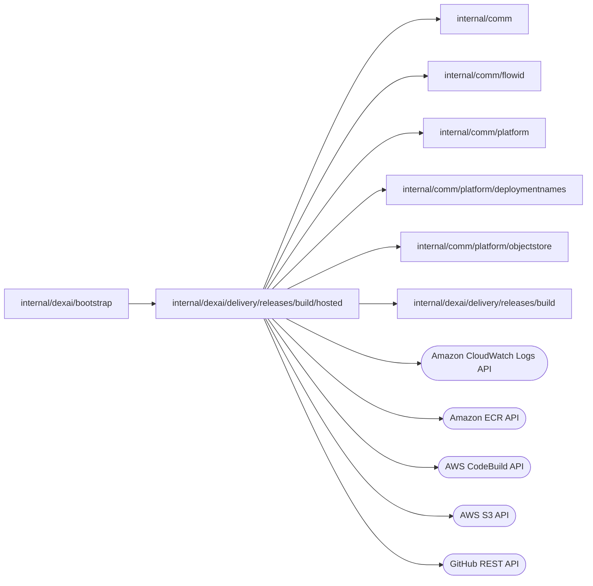

# Hosted Release builder

<!-- BEGIN GENERATED PACKAGE SUMMARY (scripts/check-package-readmes.py; edit only Purpose) -->
Purpose: Builds Releases on CodeBuild, pushes the images to ECR and keeps its admission receipts in S3 outside Local Kind, behind the `build.Builder` port.

Callers: `internal/dexai/bootstrap` imports this package.

Dependencies: it imports `internal/comm`, `internal/comm/flowid`, `internal/comm/platform`, `internal/comm/platform/deploymentnames`, `internal/comm/platform/objectstore` and `internal/dexai/delivery/releases/build` and calls the Amazon CloudWatch Logs, Amazon ECR, AWS CodeBuild, AWS S3 and GitHub REST APIs.

<!-- END GENERATED PACKAGE SUMMARY -->

`Builder` implements the `build.Builder` port on CodeBuild, ECR and S3 outside
Local Kind; `internal/dexai/bootstrap` constructs it with `New`.

| File | Responsibility |
| --- | --- |
| `builder.go` | Configuration checks, request validation, executor identity, provider names, Inspect and Start |
| `source.go` | Private source archive download, normalization and immutable upload |
| `buildspec.go` | The CodeBuild StartBuild input and inline buildspec |
| `storage.go` | Provider admission head and result objects with S3 CAS and terminal results |
| `release_cleanup.go` | The whole-Release cleanup fence, its bounded cursor and per-build cleanup |
| `builder_integration_test.go` | Actual AWS integration test (`hosted` build tag) |
| `runner.py` | The trusted runner inside CodeBuild: isolation, source analysis, BuildKit image build, ECR push and typed result |
| `start-docker.py`, `daemon.json` | Start of the host's own fixed-version Docker daemon |
| `Dockerfile.host`, `host-inputs.json` | The CodeBuild host image and its pinned official inputs |
| `Dockerfile.tools` | The tool image with `dexcli` and the `app-manifest` executable |
| `profile-bp2.json` | The `bp2` build profile manifest, embedded by `../build_profile.go` |

## Per-commit Release provider contract

Every request carries `contractVersion: 2`, uses ReleaseID equal to the main
commit and a `buildRevisionId` of `source` or `build-<UUIDv4>`. Source-only work returns strict
FDG/manifest/requirements with empty image fields; it never builds or pushes an
image. Source analysis has a four-minute work deadline and a separate 30-second
owned-container cleanup budget. The platform deadline cancels CodeBuild and
retains uncertainty until actual provider termination is observed.

Build requests bind the accepted frozen configuration digest/revision. These
identities are in the provider request, immutable FDG bundle and image labels;
configuration values/secrets stay outside the runner and image. Versioned jobs
are isolated under `jobs/<environment>/<project>/<commit>/<buildRevisionId>/`;
ECR tags include that build revision and provider attempt. Earlier READY images
remain available to running Live Deployments until Project deletion.

Whole-Release cleanup first writes a permanent commit admission fence outside
the job prefix. Start registers its exact PREPARING receipt before rechecking
that fence, so concurrent cleanup sees any admitted source work or prevents its
external effects. Cleanup reconciles/cancels every exact provider head, then
removes its image/job versions. A durable provider-only cursor processes at most
eight receipts per call, which fit the call's 30-second budget inside the
40-second round of CleanupReleasePublishing, without hydrating Release map
state. A build that is still stopping, or remaining
receipts or job versions, return `ErrPending`; uncertain cancellation or
incomplete deletion leaves the cursor at the unconfirmed receipt. Fences and
receipts survive deletion and reject delayed requests. This is external-effect
admission/cleanup bookkeeping, not another business-state owner.

## Hosted Docker configuration recipe

The host Docker daemon enables `userland-proxy` because CodeBuild hosts lack the
`bridge-nf-call-iptables` sysctl; the Unix socket, dedicated data volume,
`iptables`/`ip6tables`, disabled IPv6, fixed daemon versions and runner network
denials stay in place, and no container port is published.

The `bp1` and `bp2` recipes are embedded in the server (`../build_profile.go`). Server
composition selects `bp2` only for V2 `test` and `staging`. Its manifest adds
`version=bp2` and `dockerConfigurationVersion=2` and reuses the bp1 Dockerfile
and pinned base images. Each digest covers the manifest and Dockerfile bytes
only; build profiles carry no template or skill identity, because both are
repository source ([the current contract](../../../../../../docs/architecture/superverse-v2.md)).
`bp1` stays registered and remains the production and Local Kind default.

New per-commit Release source preparation and new `build-<UUIDv4>` admissions use
the composition-selected recipe. A repeated BuildRevisionID recovers its accepted
recipe before reading the current default. An accepted attempt's executor and
immutable profile remain fixed. Existing source-preparation receipts remain
readable with those exact identities. A settled
failed image build can admit a new BuildRevision through Save and Build; retrying
that same image build cannot change its executor.

The existing explicit Prepare retry admits a new source-only provider attempt
for the same per-commit Release. Only `sourceOnly` requests
with `buildRevisionId=source`, a strictly higher Flow-admitted attempt, and a
confirmed prior FAILED/CANCELLED head may bind the current trusted executor.
The original request/source commit/profile are unchanged. This CAS creates a new
version of the provider head; old head versions and attempt-N source/result
objects remain unchanged and readable. Same-request/same-attempt replay joins the
accepted operation; PREPARING, ADMITTED, RUNNING, UNKNOWN and READY never authorize
replacing its executor or dispatching another operation. Image-build requests
retain the original executor-change rejection. Provider-terminal
reconciliation remains required before retry, cleanup or authorized Dex time
travel.

## Runtime inputs

The server constructs `Builder` only outside Local Kind. It checks each of these trusted deployment settings of the [server configuration](../../../../../../cmd/superverse-server/config/README.md) against the deployment catalog of its environment; an invalid input prevents startup and is named without echoing its value:

| Configuration key | Meaning |
| --- | --- |
| `aws.region` | Region used by the AWS default configuration |
| `aws.accountId` | Exact 12-digit V2 AWS account |
| `builds.hosted.project` | The environment's dedicated CodeBuild project, `build_project` in the [deployment-name catalog](../../../../../comm/platform/deploymentnames/environments.json) |
| `builds.hosted.repository` | ECR repository `<registry>/<ecr_prefix>/applications` in the same account and region |
| `builds.hosted.bucket` | Versioned S3 artifact bucket |
| `builds.hosted.prefix` | Exactly the catalog's `artifact_prefix` |
| `builds.hosted.kmsKeyARN` | Exact KMS key ARN in that account and region |
| `builds.hosted.toolImage` | Reviewed immutable `<registry>/<ecr_prefix>/build-tools@sha256:…` image built from `Dockerfile.tools`, with the Go toolchain, `dexcli` and this revision's `app-manifest` executable |
| `builds.hosted.hostImage` | Reviewed immutable `<registry>/<ecr_prefix>/build-host@sha256:…` CodeBuild host image, also used for the credential-free BuildKit container |

`Dockerfile.tools` builds the tool image from the repository root; its immutable published digest must be supplied explicitly. The runner accepts only a tool image whose `io.superdurable.hosted-build-tools` and `io.superdurable.dexcli` labels match `Dockerfile.tools`, which rejects local-source overlays and the coding image. No unpublished SDK dependency is selected.

The CodeBuild host image requires Linux ARM64, Python 3, AWS CLI v2 with conditional S3 PutObject, a running Docker daemon/CLI, BuildKit `v0.25.1` (`buildkitd` and `buildctl`), `runc`, `iptables` and `ip6tables`. The image must be reviewed to contain no baked credentials or Docker registry configuration. Host/tool image references must belong to `<ecr_prefix>/{build-host,build-tools}` in the configured account/region. The source is supplied in `Dockerfile.host`, `daemon.json` and `start-docker.py`; `host-inputs.json` records actual official registry descriptors/archive checksums. These are source pins, not a published image digest.

Before admission, `BatchGetProjects` checks the dedicated private project: exact HostImage, `ARM_CONTAINER`, `BUILD_GENERAL1_LARGE`, privileged mode and `SERVICE_ROLE` image pulls; no inherited environment variables, custom certificate, registry credentials, remote Docker server, fleet/compute configuration, EFS, VPC, batch/webhook execution, shared cache or secondary sources/artifacts. Infrastructure owns project mutation and must keep the platform/build IAM roles unable to update it. The pre-dispatch read is not an atomic lock against an administrator changing that project. The actual accepted Build is checked again for its source, image, environment and unsupported attachments; mismatches retain uncertainty instead of claiming success.

The default source is `NO_SOURCE` and default buildspec fails closed. The trusted install phase invokes `python3 -I /usr/local/lib/sv2/start-docker.py`, which starts a fresh, fixed-version daemon exposing only `/var/run/docker.sock`, disables the containerd image store, and rejects a pre-existing daemon. CodeBuild owns disposal of this ephemeral host daemon after the build; the runner owns all nested containers. `StartBuild` overrides image, environment/compute/pull type, exact source/version, trusted buildspec, no-cache/no-artifact settings and disables automatic retry/debug. The inline buildspec transports the trusted runner as gzip/base64 and restores its exact bytes using Python standard-library modules. The adapter checks the 25,600-character limit before recording ADMITTED. Compression does not change the runner source hash or accepted executor fingerprint. S3 source builds omit the source-provider-only reportBuildStatusOverride parameter. No app-provided buildspec, Dockerfile, command, environment or upstream URL is accepted.

`Dockerfile.host` declares `/var/lib/sv2-docker` as a volume, matching the configured daemon data root. Docker creates a fresh anonymous volume there instead of placing nested overlay2 data inside the host container's writable overlay. The outer execution owner must remove that volume with its container; local verification uses `docker rm -v` and checks the recorded volume identity afterward. The nested BuildKit container inherits the declaration but does not run dockerd; its owned removal also includes `-v`. This follows the [official DinD image's data-volume declaration](https://github.com/docker-library/docker/blob/master/29/dind/Dockerfile) and [Dockerfile volume semantics](https://docs.docker.com/reference/dockerfile/#volume). It does not bind a host directory or socket into untrusted work.

The CodeBuild environment must honor the image volume with overlay2-compatible backing, provide the required cgroup delegation and dispose of the execution's volumes. [AWS's custom Docker image sample](https://docs.aws.amazon.com/codebuild/latest/userguide/sample-docker-custom-image.html) notes that a daemon can already be enabled for non-VPC builds; this implementation deliberately rejects an existing unknown daemon. A local DinD result is not AWS acceptance.

Build the ARM64 host source from the repository root with `docker build --platform linux/arm64 -f internal/dexai/delivery/releases/build/hosted/Dockerfile.host -t <local-reviewed-tag> .`. The two FROM references pin platform manifests, and Docker/AWS CLI downloads use verified SHA256. Package installation uses the fixed signed Debian snapshot in `host-inputs.json`. Build and publish are separate authorized operations; after review, the actual V2 ECR digest must be supplied to Terraform and server startup. Docker inspect `.Id` is not assumed to be an image configuration digest or ECR manifest digest. The application artifact reference comes from ECR `DescribeImages` and is verified by that same registry API.

The hosted infrastructure owner provides these resources and IAM; no resources are created by `New`.

## Build and credential boundaries

1. `Start` receives the existing repository-scoped GitHub token. It downloads `https://api.github.com/repos/<owner>/<repo>/zipball/<full-commit>` over HTTPS. Redirects are restricted to GitHub/codeload and remove Authorization. All errors are sanitized.
2. The archive is bounded to 128 MiB compressed, 512 MiB expanded, and 20,000 entries. Normalization rejects links, path traversal, duplicate paths, multiple roots and `.git` contents. It retains source file content and executable permission bits. The ZIP is stored immutably with an exact S3 version and KMS encryption. The token is never stored or sent to CodeBuild.
3. CodeBuild receives S3 source location plus exact `SourceVersion`. The runner verifies `CODEBUILD_SOURCE_VERSION` (S3 does not populate `CODEBUILD_RESOLVED_SOURCE_VERSION`). The accepted request, profile bytes and nonsecret configuration are carried in typed base64 JSON.
4. The outer runner executes only fixed AWS/Docker/tool commands. It never executes the repository Makefile. The profile has no publisher script; its fingerprint covers the manifest and Dockerfile.
5. Fixed `go mod download` commands prepare the application and generator modules from their accepted lockfiles. `download all` is not used because lazy dependency loading can attempt to rewrite read-only source checksums; missing required checksums still require a corrected source commit. Offline canonical AppManifest and strict FDG analysis prove that the declared dependency cache suffices. These commands run in owned per-attempt unprivileged containers without credentials or a Docker socket. The runner inspects the default Docker bridge and installs bridge-specific IPv4 `INPUT` denial (all host destinations), IPv4 `DOCKER-USER` denial (non-public destinations), and IPv6 `INPUT`/`FORWARD` denial. IPv6 bridge mode is rejected and container IPv6 is disabled. Public DNS is explicit, so downloads do not require a private host resolver. Actual FDG analysis and AppManifest extraction use `--network none`, read-only source, dropped capabilities and bounded CPU/memory/PIDs.
6. Image building uses a single owned BuildKit container from the exact HostImage, with only read-only source/recipe and a scoped image-output mount. No outer AWS environment, Docker credentials/config/socket or source-write mount is passed. Its process uses an empty environment with an explicit PATH/HOME and empty Docker-config path. The trusted daemon needs privilege to run its nested OCI worker; repository commands retain the OCI process sandbox. The OCI worker's `networkMode=host` refers to that container's inspected bridge namespace, not the CodeBuild host. A read-only worker query must confirm exactly one OCI/native/process-sandbox worker in that mode and BuildKit `v0.25.1`. Host/insecure/device entitlements are not enabled.
7. A private recipe removes only the exact pinned `# syntax=docker/dockerfile:1.7` first line; original profile bytes and digest remain unchanged. The builtin `dockerfile.v0` frontend is selected, `gateway.v0` is disabled, and the only accepted build arguments are the three immutable profile base images. No `BUILDKIT_SYNTAX` override is permitted. Frontend implementation is therefore bound to HostImage. The remaining product recipe keeps repository generation/build/test commands at `RUN --network=none`; only fixed dependency downloads use the restricted public network.
8. BuildKit exports a Docker archive, bounded to 2 GiB, whose regular-file paths, entry/layer count, manifest references and exact tag are checked before outer `docker load`. The daemon is stopped, waited and removed before loading/pushing. Named tool containers receive the same owned stop/wait/remove cleanup on success, timeout or an uncertain create response. SIGTERM/SIGINT enter these cleanup paths; a forced host kill still needs provider-terminal reconciliation. A client timeout is never treated as proof the daemon exited.
9. The trusted runner pushes the image to ECR, resolves its immutable digest, then writes the typed result with `If-None-Match: *`. AWS credentials stay in the trusted outer process. App-controlled command output is bounded and never printed into generic diagnostics.
   The result has schema `superverse.dev/hosted-build-result/v2`, whose `phaseTimings` holds the runner's measured phases as `build.BuildPhaseTiming` entries: HOST_PREPARATION for its own host work (source checks, ECR login, network protection, image pulls and the tool label check), DEPENDENCY_PREPARATION for the module downloads, ANALYSIS for the AppManifest and FDG analysis, COMPILATION for the BuildKit build and `docker load`, and IMAGE_PUBLICATION for the ECR push and digest lookup; the upload of the result itself is not measured. Source preparation ends with ANALYSIS. Durations are whole milliseconds, at least one. A v1 result fails verification as a conflict, so in-flight builds are settled before the server that requires v2 is deployed.
10. The Go adapter verifies source/attempt/build identity, encrypted versioned result, and ECR tag/digest. PublishReleaseBuildRevision verifies the exact accepted source manifest, all FDG 2.0 definitions, contracts, profile digest and Flow-owned artifact references.

## Provider admission, reconciliation and cleanup

`receipts/<environment>/<project>/<release>/<buildRevisionId>.json` is a provider admission record. It is not a Release listing or business-state projection. ProjectReleaseFlow remains the business authority. Its fixed request identity includes all immutable `BuildRequest` fields; only `attempt` changes on an explicit Flow retry.

The record has schema `superverse.dev/hosted-build-admission/v1`, typed request, accepted HostImage and trusted host/tool/runner/environment fingerprint, phase, exact source object reference, CodeBuild execution ID, exact final result reference, admission time, for CANCELLED or FAILED, a reason of at most 512 bytes: the dispatch rejection, the source download rejection or the CodeBuild status with its first unsuccessful phase and context, never build output, and, once CodeBuild ended the build, `codeBuildPhases`: QUEUE (SUBMITTED and QUEUED) and CodeBuild's share of HOST_PREPARATION (PROVISIONING, DOWNLOAD_SOURCE and INSTALL), each the sum of its ended phases. Inspect returns that reason as `BuildResult.Failure`, which the Release build failure carries, and `BuildResult.Timings`: the recorded CodeBuild phases followed by the runner's, whose own host work extends HOST_PREPARATION. A build that ended without a result reports only CodeBuild's phases; a running build reports none. S3 ETag CAS serializes all writers. Source and result objects live below `jobs/<environment>/<project>/<release>/<buildRevisionId>/attempt-N/`.

- Only the successful PREPARING CAS creator may upload source. Another process may inspect a completed source upload and proceed, but cannot repeat a missing/uncertain upload. A crash before upload proof deliberately retains UNKNOWN responsibility. If the original upload never produced an observable object, automatic retry/cancel/cleanup remain blocked: there is no unsafe operator override or absence-based redispatch API. Operations must first establish the original provider outcome. A known pre-upload rejection records CANCELLED and allows a later explicitly accepted attempt.
- A successful ADMITTED CAS winner alone calls StartBuild. Automatic SDK and CodeBuild retry are disabled. Other processes reconcile executions by exact project/source version/accepted HostImage/request token/profile and executor digests; they never dispatch after an unknown outcome or a lease timeout.
- Once StartBuild returns, the CodeBuild execution ID is recorded in the admission record (RUNNING). Only a lost StartBuild response needs a search: it lists the project's builds newest first and stops at the first build created before the admission time (minus 2 minutes of clock skew), so its cost is the builds created since the admission, never the project's history. At most 20 pages are read within the budget of the Inspect call (see below). An incomplete search is never absence proof: a search cut off by a polling round stays pending, and the next round starts it again. Unknown or conflicting outcomes remain recoverable failures; no automatic new attempt is admitted.
- CodeBuild's idempotency token lasts only five minutes, so it is an additional check, not the durable deduplication authority. The S3 record is the dispatch fence.
- A typed CodeBuild AccountLimitExceededException also proves that no execution exists but says nothing about the attempt: the adapter CAS-reopens PREPARING (the source stays) and returns a capacity error, so the Release Step's own retry dispatches again as the next ADMITTED CAS winner. The project's `concurrent_build_limit` and `queued_timeout` come from the Terraform variables `hosted_build_concurrent_limit` (15, the ARM/Large concurrent-build quota in us-west-2 on 2026-10-12) and `hosted_build_queued_timeout_minutes` (120), so builds above the limit wait in the CodeBuild queue instead of failing.
- A typed CodeBuild InvalidInputException is a confirmed dispatch rejection. The adapter CAS-records CANCELLED while preserving source identity; a later explicit Flow retry admits a higher attempt. Other errors and missing responses retain ADMITTED and return the StartBuild error with its cause; the caller's retry inspects the admitted head, which adopts the execution found by its identity or reports UNKNOWN.
- Confirmed terminal provider outcomes are recorded with an exact immutable result version/digest. They remain readable after CodeBuild history retention expires. A fully verified result published before a lost response can recover a CodeBuild FAILED outcome.
- A changed trusted host/tool/runner/environment fingerprint cannot replace an accepted attempt. Image-build retries fail closed and require a new versioned profile or a separately admitted BuildRevision. Only the new terminal-reconciled source-only attempt described above can accept the current executor. Existing terminal results, historical head versions and cleanup remain readable with their accepted fingerprint.
- Explicit newer retries are permitted only after confirmed FAILED/CANCELLED. Each attempt has its own ECR tag. A failed prior tag is removed before a later attempt starts; current READY identity is retained.
- Cancel requests CodeBuild StopBuild, then returns `ErrPending` until a subsequent observation confirms termination. Stop acceptance alone is not completion. Missing-before-start cancellation records a durable CANCELLED admission for that attempt.
- Release cleanup (`CleanupRelease`) cancels and cleans each build head under the Release fence. Per-build cleanup requires the refreshed head to equal the exact attempt/source/provider-result identity just proven terminated (or completed source preparation), then CAS-publishes a permanent CLEANUP fence. A concurrent newer PREPARING attempt causes conflict and requires a new proof; it cannot be fenced from an older attempt's terminal observation. Start cannot reuse that identity, including with a higher attempt. Only then are the exact ECR tag and scoped S3 object versions deleted. The fence is retained. Inspect reports MISSING after fencing, while repeated Cleanup still retries residual versions. Bounded batches report pending work rather than claiming complete removal.
- Active/unknown external work cannot be cleaned up as if absent. No ownership is erased to make deletion appear successful.

Every public builder call caps itself at 30 seconds, and a polling caller's round may bound it further: the rounds of PrepareReleasePublishingSource give Inspect 10 seconds, those of AwaitReleaseBuildRevision 20 seconds including a Project read, and those of CleanupReleasePublishing 40 seconds, so CleanupRelease keeps its own 30. The 45-second provider Steps, such as InspectReleaseBuildRevision, leave each call its 30 seconds. A polling round that cuts a call off stays pending, and the next round repeats the idempotent call. Long build progress is observed by AwaitReleaseBuildRevision, which polls Inspect every 10 seconds within a 180-minute deadline. CodeBuild separately has a 45-minute execution cap and a 120-minute queue cap, so it settles a build before the Flow gives up; a Flow that still gives up must reconcile/cancel the actual provider execution before cleanup or a new attempt.

### Build log

`ReadLog` reads the admission receipt of the request, then the CodeBuild
execution it names (which must still match the admission and log to the
dedicated project's group), then one page of that execution's CloudWatch
stream with `GetLogEvents`: from the head after the cursor's forward token, at
most 500 events whose messages fit the requested bytes (a page that does not
fit is read again with as many events as fit, so the next token never skips an
event; a single longer event is cut), or with `Tail` the last 500 events cut to
the requested bytes. The cursor is `<attempt>:<nextForwardToken>`: the log
group and stream always come from the admission, never from the cursor, and a
cursor of an earlier attempt restarts at the new attempt's log. A page is
complete when the execution no longer runs and a read returns no event. A
build that was never dispatched, or whose execution or stream CodeBuild no
longer keeps, has an empty page. A `ThrottlingException` of CloudWatch or
CodeBuild is `build.ErrLogThrottled`. It is read on demand, through the
replica's shared and rate-limited log reads of `PublishingFlowService`
(Studio's `GetReleaseBuildLog` and the Agent's `read_delivery_status`), which
redact it, and never stored. `GetLogEvents` allows 10 calls per second per
account in us-west-2, not adjustable ([CloudWatch Logs quotas](https://docs.aws.amazon.com/AmazonCloudWatch/latest/logs/cloudwatch_limits_cwl.html),
checked 2026-10-13); a page makes one call, at most two.

`Cancel` of a build whose head is ADMITTED without a found execution, or
whose execution CodeBuild no longer returns, is `build.ErrCancelUnconfirmed`.

### Required IAM and retention

Use the same V2 artifact bucket only with disjoint permissions:

- CodeBuild BatchGetBuilds and StopBuild are scoped to the exact dedicated Project ARN, as required by the [AWS action/resource authorization table](https://docs.aws.amazon.com/service-authorization/latest/reference/list_codebuild.html); build execution ARNs do not authorize these operations.
- Platform: Get/Put exact receipt prefix (conditional CAS); Get/Put source ZIP; Get result; list/delete exact job versions; CodeBuild Start/List/BatchGetProjects/BatchGetBuilds/Stop on the dedicated project/builds; CloudWatch Logs GetLogEvents on the build log group's streams, for `ReadLog`; Describe/Delete project image tags.
- Build role: GetObjectVersion on source ZIP keys; PutObject on result JSON keys only, with conditional-create enforcement; no receipt access or delete authority; scoped KMS; ECR push/describe application repository and pull approved tool/base images; its own log group.
- The bucket is private, versioned, KMS-encrypted and owned by the configured account. S3 API calls check expected bucket owner. Lifecycle rules cannot expire live source/result objects, current receipt versions or cleanup fences.
- The builder role may not assume platform or workload roles. Untrusted containers receive neither outer credentials nor host/Docker mounts.

## Dex Flow Changes

None. The hosted builder is a provider behind `build.Builder` and owns no Flow,
primitive, Channel, Stream or RPC. The per-commit Release contract in
[`internal/dexai/delivery/releases/README.md`](../../README.md), the
[approved contracts](../../../../../../docs/architecture/superverse-v2.md)
and the [generated graph](../../../../../../docs/flows/sv2-releases-flow.json) own all
lifecycle, map-key, concurrency, retention and recovery rules. Accepted
executions keep their persisted recipe and external-effect identities.

## Database Schema Changes

No SQL database or schema. Versioned S3 provider receipts fence external calls and preserve accepted external identities; they do not duplicate Flow-owned product state.

## UI/UX

The per-commit Publishing page's Save and Build admits a new BuildRevision with
the server-selected recipe; clients do not select a recipe. Release progress and recovery use resource snapshots/Watch.
UNKNOWN remains an actionable failure rather than success or an automatic rerun.

## Tests

`make check`, `go vet -tags=hosted ./internal/dexai/delivery/releases/build/hosted`, and compilation of the hosted test are static checks only. The runner is syntax-compiled without executing it.

`builder_integration_test.go` is an actual AWS integration test behind the `hosted` build tag. It requires `SUPERVERSE_HOSTED_BUILD_ACCEPTANCE=approved-after-kind`, all configuration above, and exact `SUPERVERSE_HOSTED_BUILD_TEST_REPOSITORY`, `SUPERVERSE_HOSTED_BUILD_TEST_COMMIT`, and private `SUPERVERSE_HOSTED_BUILD_TEST_REPOSITORY_TOKEN`. Missing values fail; no fake provider or skip is used. It exercises concurrent independent clients, restart, exact image/result validation, the measured phases (QUEUE and HOST_PREPARATION from CodeBuild, the rest from the v2 result, kept by the READY receipt), duplicate Start and cleanup admission. It creates a unique test project scope and retains unclear failures for reconciliation. It must only run after the required Kind gates and AWS resource review.

## Documentation

The hosted builder source receipt,
the local Linux runner evidence
and the AWS receipts
hold the builder's history, the reviewed V1 sources, the historical ADMITTED
reconciliation and its observed and still unverified coverage.

AWS primary references: [StartBuild](https://docs.aws.amazon.com/codebuild/latest/APIReference/API_StartBuild.html), [source version semantics](https://docs.aws.amazon.com/codebuild/latest/userguide/sample-source-version.html), and [CodeBuild environment variables](https://docs.aws.amazon.com/codebuild/latest/userguide/build-env-ref-env-vars.html).

The network/frontend implementation was checked against primary sources: [Docker packet-filter chains](https://docs.docker.com/engine/network/firewall-iptables/), [Dockerfile frontend selection](https://docs.docker.com/build/buildkit/frontend/), [BuildKit v0.25.1 configuration](https://github.com/moby/buildkit/blob/v0.25.1/cmd/buildkitd/config/config.go), [worker JSON output](https://github.com/moby/buildkit/blob/v0.25.1/cmd/buildctl/debug/workers.go), and [builtin frontend forwarding rules](https://github.com/moby/buildkit/blob/v0.25.1/frontend/dockerfile/builder/build.go).
