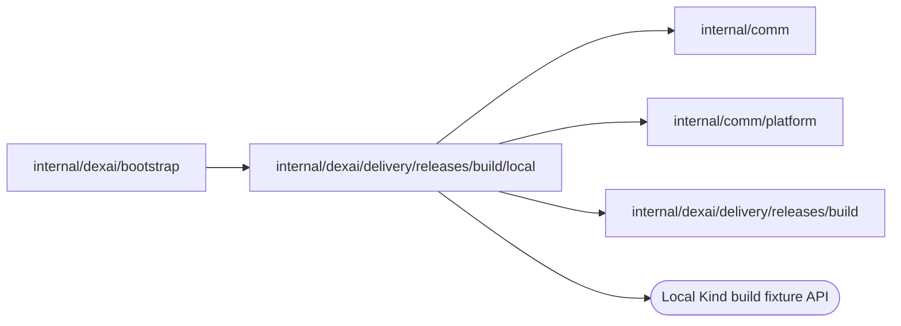

# Local Release builder client

<!-- BEGIN GENERATED PACKAGE SUMMARY (scripts/check-package-readmes.py; edit only Purpose) -->
Purpose: Builds Release images through the authenticated Local Kind build fixture on the host, behind the `build.Builder` port.

Callers: `internal/dexai/bootstrap` imports this package.

Dependencies: it imports `internal/comm`, `internal/comm/platform` and `internal/dexai/delivery/releases/build` and calls the Local Kind build fixture API.

<!-- END GENERATED PACKAGE SUMMARY -->

`Builder` implements the `build.Builder` port as a client of the [Local Kind build
fixture](../localbuilder/README.md): the trusted host-side service that fetches the
exact commit, builds the image and loads it into the Kind node. `internal/dexai/bootstrap`
constructs it with `New` in Local Kind and Native only, and only when the server holds
the fixture's token. The client accepts only reviewed local endpoints, rejects
redirects, uses a 30-second request deadline and treats an unanswered request as an
uncertain outcome that the caller resolves with Inspect.

| File | Responsibility |
| --- | --- |
| `builder.go` | `Builder` and `New`: the typed fixture endpoints, outcome classification and the end of the build log |
