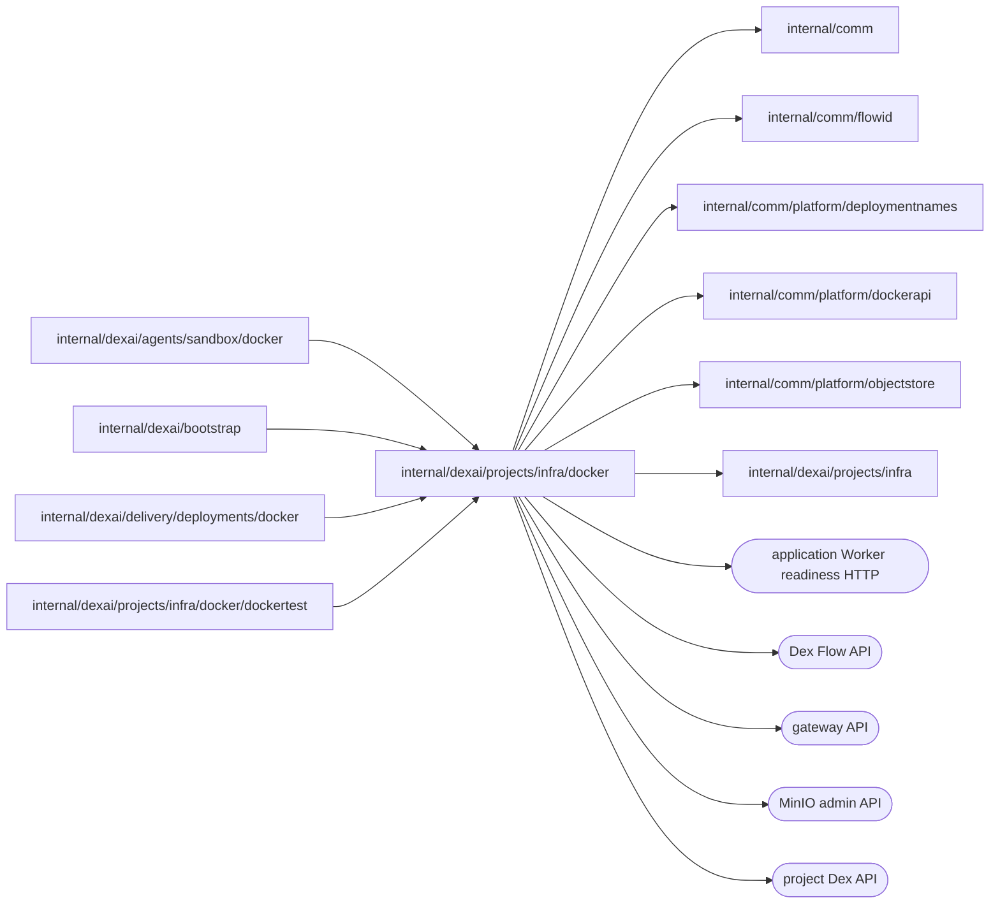

# Docker project infrastructure

<!-- BEGIN GENERATED PACKAGE SUMMARY (scripts/check-package-readmes.py; edit only Purpose) -->
Purpose: Provisions, reaches and removes each project's Live network, MinIO, Temporal and Dex containers in the local Docker Engine, grants workloads that storage and serves the gateway its routes.

Callers: `internal/dexai/agents/sandbox/docker`, `internal/dexai/bootstrap`, `internal/dexai/delivery/deployments/docker` and `internal/dexai/projects/infra/docker/dockertest` import this package.

Dependencies: it imports `internal/comm`, `internal/comm/flowid`, `internal/comm/platform/deploymentnames`, `internal/comm/platform/dockerapi`, `internal/comm/platform/objectstore` and `internal/dexai/projects/infra` and calls the application Worker readiness HTTP, Dex Flow, gateway, MinIO admin and project Dex APIs.

<!-- END GENERATED PACKAGE SUMMARY -->

`docker` is the Docker runtime of the project infrastructure, which Local Native
runs instead of a Kind cluster. It implements every role that
[`infra`](../README.md) declares, `Storage`, `Execution`, `Grants`, `Cleanup`,
`Connections` and `Redactor`, with the local backends: a project's own MinIO
and Temporal start-dev, as in Local Kind. The Docker implementations of the
Sandbox instances ([`sandbox/docker`](../../../agents/sandbox/docker/README.md))
and of the Live serving
([`deployments/docker`](../../../delivery/deployments/docker/README.md)) build on
it, and only `internal/dexai/bootstrap` constructs it.

## Identities

A Flow persists the same references in both runtimes; the Docker objects fill
them as this table maps them.

| Reference | Kubernetes | Docker |
| --- | --- | --- |
| A project's isolation boundary (`StorageRefs.Boundary`) | the project namespace, by UID | the project network `sv2-project-<project>`, by network ID |
| The storage service (`StorageRefs.Storage`) | the MinIO Service | the MinIO container `<network>-storage`, by its `superdurable.io/service-uid` label, at its fixed address on the project network |
| The Temporal credential (`ExecutionRefs.TemporalCredential`) | the Temporal Service | the Temporal container `<network>-temporal`, by its service UID label |
| The project Dex (`ExecutionRefs.DexService`) | the Dex Service | the Dex container `<network>-dex`, by its service UID label |
| A Preview grant's principal | the Sandbox namespace of the Project's Session and its service account, by UID | the Session network, by ID, and the workspace volumes, by their `superdurable.io/workspace-uid` label |

A component's service UID is generated when its container is first created
and recorded by the owning Flow. A container whose UID differs from the
accepted one is a replacement and is never adopted, and a missing container of
an accepted service is created again under that UID on the same volume, as a
Kubernetes Deployment replaces its Pod. The project Dex is replaced in place
under its UID when this server's Dex image differs; MinIO and Temporal of
another image are a conflict, as their immutable Kubernetes specs are.

Every object carries the owner labels that
[`deploymentnames`](../../../../comm/platform/deploymentnames/README.md) declares for
both runtimes, and every effect first reads the object and verifies them: a
create that finds its object present proceeds only with its owner's labels, a
removal of an absent object is done, and an object of another owner or UID is
`infra.ErrOwnershipConflict`. `infra.ErrPending` means a container still
starts, a network still has attached containers, or a removal is in progress.

A component container that a call starts, new, stopped or replaced, is pending
in that call: the engine reports it running, and its published port accepts,
before its process listens, so readiness is observed from the next call on, as
Kubernetes observes a new Pod only through its readiness probe. The storage is
ready when MinIO answers its readiness endpoint within five seconds; until then,
also while MinIO is paused, `EnsureStorage` returns `infra.ErrPending`.

Opening existing storage also starts a stopped MinIO after checking its exact
container name, Project and Native instance owner labels, service identity when
supplied, and accepted network identity. This lets Preview configuration and
grant cleanup recover after a Native stop/start without repeating Project setup.
The restart uses the inspected container ID, preserves its volume and service
UID, and returns `infra.ErrPending` for the first call. Absent storage is not
created by cleanup, and removal and paused states are never restarted.

## Network and addresses

- Every network takes a /24 of the configured network prefix (`native.networkPrefix`),
  the first one no network uses, so the lane never depends on the engine's
  default address pools. A subnet another network took first is retried with the
  next free one. Its gateway is `.1`, the engine allocates container addresses
  only from the upper half (`.128/25`), and the lower half holds fixed addresses,
  which no allocation can take, so a workload may keep one for the network's life.
- The project's MinIO, Temporal and Dex join the project network under the
  aliases `storage`, `temporal` and `dex` (`infra.ScopeAddress`), so a project
  Dex and a Live application reach them as in Kubernetes. A Sandbox joins the
  project network too, so its Preview reaches the Live MinIO.
- The MinIO container also takes the fixed address `.2` of the project network,
  which it keeps when it is replaced. `storageEndpoint` returns it, and
  `GrantEnvironment` gives a workload it as `DEX_PROJECT_STORAGE_ENDPOINT`: the
  Connector SDK accepts only a local endpoint (localhost, `host.docker.internal`,
  a Kubernetes Service name, or a loopback or private address), so a Live
  application and a Preview load their configuration through the private address,
  never the bare alias. A project network that reserves no fixed addresses, or a
  MinIO container without its address, predates this layout and is refused with
  the advice to recreate the project.
- The server reaches a container only through a port it publishes on
  127.0.0.1. The engine assigns that port when the container starts, so the
  runtime reads it from a current inspection for every use and never keeps it.
- The project's containers restart `unless-stopped`; they run with every
  capability dropped, `no-new-privileges`, and limits of two CPUs and 2 GiB.
  Temporal keeps its database on a volume mounted at the image user's home,
  which the volume takes over, so no root init step is needed.

## Credentials

The server generates the root key pair of each project's MinIO and the key
pair of every workload grant. Kubernetes keeps them in immutable Secrets; here
each is a 0600 file below `<state>/credentials/<project>/`, created
exclusively (the complete file is linked into place, which fails when it
exists) and never rewritten, with the owner it was created for: the project,
the component, the project network's ID and, for a grant, the scope,
workload and generation. A file of another owner is an ownership conflict. A
container receives a key pair only as an environment variable when it is
created; the project Dex receives its configuration as a file copied into the
container before it starts. `DestroyPreviewGrants` removes the Project's Preview
grant files with their accounts, `DestroyScope` removes the project's directory, and
`CredentialValues` gives the Agent's diagnostics the values to redact. Neither
the files nor their values reach Flow state, a log or a receipt.

## Routes

`Routes` are the public routes of Preview and Live, which one gateway serves.
Each route is a file `<state>/routes/<host>.json` with the owner and the
generation that hold it and the container port it forwards to.

- `Publish` writes a route under a file lock by compare-and-swap: the caller's
  `admit` decides whether the route the host holds may be replaced, so a stale
  generation or another holder is refused with `infra.ErrOwnershipConflict`.
  The file is written completely and renamed into place.
- `Withdraw` removes a route only when it is the caller's, and returns the
  route the host still holds.
- `ServeHTTP` is the gateway's HTTP provider. The server serves it on its
  loopback and the gateway polls it, so no bind-mounted file events are needed.
  It resolves the port each target container publishes now, leaves out a route
  whose container does not run or publish its port, and keeps one sentinel router
  that matches no host, because the gateway keeps its last configuration when a
  provider answers an empty one; while the engine does not answer it answers 503,
  which keeps that configuration too.
- `Loaded` confirms through the gateway's API that it serves the route's
  router and forwards to the container's current port, says what the gateway
  serves until then, and returns an error only when the engine or the API fails.
  `Probe` asks the gateway for a route's host with the route's Host header and
  returns the status, or what kept the gateway from answering, which the callers
  treat as not ready yet.

## Cleanup

`DestroyScope` removes every container, generation network and volume that
carries the scope's Live owner labels, then the project network, then the
project's credential directory, and returns `infra.ErrPending` until all are
gone. A Sandbox of the project's Sessions is no part of the scope: while one is
attached, the network is not gone yet, and its Session's cleanup removes it.
`DestroyPreviewConfiguration` deletes the Project's Preview configuration from
the Live bucket and `DestroyPreviewGrants` its MinIO accounts and grant files.
Both treat an absent project network as storage already gone.

## Dex Flow Changes

None. ProjectSetupFlow, ProjectFlow, ProjectDeployFlow and the Session's
SandboxProvisionFlow and PreviewFlow receive this runtime through the roles of
`infra`; the persisted references keep their JSON keys.

## Database Schema Changes

None. Labels on Docker objects, route files and credential files are the
identities and configuration of external resources; the owning Flows' Attributes
are authoritative.

## Tests

`scope_integration_test.go` (build tag `live`) runs against the local Docker
Engine through [`dockertest`](dockertest/README.md). A Live grant's environment
loads a configuration with an ordinary value and an application secret through
the Connector SDK in a container on the project network, before and after the
MinIO container is replaced. The other scenarios cover a project's storage,
pending in the call that starts it with every reference its owner records,
Temporal (data plane Ready) and Dex (health check), a Live grant that reads
exactly its configuration and its secret, its revocation fence, refusals of a
replaced network, storage service and Dex, redaction, route publication,
replacement by a newer generation, refusal of a stale one, removal by its holder
only and the gateway's forwarding, the credential files' privacy and owner
check, and that a deleted project leaves no container, network, volume or
credential file.

## Files

| File | Responsibility |
| --- | --- |
| `infrastructure.go` | `Infrastructure`, `Config`, names, owner labels, the Docker label keys, `Redact` |
| `objects.go` | Networks with subnets of the prefix and their fixed addresses, volumes and containers with ownership checks, published addresses |
| `storage.go` | Project components, `EnsureStorage`, `storageEndpoint`, storage verification, configuration access, the MinIO connection |
| `execution.go` | `EnsureTemporal`, the data-plane check, `EnsureExecutionAccess`, `StartProjectDex` and its verification |
| `grants.go` | `IssueWorkload`, `RevokeWorkload`, `GrantEnvironment`, the Preview principal check |
| `connections.go` | `DialProjectDex`, `CheckWorker`, `DialSandboxDex`, `ProbeSandboxDex`, `WorkerAddress` |
| `credentials.go` | The credential files |
| `routes.go` | Route files, the gateway's HTTP provider, the gateway API check and probe |
| `cleanup.go` | `DestroyScope`, `DestroyPreviewConfiguration`, `DestroyPreviewGrants` |

Live Worker checks verify the exact separate Worker container and its registration readiness HTTP endpoint. Project Dex starts matching with stream limits 512/2048 and defaults starts to pull. No stable Worker alias or push port remains.
