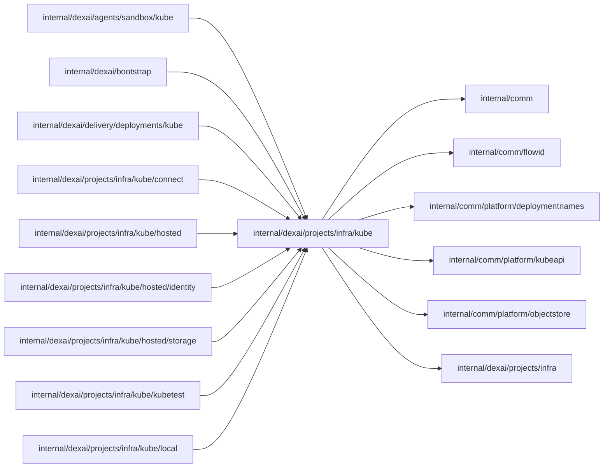

# Kubernetes project infrastructure

<!-- BEGIN GENERATED PACKAGE SUMMARY (scripts/check-package-readmes.py; edit only Purpose) -->
Purpose: Provisions, reaches and removes each project's Live namespace, Dex, storage and Temporal in the Kubernetes cluster, and grants Live and Preview workloads that storage.

Callers: `internal/dexai/agents/sandbox/kube`, `internal/dexai/bootstrap`, `internal/dexai/delivery/deployments/kube`, `internal/dexai/projects/infra/kube/connect`, `internal/dexai/projects/infra/kube/hosted`, `internal/dexai/projects/infra/kube/hosted/identity`, `internal/dexai/projects/infra/kube/hosted/storage`, `internal/dexai/projects/infra/kube/kubetest` and `internal/dexai/projects/infra/kube/local` import this package.

Dependencies: it imports `internal/comm`, `internal/comm/flowid`, `internal/comm/platform/deploymentnames`, `internal/comm/platform/kubeapi`, `internal/comm/platform/objectstore` and `internal/dexai/projects/infra`.

<!-- END GENERATED PACKAGE SUMMARY -->

`kube` is the Kubernetes runtime of the project infrastructure. It provisions,
reaches and removes the isolated infrastructure of a project's Live scope: its
own Kubernetes namespace with a project Dex, a storage bucket and a Temporal
namespace, and it implements the roles that [`infra`](../README.md) declares:
`Storage`, `Execution`, `Grants`, `Cleanup` and `Redactor`. The Project's
Preview owns no scope: its configuration and storage grants live in the Live
storage, below the names `PreviewKeysOf` derives.

The namespace, the policies and the project Dex are the same Kubernetes objects
in every environment. What differs is behind the `Backend` port
(`backend.go`): where the storage and the Temporal come from, how a workload
is granted the storage, how a scope is destroyed, and how an application is
published. Local Kind runs a MinIO and a Temporal start-dev in the scope
([`local`](local/README.md)); hosted environments use a namespace on the shared self-hosted Temporal cluster, an S3 bucket and IAM roles in the project cloud account
([`hosted`](hosted/README.md)). Both build on this package and this package
imports neither; only `internal/dexai/bootstrap` selects one. The runtime asks the
`Backend` wherever the environments differ and holds no other check. The
[`connect`](connect/README.md) subpackage implements `infra.Connections`: it
dials a project's Live Dex and a Sandbox's Preview Dex and checks a Live
application Worker.

The owning Project, Sandbox and Deployment Flows hold the accepted resource
references and decide lifecycles: `StorageRefs` for a project's configuration
storage, `ExecutionRefs` for its Temporal namespace, Temporal credential and
Live Dex, and `ScopeRefs` for both. ProjectFlow and ProjectDeployFlow still
record them combined as `Resources`, which splits into the other three. Every
effect first verifies those references: owner labels, the accepted namespace
and Service UIDs and, for cloud resources, tags bound to the namespace UID.
The owner labels name the project and the `Component` that owns a resource:
the scope's own infrastructure, the Local Kind storage or Temporal, the
project Dex, the applications or the Live route. `Component` is a closed set,
and a component the scope runs names its service account, Deployment and
Service after itself.
Every provisioning call returns the references it observed even with an
error, and a reference it does not reach stays the accepted one. A replaced or foreign
resource is never adopted; on cleanup paths it is `ErrOwnershipConflict`.
`ErrPending` means a resource is still converging and the owning Flow polls
again; each pending error wraps it with what it waits for, such as a Deployment
that is not ready or a namespace that is terminating. Every effect is retry
safe: a create that finds its resource already present verifies ownership and
proceeds, a delete of an absent resource is done, an in-place update that loses
a 409 race is pending and rereads the resource next time, and a local bucket
read that MinIO denies fails at once instead of waiting.

## Contract

- **Composition.** Bootstrap builds one `Infrastructure` for the Live scopes
  from settings it validated in `internal/dexai/bootstrap/config.go`, and hands it to
  each consumer as the role the consumer uses: a catalog environment, Local
  Kind only in `test`, a Dex image pinned by digest (`ImmutableImage`) and the
  `Backend`. In Local Kind that is `local.Backend` with the Temporal and MinIO
  images, also pinned by digest; elsewhere bootstrap builds the project cloud
  account (`hosted.New` from `hosted.Config`), which owns its `Close`. The
  `Backend` is never a typed nil.
- **Preview keys.** `PreviewKeysOf` is the only derivation of a Session's
  Preview names: its configuration prefix in the Live bucket, its prepared
  source prefix, its grant workload ID and hosted cloud identity, and the
  owner labels of its Sandbox and grant credentials.
- **Storage provisioning.** `EnsureStorage` converges a project's
  configuration storage: the namespace, the platform server's RoleBinding, the
  `default-deny` policy and the storage backend, which is the project's own
  MinIO with its versioned `application` bucket and `allow-storage` in Local
  Kind and the project's S3 bucket when hosted. No Dex or Temporal object
  exists after it. A 403 within 15 seconds of creating the RoleBinding is
  authorizer lag and stays pending. `allow-storage` also admits the project's
  Sandbox Pods of `CodingSandboxProfile`, whose Preview reads its configuration
  in the Live MinIO; a Local Kind Preview grant converges that policy first, so
  projects whose storage predates it work too.
- **Execution provisioning.** Three calls prepare the Live execution
  environment on accepted storage, and each verifies that storage first.
  `EnsureTemporal` converges the Temporal namespace and its credential: in
  Local Kind the project's own Temporal (`start-dev` with `app-<project>` and
  `ProjectSearchAttributes`) behind `allow-temporal`, hosted the self-hosted Temporal namespace and its UUID.
  It ends with one data-plane check, and an answer other than Ready is
  `ErrPending`. `EnsureExecutionAccess` converges the Dex and application
  service accounts, `allow-dex` and `allow-application`, and hosted the IAM
  role the Dex assumes through Pod Identity. `allow-application` also admits
  the platform server's credential read endpoint (`infra.CredentialReadPort`),
  which the chart's `<product>-credential-read` policy opens to project
  applications and Sandboxes, and in Local Kind the lane's Keycloak. `StartProjectDex` reads the
  accepted Temporal access without changing it and converges the project Dex
  (`start --services api,interpreter`, gRPC on 8801 only). The Dex
  configuration Secret is immutable and named `dex-server-config`. Its spec digest
  controls replacement of the Pod when the configuration changes.
  Hosted Temporal uses generation zero and no credential Secret; its accepted reference
  stores the Temporal namespace UUID under the retained `TemporalCredential` field name. The Dex Deployment and Service, the
  `live-worker` Service and every `allow-<component>` policy are updated in place under their
  resourceVersion.
  ProjectSetupFlow calls only `EnsureStorage`. A Live deployment calls
  `EnsureTemporal` and `EnsureExecutionAccess` in parallel branches, then
  `StartProjectDex`, and records the references it runs on in its own
  Attribute.
- **Temporal data plane.** `CheckTemporalDataPlane` reads the accepted access
  without changing anything and sends one `DescribeNamespace` within 10
  seconds: hosted over plaintext gRPC to the private shared frontend, in Local Kind to the
  `temporal` Service, which `allow-temporal` opens to the platform server, and
  in Local Native through a forward bound to its namespace and Service UIDs. A
  registered namespace of the same name is `DataPlaneReady`, PermissionDenied
  and Unauthenticated are `DataPlaneUnauthorized`, and Unavailable,
  DeadlineExceeded and NotFound are `DataPlaneUnreachable`; any other outcome
  is an error carrying only the gRPC code. `TemporalAccess` has no credential.
- **Configuration access.** `VerifyProjectStorage`, `ReadConfiguration` and
  `ConfigurationObjects` need no running Dex. Both scopes keep their
  configuration in the Project's storage; the `ScopeRef` these methods take
  holds its `StorageRefs` and selects only the key prefix. `ReadConfiguration`
  reads only the scope's exact configuration head version and digest. `ConfigurationObjects`
  is the Connector SDK object store confined to the scope's prefix; it checks
  the namespace before every operation. `LiveStorage` rebuilds the Live
  storage references from the namespace UID and bucket a Preview pinned.
- **Workload grants.** `IssueWorkload` grants one Live deployment or Preview
  generation (`WorkloadName`: `app-<workload>-<generation>`) read access to its
  pinned configuration and secret versions, including its credential broker's
  scope token, read access to its configuration head's current version, which
  the Connector SDK reads to renew that token, and write access to its scope's
  Trigger inboxes (`trigger-inboxes/*`, which the Connector SDK writes for the
  Triggers of an application) in the Live storage. Connection credentials are
  read only through the credential broker. The grant is a MinIO
  service account in the Live MinIO
  locally, an IAM role bound by Pod Identity when hosted. A grant needs only
  the project's storage, never a running Dex. A Live generation runs as its own
  service account. A Preview grant is bound to its `Principal`, the Session's
  Sandbox boundary and identity (here its namespace and service account),
  whose UIDs and owner labels it checks on every issue; a replaced principal
  is `ErrOwnershipConflict`. Its
  credential Secret carries the Session label, so it is never adopted as a Live
  one. A Preview may hold a new grant generation while the superseded one is
  still live, until its owner revokes the superseded one. `RevokeWorkload`
  leaves a disabled or deny-only identity as a fence against late issuance; a
  hosted Preview fence is deleted by the Preview's first grant at least 12
  hours after its revocation. AWS applies the denial asynchronously, so
  observing it does not prove issued credentials fail. `GrantEnvironment` reconciles a
  current grant like `IssueWorkload` and returns its process environment.
- **Redaction.** `Redact` replaces a project's internal resource names in text
  shown outside the platform, such as failure messages, with placeholders:
  `<project-namespace>`, `<workload>` for `app-<workload>-<generation>` and
  its credential Secret, `<temporal-namespace>` for `app-<project>`, and,
  through the hosted `RedactionPatterns`, `<cloud-resource>` for every cloud
  name of the project (roles and the self-hosted Temporal namespace)
  and `<bucket>`. It owns the pattern list: a change that introduces another
  internal name adds its pattern there.
- **Public routes.** `PublicRoutes` derives the Live (`live-<project>`) and
  Preview (`preview-<project>`) host and URL from the environment, or from the
  Local Kind domain and port.
- **Cleanup.** `DestroyScope` removes a scope after its owner has stopped its
  workloads and returns `ErrPending` until everything is gone. Hosted cleanup
  removes the Dex, then the Pod Identity associations and roles, the Temporal
  Cloud credentials, account and namespace, every bucket version and upload,
  and the namespace last. `CleanupNamespace` treats absence as done only on
  cleanup paths; `ReconcileCleanupError` turns a 403 inside the namespace into
  success only when the namespace is gone.
- **Preview cleanup.** When the Project is deleted, `DestroyPreviewGrants` deletes
  every grant its Preview was issued, fences included: in Local Kind the MinIO
  accounts its grants marked with the Preview's `GrantIdentity` and their
  credential Secrets (found without listing Secrets, which the server may not
  do), hosted the Pod Identity associations in the principal's namespace and
  the IAM roles below the Preview's cloud name. `DestroyPreviewConfiguration`
  deletes every object version below the Project's Preview prefix in the Live bucket
  through `objectstore`, 16 per call. Both return `ErrPending` until done and
  treat an absent Live namespace as storage already gone; hosted roles, which
  outlive it, are still deleted.

All Kubernetes calls are bounded by 30 seconds. Names come from the
[deployment catalog](../../../../comm/platform/deploymentnames/environments.json).

## Files

| File | Responsibility |
| --- | --- |
| `infrastructure.go` | `Infrastructure`, names, `Component`, owner labels, `Redact`, `ResourceReference`, `PreviewLabels` |
| `backend.go` | The `Backend` port |
| `resources.go` | Ensure/Remove with ownership checks, readiness, resource builders, in-place updates of the Dex Deployment, Service and policies, private Service HTTP and gRPC connections |
| `storage.go` | `EnsureStorage`, `Complete`, `S3`, the namespace and its delegation, component network policies |
| `execution.go` | `EnsureTemporal`, `CheckTemporalDataPlane`, `EnsureExecutionAccess`, `StartProjectDex` and its verification |
| `configuration.go` | Storage verification, configuration reads, Connector SDK store |
| `grants.go` | `IssueWorkload`, `RevokeWorkload`, `GrantEnvironment`, the Preview principal check |
| `cleanup.go` | Scope removal and Session Preview data cleanup |
| `addresses.go` | Cluster addresses of the Dex and the Workers, and the project Gateway that every Live and Preview route names as its parent |

## Dex Flow Changes

None. This package owns no Flow; the owning Flows' contracts are in
[`superverse-v2.md`](../../../../../docs/architecture/superverse-v2.md#dex-flow-changes),
[`delivery/deployments`](../../../delivery/deployments/README.md) and
[`agents/sandbox`](../../../agents/sandbox/README.md).

## Database Schema Changes

None. Flow Attributes own business acceptance; S3 versions and cloud and
Kubernetes resource identities represent the external effects. Secret values
stay out of Flow payloads and Terraform state.

## UI/UX

None. Studio owns the configuration UI; browser-selected addresses, permissions
and storage locations are never accepted here.

## Tests

`cleanup_namespace_integration_test.go` runs against a real Local Kind API;
`infra`'s `storage_grants_integration_test.go` runs against a real MinIO. The Live serving
Kind test in [`delivery/deployments/kube`](../../../delivery/deployments/kube/README.md)
provisions storage, Temporal with its data-plane check, a Live grant, the Dex
access and the Dex one part at a time, and covers configuration access for Live
and Preview, Local Native forwarding and scope destruction; its Preview storage
test covers a Preview grant's scope, its principal check, revocation and
the Preview cleanup on the Live MinIO with storage alone. `connect`'s Kind test
covers the Sandbox Dex identity checks. `gateway_kind_test.go`
(`TestKindProjectGatewayAuthority`) checks the project Gateway's authority on the deployed
Kind chart with `kubectl auth can-i`:
- only the Envoy Gateway controller reads Secrets cluster-wide, and it writes none
  outside its namespace;
- the proxies' service account mounts no API token and holds no permission;
- the gateway namespace runs only the controller and its proxies, behind ClusterIP
  Services.

The hosted xtemporal data-plane and NetworkPolicy checks, `Redact`, Hosted Pod Identity negative access, association
moves and fence expiry, Temporal response-loss recovery, revocation
propagation, the platform ALB's project wildcard rule and DNS record, and cloud
deletion remain unverified.

## Documentation

Cloud inputs and outputs are in `infra-as-code/terraform`. Verification
evidence is in the implementation receipts.
