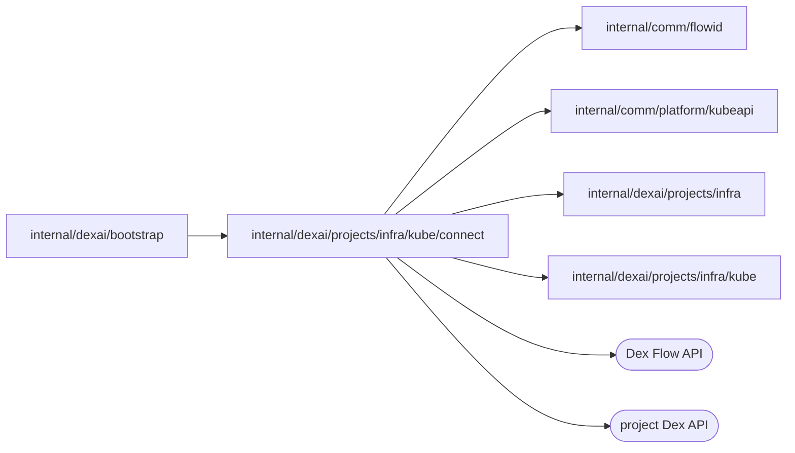

# Project scope connections

<!-- BEGIN GENERATED PACKAGE SUMMARY (scripts/check-package-readmes.py; edit only Purpose) -->
Purpose: Dials a project's Live Dex or a Sandbox's Preview Dex and checks the Live application Worker, after verifying the accepted namespace, controller and Service identities.

Callers: `internal/dexai/bootstrap` imports this package.

Dependencies: it imports `internal/comm/flowid`, `internal/comm/platform/kubeapi`, `internal/dexai/projects/infra` and `internal/dexai/projects/infra/kube` and calls the Dex Flow and project Dex APIs.

<!-- END GENERATED PACKAGE SUMMARY -->

Private connections into a project's Live scope and into a Session's Sandbox.
`DialProjectDex` verifies accepted namespace and Dex Service identities before dialing.
`CheckWorker` verifies the exact separate Worker Deployment plus namespace and HTTP
Service, then reads registration-backed Pod readiness. Its whole check is bounded
to 15 seconds; there is no inbound Worker connection.

`DialSandboxDex` reaches the Preview Dex that runs inside a Sandbox instance on
`infra.DexPort`. A `SandboxDexTarget` holds only the identities the instance's
provisioning recorded, as the Preview acquired them. The namespace and Sandbox must carry their recorded UIDs and the
Preview's owner labels from `infra.PreviewKeysOf`, the Sandbox also the
instance's `kubeapi.WorkspaceRequestLabel`, and the Service must be the
Sandbox's own headless Service with TCP 8801; any mismatch, absence included,
is `infra.ErrOwnershipConflict`. A Sandbox that is not Ready, or a Dex that does
not answer its health check, is `infra.ErrPending`, so a caller tells an engine
that is still starting from a refused identity. Identity and health checks are
bounded by 10 seconds together. `ProbeSandboxDex` runs the same checks without
keeping the connection.

Each connection, and in Local Native its Pod forward, belongs to the request
and is closed with it.

| File | Responsibility |
| --- | --- |
| `project_dex.go` | `DialProjectDex`: the verified gRPC connection to a project's Live Dex |
| `worker.go` | `CheckWorker` and `WorkerTarget`: the verified Live application Worker probe |
| `sandbox_dex.go` | `DialSandboxDex`, `ProbeSandboxDex` and `SandboxDexTarget`: the verified connection to a Sandbox's Preview Dex |

`sandbox_dex_integration_test.go` provisions a real Sandbox in Local Kind with
the installed coding profile and probes its Dex through the real Local Native
forward: before a Preview engine runs, the probe is pending, and a replaced
namespace, Sandbox, Service or instance is an ownership conflict. A ready
engine is covered by Studio Runs on a Preview in the Local Kind end-to-end
path.
