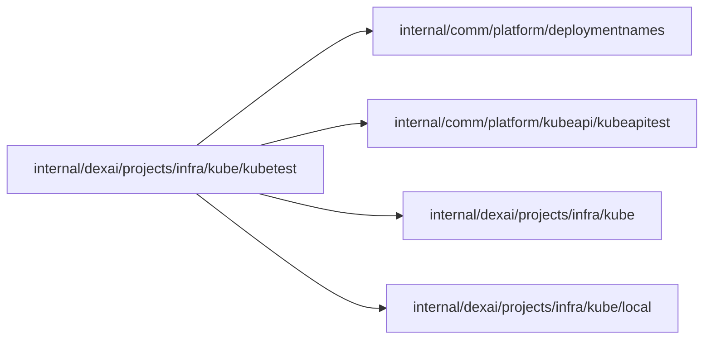

# Kubernetes integration test infrastructure

<!-- BEGIN GENERATED PACKAGE SUMMARY (scripts/check-package-readmes.py; edit only Purpose) -->
Purpose: Gives integration tests the Kubernetes runtime of the isolated Local Kind cluster as the platform server, so tests outside the Kubernetes packages need not import the Kubernetes API client.

Callers: no production package imports this package.

Dependencies: it imports `internal/comm/platform/deploymentnames`, `internal/comm/platform/kubeapi/kubeapitest`, `internal/dexai/projects/infra/kube` and `internal/dexai/projects/infra/kube/local`.

<!-- END GENERATED PACKAGE SUMMARY -->

`InfrastructureForTest` is the one entry point: the Kubernetes runtime of the isolated V2 Kind
cluster as the test environment, reached as the platform server through Local Native
forwards that the test's cleanup closes, with the Local Kind backend and no images.
Integration tests of packages outside the Kubernetes packages use it to get a real
cluster without importing the Kubernetes API client, which only the Kubernetes packages
may do, in test files as well. A missing or foreign cluster fails the test.
