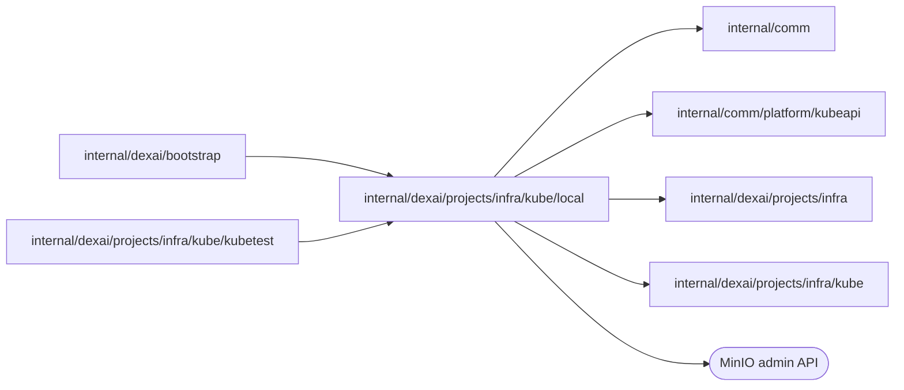

# Local Kind project infrastructure

<!-- BEGIN GENERATED PACKAGE SUMMARY (scripts/check-package-readmes.py; edit only Purpose) -->
Purpose: Runs a Local Kind project's own MinIO and Temporal start-dev in its namespace and grants workloads the storage with MinIO service accounts, for the Kubernetes runtime.

Callers: `internal/dexai/bootstrap` and `internal/dexai/projects/infra/kube/kubetest` import this package.

Dependencies: it imports `internal/comm`, `internal/comm/platform/kubeapi`, `internal/dexai/projects/infra` and `internal/dexai/projects/infra/kube` and calls the MinIO admin API.

<!-- END GENERATED PACKAGE SUMMARY -->

`Backend` is the Local Kind environment of [`kube`](../README.md): the project's
own MinIO and Temporal start-dev run in its namespace, each as one Deployment
on a volume of its own behind a Service and a network policy, and a workload
reaches the storage with the key pair of a MinIO service account. Every
application generation runs as the namespace's one `application` service
account, and the platform namespace's gateway reaches it. `internal/dexai/bootstrap`
builds it with the MinIO and Temporal images pinned by digest.

- **Storage.** The root key pair of the MinIO is an immutable Secret created
  once with the scope. The versioned `application` bucket is created through
  the MinIO's S3 API; a MinIO that does not answer yet is pending, a denial
  fails at once. Local Native reaches the MinIO through a forward bound to the
  accepted namespace UID.
- **Temporal.** `start-dev` registers the project's `app-<project>` namespace
  and its search attributes. The Dex reaches the Service at `temporal:7233`;
  the platform server's data-plane check dials it through the Service
  reference the Flow accepted.
- **Grants.** A grant is a MinIO service account under the root user with the
  grant policy, its key pair kept in an immutable Secret of the Live namespace
  so a lost response never loses the key. A Preview grant's account carries the
  Preview's grant identity, so Session cleanup finds it. Revocation disables the
  account; an account that was never created is created deny-only and disabled.
- **Cleanup.** Destroying a scope deletes the namespace pinned to its UID and
  is pending until it is gone; Session cleanup deletes the marked accounts and
  their Secrets one per call.

| File | Responsibility |
| --- | --- |
| `backend.go` | `Backend` and the answers that need no Kubernetes call |
| `storage.go` | The MinIO and Temporal Deployment builder, the MinIO and its root credentials |
| `temporal.go` | The Temporal start-dev, its access and data-plane dial, the Dex configuration |
| `grants.go` | MinIO service accounts for Live and Preview workloads |
| `cleanup.go` | Scope destruction and Session grant cleanup |
