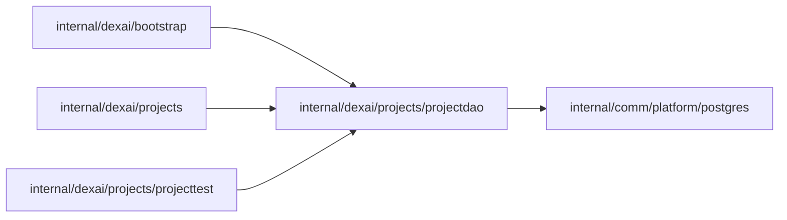

# Project read model queries

<!-- BEGIN GENERATED PACKAGE SUMMARY (scripts/check-package-readmes.py; edit only Purpose) -->
Purpose: Reads the projects table, which the platform Dex Attribute Store writes from ProjectFlow and ProjectSetupFlow: one Project, its authorization join and the keyset-paged list.

Callers: `internal/dexai/bootstrap`, `internal/dexai/projects` and `internal/dexai/projects/projecttest` import this package.

Dependencies: it imports `internal/comm/platform/postgres`.

<!-- END GENERATED PACKAGE SUMMARY -->

The only SQL of the `projects` table (`docs/architecture/teamspace/read-model.md`).
Dex is its only writer: ProjectFlow's store upserts the Project's columns and
ProjectSetupFlow's store the `setup_*` columns of the same row. The package holds
queries and row types and no business rule, and reads only.

| Method | Query |
| --- | --- |
| `Project` | One row that ProjectFlow has written (`project_status` set); a row holding only its Setup's columns is not found |
| `AuthorizeProject` | That row joined with the asking account, which is the platform admin when its email and status are the ones the caller passes, with its `project_members` role and its `team_space_members` role in the Project's TeamSpace; an unknown account holds nothing and still gets the row |
| `ListProjects` | Those rows newest first, in `(created_at, project_id)` keyset pages of the size the caller asks for, with the key of the next page, each with the listing account's two roles; the TeamSpace, a status set and an excluded status filter them |

Every column but the key may be NULL, because each store writes only the
columns of its batch. JSON columns stay the Attributes' JSON encodings
(`json.RawMessage`, nil for NULL through `postgres.JSONColumn`), which
`projects` decodes with the Attributes' own types; no local struct mirrors
them. The one read inside a JSON column is the Live version: every query joins
the `releases` row that `current_live->>'ReleaseID'` names and reads its
`prepared_source->'Version'`, NULL without Live or when that Release recorded
no version. Every query is one statement without a transaction or lock. A missing row is `postgres.ErrNotFound`; every other error
names its operation.

## Tests

`TestProjectDAOIntegration` writes rows into a migrated scratch database of the
lane's PostgreSQL (`postgrestest.MigratedScratchDatabaseForTest`) as both stores
would, including a row that only a Setup batch has written, and runs every
query: every filter of the list with the listing account's roles, paged two
rows at a time, and the admin flag and roles for the admin, the owner, another
and an unregistered account. Its key case is an account with a Project role in
a TeamSpace it does not belong to: the list shows its Project role without a
TeamSpace role, which the effective role then ignores.
