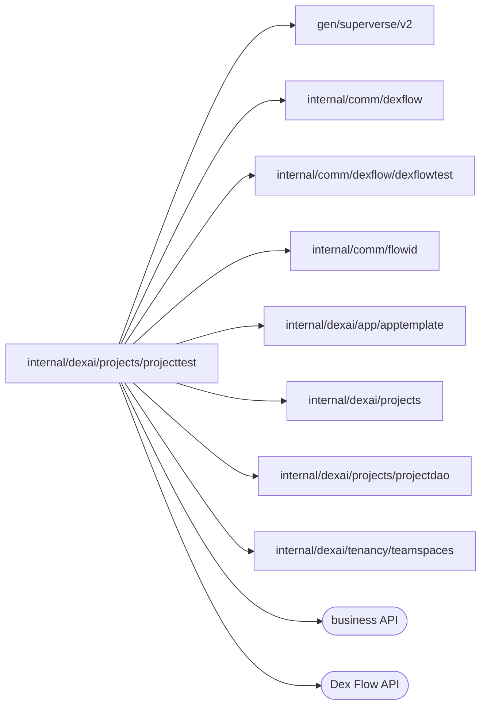

# Project integration test fixture

<!-- BEGIN GENERATED PACKAGE SUMMARY (scripts/check-package-readmes.py; edit only Purpose) -->
Purpose: Gives integration tests throwaway READY Projects of their own, created and deleted through ProjectFlow as the business API does, never substituting a Flow or dependency.

Callers: no production package imports this package.

Dependencies: it imports `gen/superverse/v2`, `internal/comm/dexflow`, `internal/comm/dexflow/dexflowtest`, `internal/comm/flowid`, `internal/dexai/app/apptemplate`, `internal/dexai/projects`, `internal/dexai/projects/projectdao` and `internal/dexai/tenancy/teamspaces` and calls the business and Dex Flow APIs.

<!-- END GENERATED PACKAGE SUMMARY -->

Each Project has exactly one Session, which ProjectFlow starts when the
Project becomes READY and which ends only with the Project's deletion. A test
whose Session must start from a fresh conversation, workspace and Preview
therefore creates a Project of its own.

`StartForTest` registers an ordinary account through the merged business API
(`SUPERVERSE_TEST_API_ADDRESS`), starts a TeamSpace whose one admin is that
account on the lane's server Worker (`TeamSpaceForTest`, which the platform
admin deletes when the test ends, after the Project), and starts a managed
Project of that account in it through ProjectFlow exactly as `CreateProject` does: the Project ID comes from
the account and a random request ID with the server's Project ID length
(`IDLengthForTest`, `SUPERVERSE_TEST_PROJECT_ID_LENGTH`), and its Setup runs on the
existing Worker with the real GitHub repository, storage and runtime, so it
requires `SUPERVERSE_TEST_GITHUB_EFFECTS=true`. `AwaitReadyForTest` returns the
Project once it is READY in ProjectFlow and in its read model row, which the
API authorizes from and which the client's `Projections` read, and
`CreateForTest` does both. `StartAfterForTest` starts the
Project as `StartForTest` does after a callback received the Project's ID, so a test
can stage what the Project's Flows meet first, such as an execution that
already holds the Session's FlowID. The test owns the deletion
from before the start: when the test ends the cleanup requests the deletion
and waits up to ten minutes for the Project's DELETED snapshot, which
completes the Session, ends the Preview and releases the Sandbox and the
storage. `DeleteForTest` does the same during a test.

A missing setting fails the test instead of skipping it.
