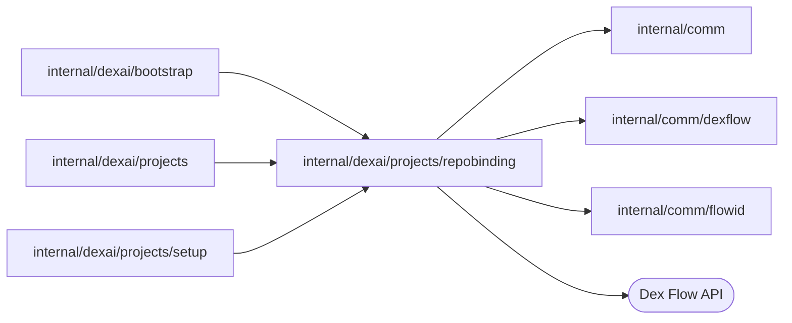

# Repository binding

<!-- BEGIN GENERATED PACKAGE SUMMARY (scripts/check-package-readmes.py; edit only Purpose) -->
Purpose: Owns the exclusive binding of each managed repository to one Project for Project setup and deletion, through RepositoryBindingFlow claims and releases.

Callers: `internal/dexai/bootstrap`, `internal/dexai/projects` and `internal/dexai/projects/setup` import this package.

Dependencies: it imports `internal/comm`, `internal/comm/dexflow` and `internal/comm/flowid` and calls the Dex Flow API.

<!-- END GENERATED PACKAGE SUMMARY -->

`RepositoryBindingFlow` (`repository-<numeric repository ID>`) owns which
Project a managed repository is bound to. Claims and releases are RPCs.
`ClaimRepository` binds an unbound repository to the claiming Setup under a new
generation; the same claim repeated finds its binding, any other claim of a
bound repository is ALREADY_EXISTS and a claim of a released one is
FAILED_PRECONDITION. Every template-created Project claims a repository.

`ReleaseRepository` ends the binding once its repository is archived: Project
deletion and Setup cleanup both archive first. It accepts exactly the claimed
generation of the releasing Project, or an UNBOUND binding at its generation:
generation 0 when a claim's start committed and its RPC never did, or above 0
when the earlier release cleared it; any other generation or Project is
ABORTED. It records `RELEASED` with the releasing Project and moves into its one
Step, `CompleteRepositoryBinding`, which completes the execution gracefully.
The client classifies the closed execution: a later claim is
FAILED_PRECONDITION, and a repeated release succeeds only when the retained
binding shows its own release.

**Retention.** The closed execution answers `GetRepositoryBinding`, and `Find`,
until the engine's closed-execution retention passes; then `Find` returns nil as
for a repository never claimed, and a claim would start the FlowID afresh. That
is safe only because a repository ID is never reused (GitHub's IDs, the local
Git host's monotonic IDs) and the Setup refuses an archived repository before it
claims one (`createManagedRepository`), so no claim of a released repository ever
comes. Relaxing either rule requires a permanent record of released bindings.
The primitive inventory is in the
[architecture](../../../../docs/architecture/superverse-v2.md#repositorybindingflow).

| File | Responsibility |
| --- | --- |
| `repository_binding_flow.go` | The Flow, its primitives, RPCs and completion Step |
| `repository_binding_flow_client.go` | `RepositoryBindingFlowClient`: `Find`, `Claim` (starting the binding execution if needed) and `Release`, with the closed-execution classification |

## Tests

`TestRepositoryBindingDexIntegration` runs RepositoryBindingFlow on an
in-process Worker against real Dex: absent, claimed and conflicting bindings, a
release that completes the execution and stays readable, a repeated release and
mismatched releases against the closed execution, a refused claim that starts no
Run, and the release of a never-claimed generation 0.
