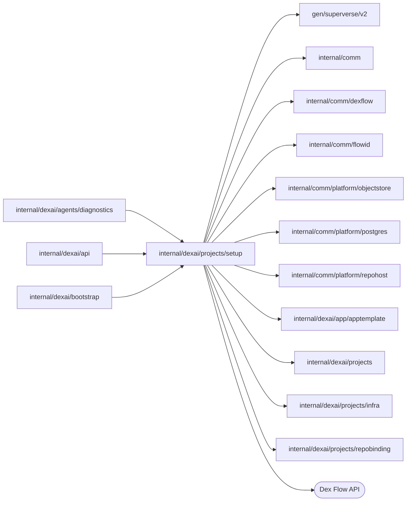

# Project setup

<!-- BEGIN GENERATED PACKAGE SUMMARY (scripts/check-package-readmes.py; edit only Purpose) -->
Purpose: Owns Project setup attempts for ProjectFlow: ProjectSetupFlow prepares the repository, template, app manifest and configuration storage, then hands them to the Project.

Callers: `internal/dexai/agents/diagnostics`, `internal/dexai/api` and `internal/dexai/bootstrap` import this package.

Dependencies: it imports `gen/superverse/v2`, `internal/comm`, `internal/comm/dexflow`, `internal/comm/flowid`, `internal/comm/platform/objectstore`, `internal/comm/platform/postgres`, `internal/comm/platform/repohost`, `internal/dexai/app/apptemplate`, `internal/dexai/projects`, `internal/dexai/projects/infra` and `internal/dexai/projects/repobinding` and calls the Dex Flow API.

<!-- END GENERATED PACKAGE SUMMARY -->

`ProjectSetupFlow` (`setup-<projectID>-<setupID>`) is one setup
attempt of a Project: it prepares the repository and its source and hands them
to the Project. `ProjectSetupFlowClient` implements the Project's
`SetupLifecycle` port: `StartForProject` starts the accepted Setup with the
Project's StartIdentity and `RemoveForProjectCleanup` stops it for Project
deletion. The primitive inventory is in the
[architecture](../../../../docs/architecture/superverse-v2.md#projectsetupflow).

| File | Responsibility |
| --- | --- |
| `project_setup_flow.go`, `project_setup_flow_state.go` | ProjectSetupFlow and its values, including the `Status*` SetupStatus values |
| `project_setup_flow_effects.go` | Setup effects and the `AppManifestRegistrar` port |
| `project_setup_flow_client.go` | `ProjectSetupFlowClient`: `StartForProject`, `Read`, `RemoveForProjectCleanup` |

## Dex Flow Changes

**Setup.** `AdmitSetup` registers the Setup as a Project child before any
provider effect and cancels when the Project no longer admits it. The Steps then
create or recover the managed repository, claim its exclusive binding
(`RepositoryBindingFlowClient.Claim`), push the accepted template, publish the app manifest (`PublishAppManifest`), reconcile the
project's configuration storage while handing every discovered identity to the
Project, register the manifest with the configuration owner, recheck the
repository and hand the result to the Project (`CommitProjectSetup`), which
then acknowledges the Setup's membership. The Project is READY once its code
and configuration storage are usable: Setup creates no Temporal namespace and
no project Dex, which the first Live deployment prepares.

Every Step except one holds the Setup's Revision lock, which
`RequestProjectSetupCleanup` also takes. `ReconcileProjectStorage` waits for
the storage in one long-running Execute without that lock: `dexflow.PollUntil`
runs a round every two seconds within a 30-second round timeout, under
`dexflow.PollingStepOptions(10m)`. Each round reads the Project, calls
`EnsureStorage` and records any new storage identity with
`RecordProjectStorage`, also when the call failed; it writes no Setup
Attribute until the wait ends. A changed pending reason writes a
`SetupProgress` frame whose Detail carries it; the API never maps Detail.
`PollUntil` treats a round cut off by its round timeout as pending, which is
safe because both calls are idempotent. The engine owns the 10-minute wait
limit (ExecuteMethodTimeout and ExecuteRetry.TotalDuration): when it passes,
the Execute failure route moves to `RecordSetupFailure`, which records
`SETUP_FAILED` saying that the configuration storage did not become ready
within 10 minutes, with the redacted timeout as its cause; the last pending
reason is not stored. Readiness moves to `CommitProjectStorage`, which records
the next phase under the lock. A Project that starts deleting fails a round,
and the retried attempt reads the deletion request and moves to `CleanupSetup`;
the storage belongs to the Project, whose deletion destroys it.

`InitializeTemplate` heartbeats every 20 seconds through
`dexflow.KeepAlive` while its repository host requests, each bounded to 30 seconds, run
for the template upload, so the default one-minute
heartbeat timeout detects a lost Worker within its five-minute attempt. Every
external effect is retry safe: the managed repository has a deterministic name
and ownership marker and is taken from its create response, the binding claim is exact, template objects are content
addressed.
`RecordSetupFailure` keeps a Failure recorded by a decision, or writes the final
error from `RecoveryError()` after exhausted retries, with the project's
internal resource names replaced by `infra.Redactor`. Each Step reads the Setup's
ProjectDeletionRequested flag first; deletion moves a running Setup to
`CleanupSetup`, which archives only a managed repository it never handed off and
then ends its binding: its own claim, or a binding whose start committed and
whose claim never did (generation 0), so no RepositoryBindingFlow stays running.
CreateManagedRepository refuses an archived repository, which keeps a released
binding from ever being claimed again
([repobinding](../repobinding/README.md)). A repository the Setup recorded under another repository host than the
server's (`repohost.ErrOtherHost`) would read as absent and pass for archived, so
`CleanupSetup` records `SETUP_FAILED` by decision, with a message that names the host
to run the server with, and `RemoveForProjectCleanup` refuses such a Setup with
`ErrOtherHost` before it asks it to clean up, which ends the Project's deletion as
`REPOSITORY_HOST_MISMATCH`.
During the storage poll, each round rereads the owning Project through its client.
If that Project has already closed child admission before its cleanup RPC
arrives, the typed `ErrChildAdmissionClosed` ends the poll into `CleanupSetup`
without recording `SETUP_FAILED`. Other provider errors retain their retries and
failure details. Flow/Step identities, primitive schemas, locks, RPCs and retention
are unchanged; this correction requires no database or UI change.

**Repository name.** The managed repository is named
`<prefix>-<name slug>-<projectID>` ([managed repository names](../../../comm/platform/repohost/README.md#managed-repositories)).
Only this package derives the name, and only from the Project's immutable name, which
CreateManagedRepository reads from the Project: the Setup keeps no name Attribute, so
an open Setup needs no persistence change. `CleanupSetup` finds a repository by its
deterministic name only when the Setup recorded none. A recorded repository keeps the
name it was created with, so a Setup that was open across the naming change still
archives and releases its `sv2-test-<projectID>` repository. Only a Setup whose
create response was lost before it recorded the repository, within that change, would
not find that repository by the new name.

**The template a Setup commits.** `TemplateRevision` names the composed tree of one example of
the application template ([the examples](../../app/apptemplate/README.md)): the default,
`app-template@<tree>`, or the example a person picked, `app-template/<id>@<tree>`.
`InitializeTemplate` resolves it with `apptemplate.ForRevision` and commits that tree exactly as it
committed the one template before; the hosts' reconciliation by tree is unchanged. A revision this
server build does not hold, as during a rollout to another build, is an error the Step retries
within its 15 minutes, then `SETUP_FAILED`, as a template revision that differed from the embedded
one always was. Open Setups of the default keep their revision, whose tree is unchanged.

**Managed source only.** SourceRepository is the ordinary RepositoryBindingRef
Attribute described in the Project inventory. CreateManagedRepository records
this Setup's deterministic repository identity, ClaimRepositoryBinding always writes
its exclusive generation, and InitializeTemplate uploads the accepted template.
FlowID, RequestID, reuse policy, every Attribute key/type/index, Revision locks,
SetupProgress shared retention and best-effort recovery, RPC authorization,
timeouts/retries and cleanup ownership remain as documented above and in the
architecture. AttributeMaps, Channels and ChannelMaps: None.
Pre-launch rollout cleans all old project executions before switching to these
Step identities; there is no old handler or repository source compatibility path.

## Tests

Every scenario runs on the merged Worker with real Dex, the repository host
and the runtime of the local lane (`SUPERVERSE_TEST_DEX_ADDRESS`,
`SUPERVERSE_TEST_API_ADDRESS`, `SUPERVERSE_TEST_WORKER_TARGET`,
`SUPERVERSE_TEST_WORKER_HEADLESS`, `SUPERVERSE_TEST_PROJECT_ID_LENGTH`,
`SUPERVERSE_TEST_LANE`, with `SUPERVERSE_TEST_KIND_KUBECONFIG` on Kind or
`SUPERVERSE_TEST_NATIVE_RUN_ID` on Native, and
`SUPERVERSE_TEST_GITHUB_EFFECTS=true`) and deletes its Project at the end. It
reads the project's objects with kubectl or the Docker CLI. A READY Project
must hold complete storage whose boundary (namespace or network) and MinIO
service are the recorded ones, no Live execution references and no component
but the storage.

- `TestProjectSetupSurvivesInitiatingClientExitIntegration`: the initiating
  client exits, a fresh client joins the same Project and Setup, and the
  Project reaches READY with its storage only.
- `TestProjectSetupDeletionDuringStorageIntegration`: a deletion admitted while
  `ReconcileProjectStorage` waits on a recorded boundary cancels the Setup in
  that phase without a Failure, the DELETED Project leaves no boundary, and the
  Setup's cleanup ends its repository binding: RELEASED and completed.
- `TestProjectSetupStorageWorkerRestartIntegration`: the server is replaced
  (`dexflowtest.RestartServerForTest`) while `ReconcileProjectStorage` waits, and no
  attempt failed before; the attempt of the replaced Worker fails, by its
  shutdown or the heartbeat timeout, the wait resumes in a new attempt, and
  the READY Project's storage is the boundary and service it recorded, not a
  replacement.

The deletion and restart scenarios hold the storage through the lane's own
runtime, as an operator stops it: from before the Project exists, they look
for its storage every 50 milliseconds and, once the lane runs it, Kind scales
its MinIO Deployment to zero, which the storage reconciliation keeps, and
Docker pauses its MinIO container. Both runtimes report the storage pending in
the round that starts it, and the Setup's next round comes two seconds later,
so the Setup waits until the scenario releases the storage: the deletion
scenario never does, and the deletion removes the held storage; the restart
scenario releases it once the new attempt waits. A Setup that passed its
storage wait before the hold fails the run, never counted as covered.
