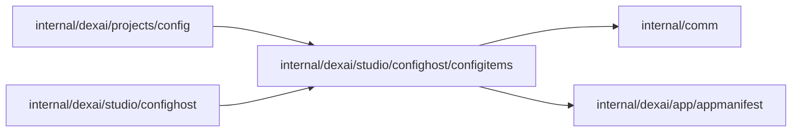

# internal/dexai/studio/confighost/configitems

<!-- BEGIN GENERATED PACKAGE SUMMARY (scripts/check-package-readmes.py; edit only Purpose) -->
Purpose: Models configuration items and resolves them: the Preview head against its applied version, and Live's next publish from its layer, Preview's applied version and current Live.

Callers: `internal/dexai/projects/config` and `internal/dexai/studio/confighost` import this package.

Dependencies: it imports `internal/comm` and `internal/dexai/app/appmanifest`.

<!-- END GENERATED PACKAGE SUMMARY -->

`configitems` is the pure item model of the [configuration host](../README.md): a configuration
item is one setting Setup shows on its own (a connection name's selection, a trigger binding, a
Step setting or an environment variable), keyed by its names (`Key`) and compared by value, a
connection by the TeamSpace connection it selects and a secret by its reference. It reads no
storage and calls nothing.

- `PreviewItems` compares the Preview's head, as an Apply would freeze it, with the applied
  version: `UNCHANGED`, `CHANGED`, `ADDED` or `REMOVED`.
- `Seed` computes the next-publish layer of a Project that has none from current Live and
  Preview's applied version; `Resolve` resolves each item a source declares (`Declared`, with its
  `FollowRefusal`) from the layer, Preview's applied version and current Live, into the resolved
  document and its items: `FOLLOWS_PREVIEW`, `OWN` or `NO_LONGER_USED`.
- `Without` removes items from a layer, keeping an `Anchor` (a connection entry without a selected
  TeamSpace connection) for a connection name whose bindings or Step settings stay; `Holds` and
  `SameItems` compare.

## Files

| File | Responsibility |
| --- | --- |
| `items.go` | Item kinds, states, warnings and keys, document items and their comparison, anchors and the Preview's item diff |
| `next_publish.go` | The layer's seed, the resolution of Live's next publish and what a layer holds |
