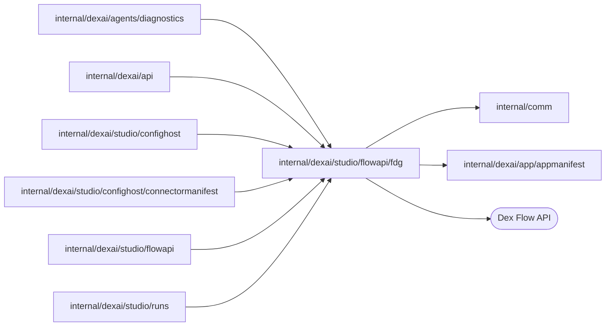

# Flow Definition Graph contract

<!-- BEGIN GENERATED PACKAGE SUMMARY (scripts/check-package-readmes.py; edit only Purpose) -->
Purpose: Defines and validates the Flow Definition Graph 2.0 contract for the Flow API, configuration host and Studio Runs: bundles, typed values, Start input and visibility queries.

Callers: `internal/dexai/agents/diagnostics`, `internal/dexai/api`, `internal/dexai/studio/confighost`, `internal/dexai/studio/confighost/connectormanifest`, `internal/dexai/studio/flowapi` and `internal/dexai/studio/runs` import this package.

Dependencies: it imports `internal/comm` and `internal/dexai/app/appmanifest` and calls the Dex Flow API.

<!-- END GENERATED PACKAGE SUMMARY -->

The Flow Definition Graph 2.0 contract that the Flow API serves. `ParseBundle`
is the trust boundary of served definitions: it accepts only valid FDG 2.0
graphs of Go source with distinct Flow types and validates every rule the
operations rely on.

| File | Responsibility |
| --- | --- |
| `definition.go` | The Flow Definition Graph 2.0 V2 contract types and their closed value sets |
| `definition_validation.go` | Load-time contract validation, including the Start input schema |
| `bundle.go` | Bundle parsing, connector factory Steps and the bundle digest |
| `visibility_query.go` | Search filters and the visibility query compiler |
| `values.go` | Typed value checks and Dex value encoding |
| `start_input.go` | Start input values |
