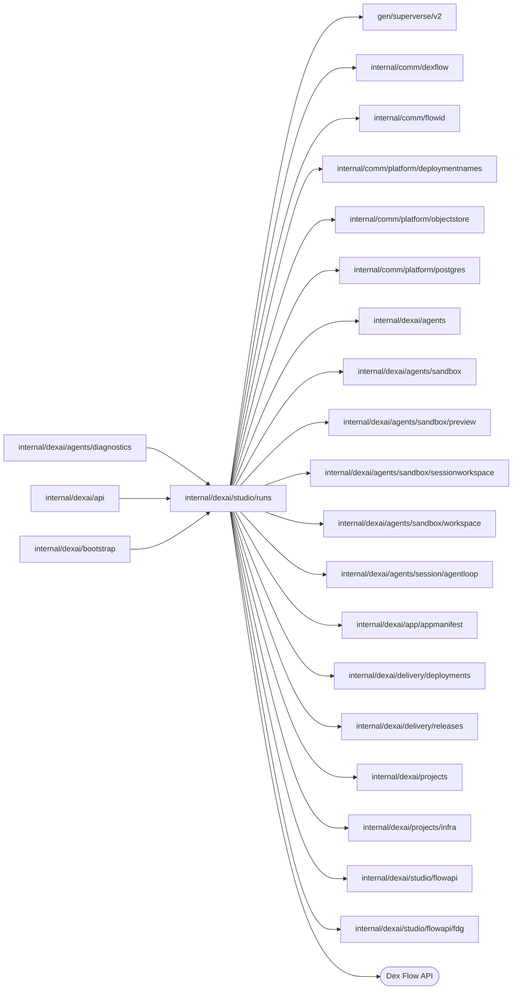

# Studio Runs

<!-- BEGIN GENERATED PACKAGE SUMMARY (scripts/check-package-readmes.py; edit only Purpose) -->
Purpose: Authorizes Studio Runs operations against an exact serving Live deployment or Session Preview for the API and serves them through the Flow API in process.

Callers: `internal/dexai/agents/diagnostics`, `internal/dexai/api` and `internal/dexai/bootstrap` import this package.

Dependencies: it imports `gen/superverse/v2`, `internal/comm/dexflow`, `internal/comm/flowid`, `internal/comm/platform/deploymentnames`, `internal/comm/platform/objectstore`, `internal/comm/platform/postgres`, `internal/dexai/agents`, `internal/dexai/agents/sandbox`, `internal/dexai/agents/sandbox/preview`, `internal/dexai/agents/sandbox/sessionworkspace`, `internal/dexai/agents/sandbox/workspace`, `internal/dexai/agents/session/agentloop`, `internal/dexai/app/appmanifest`, `internal/dexai/delivery/deployments`, `internal/dexai/delivery/releases`, `internal/dexai/projects`, `internal/dexai/projects/infra`, `internal/dexai/studio/flowapi` and `internal/dexai/studio/flowapi/fdg` and calls the Dex Flow API.

<!-- END GENERATED PACKAGE SUMMARY -->

`Runs` serves the FlowRunService and FlowDiagnosticsService RPCs of the Flow
API. Each request carries a `FlowApiContext`: the `FlowApiTarget` and the
revisions the page observed. The API authenticates the account freshly; `Runs`
authorizes the account again for every operation, from the Project's read
model row: on Live a read, a pinned read and a pinned write need
`projects.CapabilityOperateLive` and a `Write` (stop, time travel, Channel
message deletion) `CapabilityBuild`; on a Preview every operation needs
`CapabilityBuild`. It then maps the
target's `ProjectScope` through `infra.ScopeOf`, resolves the exact serving
target and serves the operation through the imported Flow API adapter
(`../flowapi`) in process. It opens no listener and accepts no browser-selected
method, path, Worker address, permission or proxy route.

## Serving targets

A Live target names the exact current Release and Deployment, which the read
model's Live target selects (`deployments.ProjectDeployFlowClient.ReadLiveTarget`):
the Deployment the Project's Live pointer names, READY, with the pointer's
Release and build revision, read with the Project's storage and Live execution
references in one query. ProjectDeployFlow verified the build, frozen
configuration, workload grant and definitions it pinned, so they are read, not
compared again; the definitions come from the pinned, digest-verified bundle
(`releases.ReadRecordedDefinitions`), and the mutable Project configuration
never selects serving Runs. A read is served from that selection, which lags a
redeploy or a Live removal by seconds; a write first reads ProjectFlow
(`AuthorizeCurrent`) and is refused unless its current Live pointer names the
same deployment and generation (decision 27). The connection reaches the Live
Dex through the Project's storage and Live execution references.

A Preview target names a Project whose ID passes `flowid.ValidateSessionScope`,
the rule its Sandbox admission enforces; any other is an invalid argument before
authorization. The Project is read once, by that authorization. The target reads
only the Session's retained summary, its instance and the Project's Preview
(`SessionFlowService.ReadPreviewServing`), never the conversation or the
connector contributions. The Project's one Session must be ACTIVE with an
accepted READY Workspace, whose Sandbox instance that read returns: READY for
the same Workspace request, in the Project's Sandbox namespace. Its
Sandbox-local Preview engine must be READY behind the instance's recorded
Sandbox and Service, and the Project's Preview READY on that same instance. A
write names the Workspace request and generation the caller observed; a read may
omit them, but supplied values must still match. Runs keep this instance fence;
the Preview configuration does not. The definitions are the exact
bundle the running Preview admitted, read through
`sandbox.ReadPreviewDefinitionBundle`; the next prepared source never selects
them.

A target that is no longer current is rejected, never retargeted.

## Operations

`Definitions` returns the serving target's definitions document without
reading Dex state. `Invoke` serves one Flow API operation through a pooled
connection to the target's Dex: the project's Live Dex through
`infra.Connections.DialProjectDex`, or the Preview engine's Dex inside the Sandbox
through `DialSandboxDex`, which verifies the recorded namespace,
Sandbox and Service before it dials the Sandbox Service's port 8801. An `Operation` states what the
request needs:

| Operation | Operations | Requirement |
| --- | --- | --- |
| `Read` | catalog, engine summary/state/history/stream/blobs | a supplied definition revision must be the serving one |
| `Write` | stop, time travel, Channel message deletion | Preview names the observed instance |
| `PinnedRead` | search, Display, Start recovery | the caller names the serving definition revision |
| `PinnedWrite` | edit, Action, Start | both |

A stale definition revision returns the `FLOW_DEFINITION_CHANGED` document;
this check exists only here. Only engine diagnostics accept a RunID.

The target revision digests the serving resource identity and definition
revision without the account; a Preview's also digests its Sandbox UID and the
engine's Temporal cluster ID. Start binds it, along with the actor, the Worker
and the complete Start input, in its Dex RequestID (see `../flowapi`). Start
checks the target's Worker first. A Live Worker goes through
`CheckWorker`, which verifies the fixed Live port, resource ownership,
UID and generation. A Preview's Worker runs inside the Pod on
127.0.0.1:18811, where only the Sandbox-local Dex dials it, so
`workspace.Capabilities.CheckPreviewWorker` asks the Preview supervisor
through sandboxd that the application of the served commit, configuration
digest and grant generation runs with its Worker listening.

## Trusted Live reads

`InvokeLive` serves the Agent's `read_live_app_runs`
([`agents/diagnostics`](../../agents/diagnostics/README.md)), whose caller
already holds the Project scope from its Session identity: no account is
authorized and the request names no target. It resolves the Project's current
Live pointer with the same checks as a Studio Live target, then hands the read
a pooled Live engine connection with the serving
definitions, the Project and the READY deployment. A Project without a
consistent READY Live deployment is `ErrLiveNotReady`.

## Per-replica caches

Every operation reads the target's currency afresh as above; only what derives
from the identities that read returns is cached on the replica
([Runs target cache](../../../../docs/architecture/runs-target-cache-and-watch-authorization.md)).
The definitions cache holds parsed bundles keyed by the digest-verified
definitions object, at most 256 entries and 64 MiB of graph JSON for 10
minutes. The Dex connection pool holds `DexConnections` verified connections
keyed by the recorded identity the dial verified; a connection serves for 30
seconds after its verification, retires on LRU eviction, a failed transport or
`Close`, and closes when its last request releases it.

## Files

| File | Responsibility |
| --- | --- |
| `runs.go` | dependencies, operation kinds, `Definitions`, `Invoke` and `InvokeLive` |
| `serving_target.go` | target validation and Live/Preview serving target resolution |
| `serving_definitions.go` | parsing the definitions the serving Worker loaded |
| `definitions_cache.go` | the bounded LRU of parsed serving definitions |
| `dex_connection_pool.go` | the bounded pool of verified Dex connections with leases |

Live Flow starts use an explicit pull WorkerTarget and validate the exact separate Worker resource with registration readiness. Preview keeps its address override and Sandbox authorization. The Start fingerprint includes target mode.
