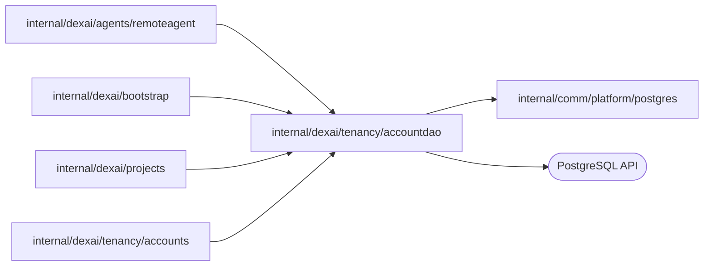

# Account tables

<!-- BEGIN GENERATED PACKAGE SUMMARY (scripts/check-package-readmes.py; edit only Purpose) -->
Purpose: Reads and writes the accounts and login_sessions tables: registration, login admission, token authentication, revocation and the platform admin check.

Callers: `internal/dexai/agents/remoteagent`, `internal/dexai/bootstrap`, `internal/dexai/projects` and `internal/dexai/tenancy/accounts` import this package.

Dependencies: it imports `internal/comm/platform/postgres` and calls the PostgreSQL API.

<!-- END GENERATED PACKAGE SUMMARY -->

The only SQL of the accounts. It holds the queries, the row types and their
transactions, and no business rule: `internal/dexai/tenancy/accounts` hashes
passwords, signs tokens and decides what a result means.

| Method | Query |
| --- | --- |
| `Register` | `INSERT … ON CONFLICT (canonical_email) DO NOTHING`, else the registered row |
| `AccountByEmail`, `IsPlatformAdmin` | One account |
| `CreateLoginSession` | In one transaction: the ACTIVE account at the verified credential revision `FOR SHARE`, deletion of its expired logins, the new login (the same session and token hash again is a success) |
| `AuthenticatedAccount` | The login joined with its account: unexpired, same token hash and authentication epoch, ACTIVE |
| `DeleteLoginSession` | Revocation; an absent login is already revoked |

`ErrNotFound` is an absent row or a login that is not admitted; every other
error names its operation.

## Tests

`TestAccountDAOIntegration` runs every query against the lane's PostgreSQL as
the server role, including stale credential revisions, expired logins, a new
authentication epoch and a replaced token hash, and deletes its rows.
