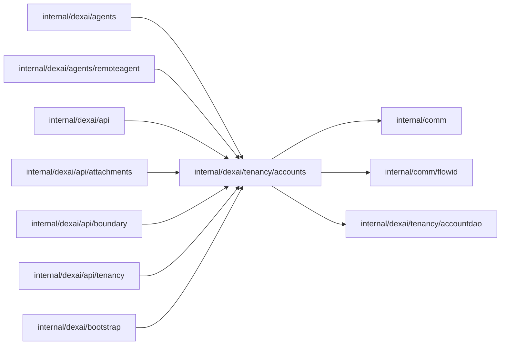

# Accounts and login authority

<!-- BEGIN GENERATED PACKAGE SUMMARY (scripts/check-package-readmes.py; edit only Purpose) -->
Purpose: Registers, logs in, logs out and authenticates accounts, which the database owns, with Argon2id password records and HMAC-signed login tokens.

Callers: `internal/dexai/agents`, `internal/dexai/agents/remoteagent`, `internal/dexai/api`, `internal/dexai/api/attachments`, `internal/dexai/api/boundary`, `internal/dexai/api/tenancy` and `internal/dexai/bootstrap` import this package.

Dependencies: it imports `internal/comm`, `internal/comm/flowid` and `internal/dexai/tenancy/accountdao`.


<!-- END GENERATED PACKAGE SUMMARY -->

`internal/dexai/tenancy/accounts` owns user accounts
([accounts](../../../../docs/architecture/teamspace/accounts.md)). The database is
their only record; `internal/dexai/tenancy/accountdao` runs every query.

| File | Responsibility |
| --- | --- |
| `accounts.go` | `Accounts`: registration, login, logout, caller authentication, the administrator check |
| `account_identity.go` | Canonical email and the `account-<canonicalEmail>` name a token signs |
| `password.go` | Argon2id password record |
| `login_token.go` | HMAC-signed login token and its hash |

## Dex Flow Changes

None. Accounts have no Flow.

**Registration.** `Register` inserts an account with a new random 32-character
AccountID, an Argon2id record, credential revision and authentication epoch 1
and the fingerprint of the canonical email and the caller's request ID. When the
email is registered already, the same request with the same password logs in to
that account; knowing the request ID alone never authenticates, so another
request or another password is `ErrAccountExists`. Concurrent registrations of
one email meet the unique index: one inserts, the others see its row.

**Login.** Registration and `Login` verify the stored record, then
`CreateLoginSession` admits a `login-<random>` row holding only the SHA-256 of
the token, its issue and expiry times and the authentication epoch. The
transaction rechecks ACTIVE status and the verified credential revision and
deletes the account's expired logins, so no background cleanup exists. Logins
last seven days without sliding renewal. `Logout` deletes the row.

**Authentication.** `Authenticate` binds the BFF-supplied AccountID and
canonical email to a token whose signature, expiry and `account-` name check
first, then reads the exact login joined with its account. Every request
authenticates this way; there is no cache.

**Administrator.** The configured ACTIVE platform administrator account (`accounts.platformAdminEmail`) is the single
administrator (`IsAdministrator`, and `accountdao.AccountDAO.IsPlatformAdmin`
for Project access). It manages every Project without owning it.

## Database Schema Changes

`accounts` and `login_sessions` of migration `0001_accounts`
(`internal/comm/platform/postgres/migrations`), owned by this package through
`accountdao`.

## UI/UX

No account UI state is owned here. A transport retry of a registration with the
same request and password returns the original account.

## Tests

- `TestAccountsIntegration`: registration, its replay and conflicts, login,
  authentication with forged callers, and precise logout, against the lane's
  PostgreSQL.
- `TestConcurrentRegistrationIntegration`: one of several concurrent
  registrations of an email creates the account.
- `internal/dexai/tenancy/accountdao.TestAccountDAOIntegration`: the queries,
  including expiry, epoch and credential revision.
- `internal/dexai/api.TestAccountGRPCIntegration`: the gRPC boundary.
- `internal/dexai/projects.TestAdministratorProjectAccessDexIntegration`: owner and
  administrator access on retained Projects.

```sh
SUPERVERSE_TEST_LANE=native go test -count=1 ./internal/dexai/tenancy/... ./internal/comm/platform/postgres/...
```

Missing services fail the tests; nothing is skipped or substituted.
