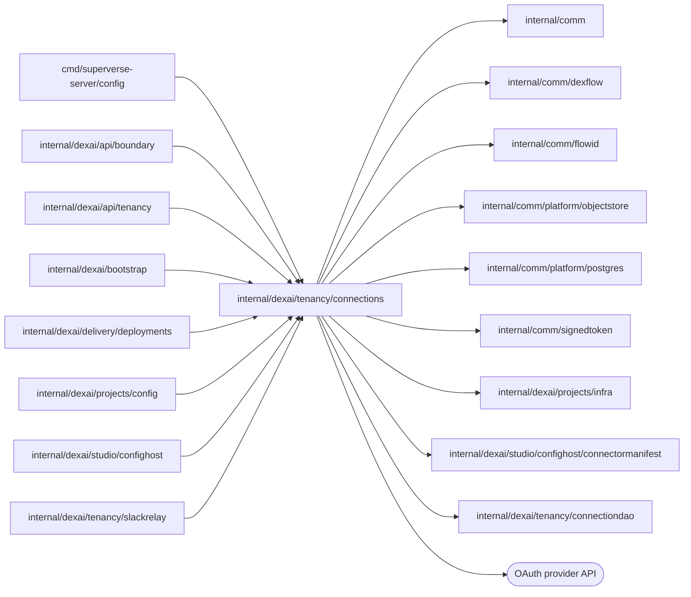

# TeamSpace connections

<!-- BEGIN GENERATED PACKAGE SUMMARY (scripts/check-package-readmes.py; edit only Purpose) -->
Purpose: Reads TeamSpace connection credentials for applications and the platform, refreshing and minting them as manifests declare, and records which Project scopes use which connection.

Callers: `cmd/superverse-server/config`, `internal/dexai/api/boundary`, `internal/dexai/api/tenancy`, `internal/dexai/bootstrap`, `internal/dexai/delivery/deployments`, `internal/dexai/projects/config`, `internal/dexai/studio/confighost` and `internal/dexai/tenancy/slackrelay` import this package.

Dependencies: it imports `internal/comm`, `internal/comm/dexflow`, `internal/comm/flowid`, `internal/comm/platform/objectstore`, `internal/comm/platform/postgres`, `internal/comm/signedtoken`, `internal/dexai/projects/infra`, `internal/dexai/studio/confighost/connectormanifest` and `internal/dexai/tenancy/connectiondao` and calls the OAuth provider API.

<!-- END GENERATED PACKAGE SUMMARY -->

TeamSpace connections are database-authoritative
(`docs/architecture/teamspace/connections.md`): no Flow owns them, and
`internal/dexai/tenancy/connectiondao` holds their SQL. A credential lives only in
immutable objects of the platform bucket under
`teamspaces/<ts>/connections/<id>/`; the row references the current one.

| File | Responsibility |
| --- | --- |
| `credential_reader.go` | `CredentialReader`: one read, renewing the due grant first under the connection's lease |
| `token_grants.go` | The token request of a refresh, a client credentials mint or a JWT bearer mint, and the classification of its answer |
| `credential_writeback.go` | The credential objects, the stored raw answers and the write-back with its cleanup |
| `credential_read_endpoint.go` | `ReadEndpoint`, the applications' `POST /internal/connection-credentials/read`, scope tokens and `ValidateReadURL` |
| `connection_usages.go` | `Usages`: selections, Preview sets, Live deployments, releases, Project and TeamSpace cleanup, scope tokens |
| `connection_admin.go` | `TeamSpaceConnections`: the catalog, creation with copies, settings and key edits, deletion, lists, a scope's selection and the typed refusal reasons |
| `connection_forms.go` | The connection editor's forms: a release's Studio manifest with the platform OAuth offer, and its provider commands, which a form's nonce binds to one actor, TeamSpace, connection and release for 10 minutes. The nonce is a token signed with the `signedtoken.ConnectionForm` key, which `internal/dexai/bootstrap` derives from `SUPERVERSE_COOKIE_SIGNING_KEY`; the server keeps no form, so any replica serves it, and rotating that key voids the open forms |
| `connection_oauth.go` | A connection's OAuth authorization: its attempt objects, the authorization URL and the code exchange under the lease |
| `oauth_clients.go` | The `user` and `platform` OAuth client sources and the provider HTTP client |

## A read

1. **Authorize** (the endpoint only): the SHA-256 of the scope token names a
   Project scope, and that scope's usage the connection; an unknown token is
   401 and an unused connection `CONNECTION_NOT_SELECTED`. The platform's own
   uses, such as Studio's pickers, are authorized by the API and skip this.
2. **Decide**: the manifest version the row records resolves the method's
   grants with the connection's settings. A credential no grant renews is
   static and returned as stored. A grant is due when its access token is
   missing or `oauthtoken.IsRefreshRequiredWithIssueTime` says so; of the due
   grants the one that expires first renews, one per read. A read with
   `rejectedRevision` equal to the current revision forces the renewal of the
   grant issued longest ago, unless it was issued within
   `oauthtoken.ForcedRefreshFloor`.
3. **Lease**: `ClaimRefreshLease` at the current credential revision. A read
   that does not get it rereads the row every 200 ms until the credential
   changes or the lease expires; a read ends within 35 seconds.
4. **Recover**: a successful refresh answer stored under
   `refresh/<credential revision>` names its grant and is applied to that
   grant without a provider call, whichever grant is due: its refresh token
   is spent. A stored answer that cannot be applied, such as one of a grant
   the release no longer declares, is deleted and sets reauthorization
   required instead of failing every read.
5. **Call the provider** until 5 seconds before the 30-second lease, measured
   on the local clock from before the claim, and within the read's 35
   seconds, below the listener's 40-second write timeout; a renewal with less
   than 10 seconds left does not start. The call outlives the caller's
   request. A refresh's successful answer is stored before it is parsed; a
   refresh whose answer was lost is retried once with the old token. A
   declared terminal error code, or a reported scope that no longer covers the
   declared scopes, sets reauthorization required. Any other failure releases
   the lease and returns the current credential while it has not expired.
6. **Write back**: the grant's mappings into a new credential object, then the
   commit fenced by the lease owner and the credential revision. While the
   lease has at least 10 seconds left, the commit first deletes every object of
   the connection but the current credential, the new one and the stored answer
   of its revision; after the commit it deletes only the replaced credential
   and that answer. A commit that lost the lease deletes nothing: its object may
   be identical to the new lease holder's.

An application never reads what the platform keeps: exactly the fields the
release metadata lists in `authMethods[].hostKeptCredentials`
(`connectormanifest.Release.HostKeptCredentials`), such as refresh tokens,
client secrets and service account keys. Every other field is returned,
including the token a client credentials or JWT bearer method minted.

A release whose metadata lacks that field predates TeamSpace connections and
fails closed (`errConnectorVersionUnsupported`): an empty list keeps nothing,
but an absent one never backs a connection. Creation, copies, selection and
every advance of `manifest_version` (an edit's newest release, a selection's
newer declared release, a reauthorization to a release) refuse it and name the
newest release of the major version that lists the field, or say that none
does yet. A read through such a version, which no admission produces, answers
HTTP 409 with no credential.

## Administration

`TeamSpaceConnections` holds the rules the API applies after it authorized
the caller:

- **Create**: the release or release candidate validates the settings and the
  credentials an API key or service account method takes. The ID derives from
  the creator and request ID (`flowid.TeamSpaceConnectionCreationID`), so a
  replay returns the row and the same request with other content is refused.
  A connection of an OAuth method is created by its authorization instead
  (`OAuthStart.Creation`), so one that is abandoned or refused leaves none. A
  copy to another major version takes the source's settings and user OAuth
  client, starts AUTHORIZING and needs a new authorization.
- **Update**: settings validate against the newest catalog release of the
  major version, which then refreshes the connection unless it declares other
  OAuth scopes than the credential carries; then the current release stays.
  Editing a setting that
  a grant reads through a value source (`connectormanifest.CredentialSettings`:
  an endpoint, the scopes, an issuer) marks the credential
  REAUTHORIZATION_REQUIRED in the same statement. An entered
  credential replaces the stored one under a lease at the form's credential
  revision. Both are credential changes, which the update's
  `MayChangeCredential` admits before anything is written
  (`ErrCredentialChangeForbidden` otherwise); the API decides it from the
  caller's roles.
- **Delete**: a connection whose usages all belong to DELETED Projects loses
  those usages and is deleted; any other usage refuses it.
- **Select**: a scope's connection name takes an ACTIVE connection of the
  declared connector, major version and method, with the settings the
  declared release declares. A declared release that asks for other OAuth
  scopes than the release the connection was authorized for is refused and
  changes nothing; the comparison is made from the two manifests on every
  selection. Otherwise a newer declared release refreshes the connection from
  then on. A Preview selection records its usage at once.
- **Authorize**: an attempt stores its seed and, before it reads it, the
  token answer, under `teamspaces/<ts>/connection-oauth/<connection>/<attempt>/`,
  outside the connection's prefix; the OAuth state names the TeamSpace, the
  connection and the attempt. A new attempt deletes the connection's earlier
  ones, a completed one every other object of them but its completion marker,
  and the TeamSpace's deletion all of them; an attempt expires after ten
  minutes. An attempt that creates its connection holds the creation in its
  seed, under the ID the creation derives, and needs its name free when it
  starts; its callback validates the creation again, exchanges the code, and
  only then stores the connection and commits the credential to it under its
  lease. A provider's refusal or a refused code stores nothing and leaves the
  attempt usable; a repeated callback after the store takes the path of an
  existing connection. A platform connection's seed records only the client source and
  ID: the callback takes the secret from the platform's configuration. The callback exchanges under the connection's
  lease at its current credential revision, so refreshes during the actor's
  consent do not refuse it. Reauthorization reuses the stored user client;
  a platform connection uses the platform's application and stores only
  tokens. Reauthorizing to a newer release authorizes with its scopes and
  makes it the refreshing release once the new credential is committed;
  until then the old credential keeps serving. The authorization URL is
  https, or http where the profile allows plain http.
- **Forms**: `OpenForm` returns a release's Studio manifest and the methods
  for which the platform offers its OAuth application: those whose
  authorization fills every required credential field and whose scopes the
  application covers. `RunFormCommand` runs a provider command of an open
  form with the connection's credential; a form lives ten minutes, at most
  128 at once.

Refusals Studio branches on are typed once (`RefusalReason`):
`CONNECTOR_VERSION_UNSUPPORTED`, `CONNECTION_SCOPES_DIFFER`,
`CONNECTION_DELETED`, `CONNECTION_IN_USE`, `CONNECTION_NAME_TAKEN` and
`OAUTH_DENIED`. `Refusal` names the reason of an error; the API sends it as
the ErrorInfo reason and the configuration host as the document's code.

## Provider calls

`NewProviderHTTPClient` is the one client of every provider call. sdkgo's
`providerhttp` address policy checks each resolved address when it dials:
`PublicHTTPS` in hosted environments, and `PrivateNetworkHTTP`, which allows
plain http to loopback and private addresses, where
`connections.allowInsecureOAuthEndpoints` is set (local lanes only). It never
follows a redirect.

## Tests

`TestReadEndpointAuthorizationIntegration` serves the endpoint over the lane's
PostgreSQL and MinIO and actual published releases: tokens of another scope,
unused connections, unknown, missing and deleted Projects' tokens, and
malformed requests are refused; openai v0.21.1 reads READY, a gmail v0.23.0
OAuth connection reads READY without its host-kept fields, and openai v0.8.0,
which predates the list, answers 409.

`TestPreWaveReleaseRefusedLive` (tag `live`) refuses gmail v0.22.0 at
creation and selection against the actual releases and catalog, naming
v0.23.0. `TestPlatformClientOfferLive` (tag `live`) offers a platform OAuth
application for gmail v0.23.0, not for Slack v0.22.0, whose required
app-level token no authorization returns, and not for an application missing
one of gmail's scopes.
