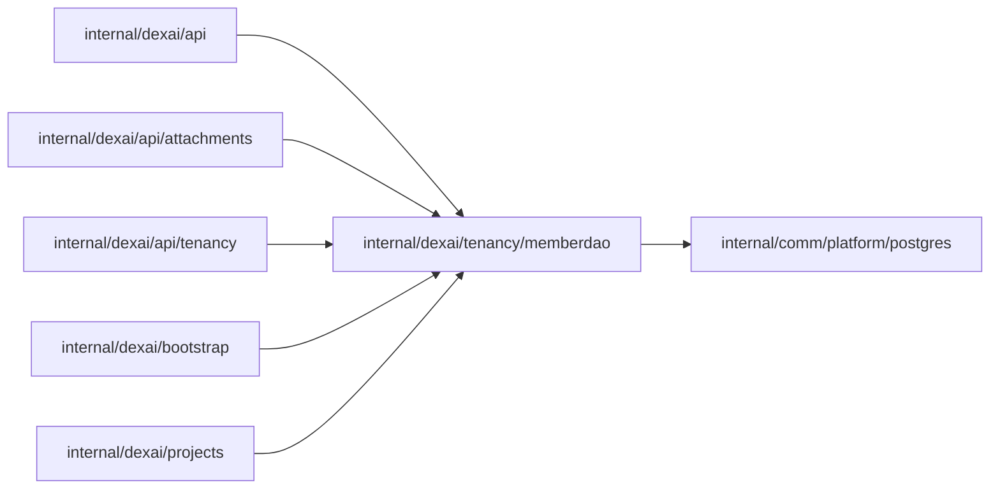

# Member read model queries

<!-- BEGIN GENERATED PACKAGE SUMMARY (scripts/check-package-readmes.py; edit only Purpose) -->
Purpose: Reads the team_space_members and project_members child tables that the platform Dex Attribute Store writes from the Members maps of TeamSpaceFlow and ProjectFlow.

Callers: `internal/dexai/api`, `internal/dexai/api/attachments`, `internal/dexai/api/tenancy`, `internal/dexai/bootstrap` and `internal/dexai/projects` import this package.

Dependencies: it imports `internal/comm/platform/postgres`.

<!-- END GENERATED PACKAGE SUMMARY -->

The only SQL of the member tables (`docs/architecture/teamspace/teamspaces-and-roles.md`).
Dex writes one row per instance of TeamSpaceFlow's and ProjectFlow's `Members`
maps and deletes the row with the instance; rows stay when their TeamSpace or
Project is deleted, so the queries leave out an excluded status. A Project role
counts only while its account is still a member of the Project's TeamSpace,
which an account removed from the TeamSpace no longer is. The package holds
queries and row types and no business rule, and reads only.

| Method | Query |
| --- | --- |
| `TeamSpaceMembers` | The members of a TeamSpace with their emails, in the order they were added |
| `ProjectMembers` | The members of a Project outside the excluded status with their emails and whether each is still a member of the Project's TeamSpace |
| `MemberAccounts` | The emails of given accounts and whether each is a member of a TeamSpace, for the member lists that a Flow returns |
| `TeamSpaceRole` | An account's role in a TeamSpace outside the excluded status |
| `SoleOwnedProjects` | The TeamSpace's Projects in which the account holds the owner role and no other TeamSpace member does, which its removal would leave without an owner whose role counts |
| `RetainedProjectRoles` | How many of the TeamSpace's Projects still give the account a role, which counts again when it rejoins |

Roles and statuses are passed in or returned as stored: the owning Flow
packages declare their typed constants. `TeamSpaceRole` answers `postgres.ErrNotFound`
for a TeamSpace that the read model does not hold, or holds in the excluded
status, and an empty role for an account that is not a member; every other
error names its operation.

ProjectFlowClient lists a Project's members; the TeamSpace and Project member
services and CreateProject's membership check use the other queries.

## Tests

`TestMemberDAOIntegration` writes accounts, TeamSpace, Project and member rows
into a migrated scratch database of the lane's PostgreSQL
(`postgrestest.MigratedScratchDatabaseForTest`) as Dex and the account code
would, and runs every query. Its key case is an owner whose co-owner left the
TeamSpace: the Project still counts as solely owned, which fails if the query
stops requiring the other owner's TeamSpace membership.
