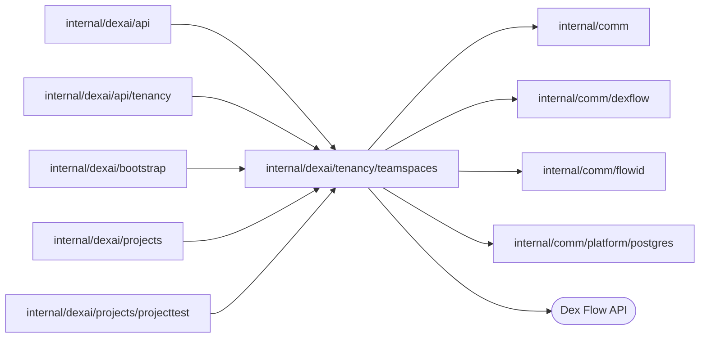

# TeamSpaces

<!-- BEGIN GENERATED PACKAGE SUMMARY (scripts/check-package-readmes.py; edit only Purpose) -->
Purpose: TeamSpaceFlow owns one TeamSpace: its name, its members and their admin or member role, the registry of its Projects, and its deletion.

Callers: `internal/dexai/api`, `internal/dexai/api/tenancy`, `internal/dexai/bootstrap`, `internal/dexai/projects` and `internal/dexai/projects/projecttest` import this package.

Dependencies: it imports `internal/comm`, `internal/comm/dexflow`, `internal/comm/flowid` and `internal/comm/platform/postgres` and calls the Dex Flow API.

<!-- END GENERATED PACKAGE SUMMARY -->

`TeamSpaceFlow` (`teamspace-<teamSpaceID>`) is the permanent owner of a
TeamSpace. Its complete per-Flow contract is in
[teamspaces-and-roles.md](../../../../docs/architecture/teamspace/teamspaces-and-roles.md);
the generated graph is [sv2-teamspace-flow.json](../../../../docs/flows/sv2-teamspace-flow.json).
This README records what the code adds to it.

| File | Holds |
| --- | --- |
| `team_space_flow.go` | The primitives, Steps and RPCs |
| `team_space_flow_state.go` | The persisted values, the `Status` and `Role` sets, the RPC inputs and results, the member rules |
| `team_space_flow_client.go` | `TeamSpaceFlowClient`: the start and the writes |
| `team_space_flow_effects.go` | The `ProjectCleanup` and `ConnectionCleanup` ports and the deletion round |

**Lifecycle.** A TeamSpace starts READY with its creator as its one admin;
`AwaitTeamSpaceCommands` is the start Step. Only the platform admin's
`RequestTeamSpaceDeletion` makes it DELETING; `DeleteTeamSpaceResources` asks
each registered Project, at most eight per round, to delete itself through
`ProjectCleanup` until every one is DELETED, then deletes the TeamSpace's
connections through `ConnectionCleanup` (bounded and idempotent, never refused
by usages) until none is left, within a six-hour wait limit, and
`CompleteTeamSpaceDeletion` records DELETED and completes the Flow. A deletion
that does not converge is recorded by `RecordTeamSpaceFailure`
(`DELETION_FAILED`, or `DELETION_TIMEOUT` at the wait limit); one that meets a
Project whose execution closed before it was DELETED (`ErrProjectClosed`, which
no deletion request reaches) stops at once and records `PROJECT_CLOSED` naming
the Project and its last status. Either way the TeamSpace stays DELETING and
admits a new deletion request once an operator has reconciled the Project. The members stay with the
completed Flow, and the read model keeps their rows.

**Writes.** Every write locks `Revision`. Name, member and status writes bump
it; the Project registry does not, so a registration never breaks a rename's
fence. Member writes load the whole `Members` map (at most 500 instances) and
keep at least one admin. `RenameTeamSpace` loads the caller's instance and
refuses a stale revision with a stale rejection, which the API answers with
`REVISION_CHANGED`. `RegisterProject` loads the caller's `Members` instance and
the Project's `Projects` instance; a registered Project is accepted in any
status, so a retry after a lost answer passes, and a new one needs a READY
TeamSpace and a member or the platform admin. `UnregisterProject` admits any
status and no actor: only the Project's own deletion calls it.

**Reads.** TeamSpaces and their members are read from the read model
(`teamspacedao`, `memberdao`); `AwaitRow` waits up to 10 seconds for the row of
a TeamSpace whose Flow exists and is not DELETED, which one bounded read of the
Flow's display tells, which the platform Dex Attribute
Store writes from the synced Attributes and the `Members` map
(`team_spaces`, `team_space_members`).

TeamSpaceService and TeamSpaceMemberService (`internal/dexai/api/tenancy`) call the
writes, and ProjectFlow registers and unregisters its Project.

## Tests

| Test | Proves |
| --- | --- |
| `TestTeamSpaceReadModelTableIntegration` | The migrated `team_spaces` and `team_space_members` tables have exactly the columns of the synced Attributes and `Members` fields |
| `TestTeamSpaceDexIntegration` | On a Worker of the test and the lane's platform Dex: a replayed start joins and another name for the ID is refused; a non-admin's change is refused; five admins racing to be removed or demoted leave exactly one (dropping the last-admin check fails it); a stale rename is refused as stale; the registry admits a member, a repeat and the platform admin, refuses an outsider and a missing or deleted TeamSpace; the rows follow the Flow to DELETED with the members kept |
| `TestTeamSpaceDeletionRaceDexIntegration` | Of eight concurrent deletion requests exactly one is admitted, and the TeamSpace completes DELETED under its ID |

The cascade through real Projects is tested with ProjectFlow, which implements
`ProjectCleanup`.
