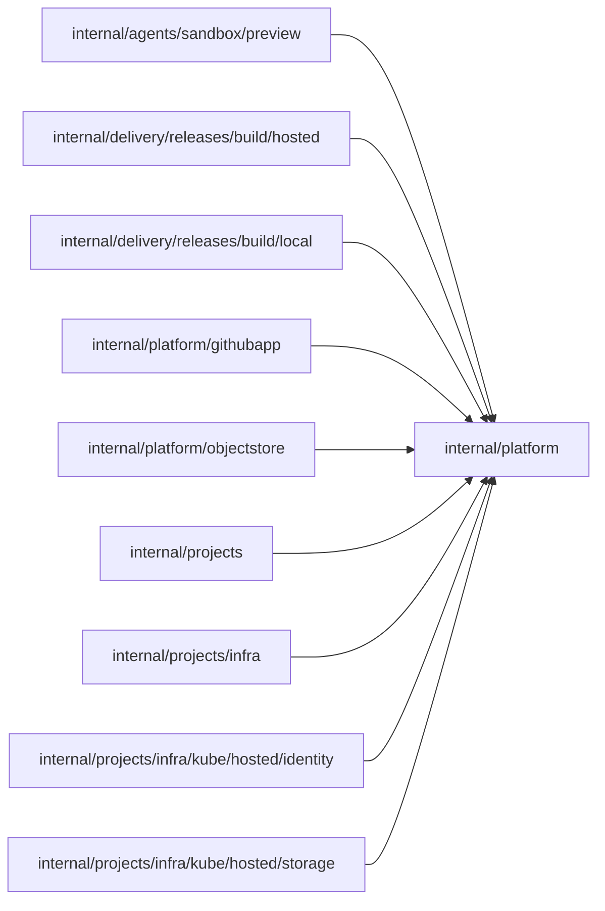

# Provider outcome classification

<!-- BEGIN GENERATED PACKAGE SUMMARY (scripts/check-package-readmes.py; edit only Purpose) -->
Purpose: Classifies the outcomes of Kubernetes, AWS, S3, GitHub and gRPC provider calls for every adapter and business package, without reading error text.

Callers: `internal/agents/sandbox/preview`, `internal/delivery/releases/build/hosted`, `internal/delivery/releases/build/local`, `internal/platform/githubapp`, `internal/platform/objectstore`, `internal/projects`, `internal/projects/infra`, `internal/projects/infra/kube/hosted/identity` and `internal/projects/infra/kube/hosted/storage` import this package.

Dependencies: it imports no other package of this module and calls no remote API.

<!-- END GENERATED PACKAGE SUMMARY -->

Classifies the outcome of calls to external providers: Kubernetes, AWS and
S3-compatible storage, GitHub and gRPC services. It holds only error typing and
classification shared by several packages and imports no Superverse package, so
every provider adapter can use it. An adapter exposes what classification needs
through a method its error type implements, never through error text. Business
packages decide what a classified error means for their own durable state.
