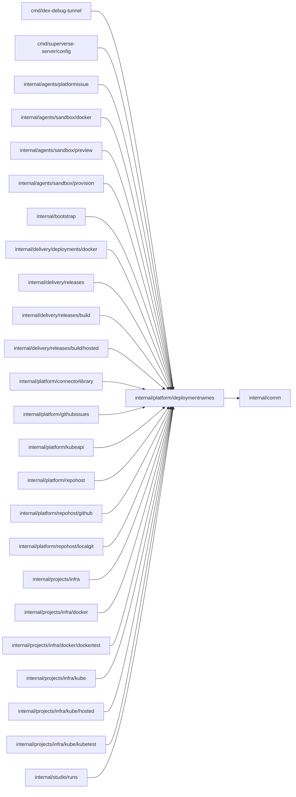

# Deployment names

<!-- BEGIN GENERATED PACKAGE SUMMARY (scripts/check-package-readmes.py; edit only Purpose) -->
Purpose: Declares the deployment environments and owns their static, operator-selected names (prefixes, clusters, registries, IAM paths and domains) that Go, Terraform, Helm and the infra scripts share.

Callers: `cmd/dex-debug-tunnel`, `cmd/superverse-server/config`, `internal/agents/platformissue`, `internal/agents/sandbox/docker`, `internal/agents/sandbox/preview`, `internal/agents/sandbox/provision`, `internal/bootstrap`, `internal/delivery/deployments/docker`, `internal/delivery/releases`, `internal/delivery/releases/build`, `internal/delivery/releases/build/hosted`, `internal/platform/connectorlibrary`, `internal/platform/githubissues`, `internal/platform/kubeapi`, `internal/platform/repohost`, `internal/platform/repohost/github`, `internal/platform/repohost/localgit`, `internal/projects/infra`, `internal/projects/infra/docker`, `internal/projects/infra/docker/dockertest`, `internal/projects/infra/kube`, `internal/projects/infra/kube/hosted`, `internal/projects/infra/kube/kubetest` and `internal/studio/runs` import this package.

Dependencies: it imports `internal/comm`.

<!-- END GENERATED PACKAGE SUMMARY -->

The static, operator-selected names of each deployment environment: product and
namespace prefixes, clusters, registries, IAM paths and domains.
`environments.json` is the catalog that Go, Terraform, Helm and the infra
scripts read; it holds no business state and a resource request never selects a
name from it.

`Environment` is the closed set of the catalog's keys, declared once as
`EnvironmentTest`, `EnvironmentStaging` and `EnvironmentProd`. It is a struct
that string literals cannot convert to: operator input enters Go through
`ParseEnvironment`, which reports an `unknownEnvironmentError` for another
name, and `For` and `MustFor` take the typed value. Its JSON and text spelling
is the catalog key, so persisted and wire documents keep their names. The
package panics at start unless the declared environments and the catalog's keys
are the same set.

`RepositoryPrefix` is the first part of a managed repository's name. The two local
lanes run as the test environment, so the catalog cannot hold it: it is the closed set
`RepositoryPrefixLocalNative`, `RepositoryPrefixLocalKind` and
`HostedRepositoryPrefix(environment)`, the environment's name, a struct that string
literals cannot convert to. `internal/bootstrap` chooses among them from the server
configuration. The
[managed repository names](../repohost/README.md#managed-repositories)
define the rest of the name.
