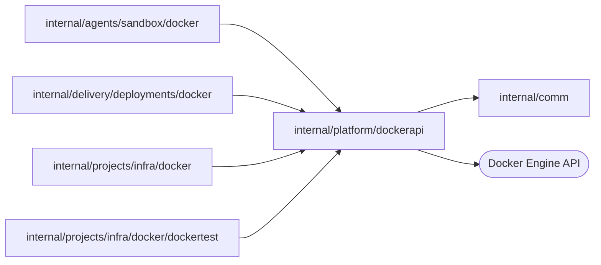

# Docker Engine API client

<!-- BEGIN GENERATED PACKAGE SUMMARY (scripts/check-package-readmes.py; edit only Purpose) -->
Purpose: Gives the Docker runtime packages one raw REST client of the Docker Engine API on its unix socket, with the container, network, volume and image calls they build on.

Callers: `internal/agents/sandbox/docker`, `internal/delivery/deployments/docker`, `internal/projects/infra/docker` and `internal/projects/infra/docker/dockertest` import this package.

Dependencies: it imports `internal/comm` and calls the Docker Engine API.

<!-- END GENERATED PACKAGE SUMMARY -->

The shared Docker Engine API boundary of Local Native, built like
[`kubeapi`](../kubeapi/README.md): plain HTTP over the engine's unix socket,
no SDK. Every request names API version 1.44, the first that attaches a new
container to several networks at once, and every path is built here from
typed arguments, so no caller selects an endpoint.

- **Errors.** A 404 and a 304 are no errors: a read of an absent object is
  `nil`, a start of a running container or a stop of a stopped one succeeds,
  and the caller decides what absence means. A refused request is a
  `responseError` with the engine's message; `IsConflict` recognizes a taken
  name, an object in use and a removal in progress. A transport failure leaves
  a mutation unconfirmed, and the caller reads the object again before it
  retries.
- **Bounds.** An ordinary call is bounded by 30 seconds unless its context is
  shorter; a stop waits for its own grace period on top of that, and a pull up
  to ten minutes. The engine completes a stop it started even when the call is
  cut off, so a caller that polls finds the container stopped.
- **Containers.** `ContainerSpec` with `Publish` and `Attach` creates a
  container that publishes TCP ports on ephemeral ports of 127.0.0.1 and joins
  networks under aliases; `AttachAt` joins a network at a fixed address, which
  `FixedAddress` reads back. A network's `IPAMConfig` names its subnet, gateway
  and the range the engine allocates addresses from. The engine assigns a published port when the
  container starts, so `PublishedAddress` and `LoopbackPort` are read from a
  current inspection for every use and never kept. `Exec` runs a command detached and waits for
  its exit code; `CopyToContainer` places a tar archive into a container that
  has not started; `ContainerLogs` demultiplexes the end of its log.
- **Owner labels.** The client knows no owner. The callers stamp the owner
  labels that [`deploymentnames`](../deploymentnames/README.md) declares for
  both runtimes and verify them before they adopt or remove an object;
  `Labels` builds the filter that selects them.

Only the `docker` implementation packages and their test fixture import this
package, which `scripts/check-package-layers.py` enforces.

| File | Responsibility |
| --- | --- |
| `client.go` | The socket client, `responseError`, `IsConflict`, filters and request escaping |
| `containers.go` | Container inspection, creation, start, stop, removal, listing, logs, exec and archive copies; published ports and network attachments |
| `networks.go` | Bridge networks with an explicit subnet |
| `volumes.go` | Named volumes |
| `images.go` | Image inspection and pulls of references pinned by digest |
