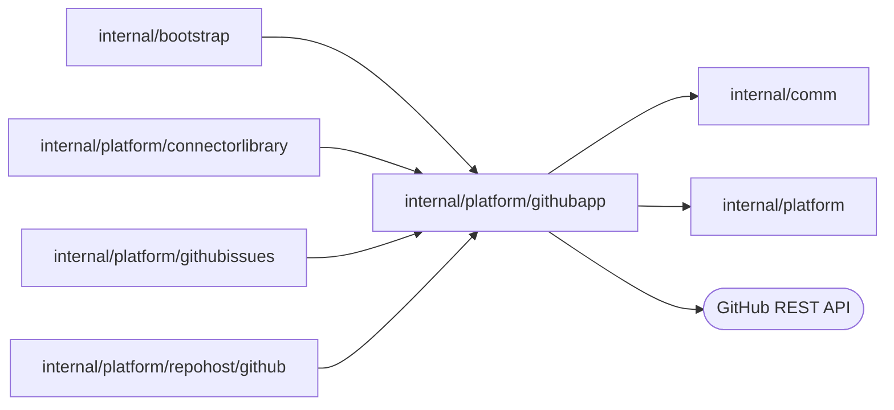

# GitHub App authentication

<!-- BEGIN GENERATED PACKAGE SUMMARY (scripts/check-package-readmes.py; edit only Purpose) -->
Purpose: Authenticates as one installation of the GitHub App by signing its JWT and minting installation and repository tokens, and calls the GitHub REST API with them.

Callers: `internal/bootstrap`, `internal/platform/connectorlibrary`, `internal/platform/githubissues` and `internal/platform/repohost/github` import this package.

Dependencies: it imports `internal/comm` and `internal/platform` and calls the GitHub REST API.

<!-- END GENERATED PACKAGE SUMMARY -->

The GitHub repository host ([`repohost/github`](../repohost/github/README.md)) acts through
this package, and so does every other feature that acts through the same App, such as
platform issue reporting ([`githubissues`](../githubissues/README.md)) and connector pull
requests.

- `App` holds the App ID, the installation and the private key. It caches the
  installation-wide token and renews it a minute before it expires. `Permissions`, when
  set, restricts that token to the permissions a feature needs: the issue installation's
  token holds Issues write and Metadata read and nothing else of the App.
- `RepositoryToken` mints a token restricted to the contents of one repository.
- `Call` sends one JSON request as the installation; `CallAsApp` sends one with the
  App JWT, for the endpoints of the App itself.
- A failed call is an `*HTTPError`, which exposes its status through `HTTPStatusCode`
  so `platform` can classify it. A lost or unreadable response is an
  `*platform.OutcomeUnknownError` that matches `ErrOutcomeUnknown`: the call may have
  taken effect, so the caller reads before it repeats a write.

Every call is bounded to 30 seconds, never follows a redirect, which would carry the
bearer token to another host, and never puts a token in an error.

| File | Responsibility |
| --- | --- |
| `app.go` | The App, its JWT and its installation and repository tokens |
| `request.go` | The bounded GitHub API call and its errors |
| `integration_test.go` | The real installation and App description |
