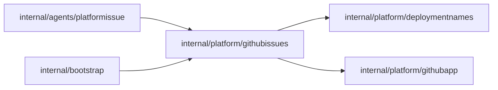

# GitHub issues of platform incidents

<!-- BEGIN GENERATED PACKAGE SUMMARY (scripts/check-package-readmes.py; edit only Purpose) -->
Purpose: Files each platform incident once as a GitHub issue, found or opened by the label of its signature, as one installation of the GitHub App.

Callers: `internal/agents/platformissue` and `internal/bootstrap` import this package.

Dependencies: it imports `internal/platform/deploymentnames` and `internal/platform/githubapp`.

<!-- END GENERATED PACKAGE SUMMARY -->

The `PlatformIssueFlow` of a platform failure's signature
([`agents/platformissue`](../../agents/platformissue/README.md)) files it through this package
([tool orchestration](../../../docs/architecture/agent-harness-design/tool-orchestration.md#platform-issue-reporting)
owns the design). GitHub owns the issue; the platform keeps no copy.

- `Repository` is the repository of the issues (`github.issues.repository` of the
  [server configuration](../../../cmd/superverse-server/config/README.md#github)) reached as
  the App's installation on it (`github.issues.installationId`), a second
  [`githubapp.App`](../githubapp/README.md) beside the repository host's. The App needs the
  Issues permission (read and write) there, and bootstrap restricts the installation's
  token to `TokenPermissions`, Issues write and Metadata read, so it can change nothing
  else of the repository whatever else the App may do.
- `EnsureIssue` queries the open and closed issues for the label first and opens an issue
  only when none carries it, so a call repeated after an error never opens a second one. It
  reports whether the opened issue carries the label (`Filed.Labeled`), which GitHub silently
  drops for a caller that may not set it, and does not add it: a call repeated after a failed
  label call would not find the unlabeled issue and would open another, so the caller commits
  the opened issue's number first and then calls `LabelIssue`, which adds the label and changes
  nothing when it is already there. A label dropped at the creation whose answer was also lost
  leaves an unlabeled issue that no call finds; this narrow window is accepted. GitHub's issue listings are
  eventually consistent for a few seconds and GitHub offers no create-if-absent, so two calls
  for one label within that window, in one process or in several, may each open an issue. The
  platform makes no such calls: the reports of one signature join the one open run of its
  `PlatformIssueFlow`, which calls once. Only a run that starts within seconds after the run
  that opened the issue completed may still open a second one; this is accepted.
- `IncidentLabel` is the label `superverse-incident:<env>:<sig16>`: the environment and the
  first 16 hex characters of the incident's signature, at most 44 characters and without a
  comma.
- `NotConfigured` stands for a server without an issue repository: it files nothing and
  answers `ErrNotConfigured`, so the caller only logs the incident.

Errors are classified as the [GitHub repository host](../repohost/github/README.md) does,
keeping the GitHub error behind the type: a lost answer is `errOutcomeUnknown`, and the
next call reads before it writes; a 4xx other than 408 and 429 is `ErrRejected`, which
asking again cannot change; any other error, such as a server error, stays untyped and may
succeed when asked again. Title and body come from the caller, which writes identifiers and
classification only.

## Verification

`TestPlatformIssueGitHubIntegration` and `TestPlatformIssueLabelGitHubIntegration` are manual tests. Run them, with
`TestPlatformIssueFlowGitHubIntegration` of [`agents/platformissue`](../../agents/platformissue/README.md#tests),
which runs three joined reports of one signature against the same repository and requires one
issue, only when this package, [`githubapp`](../githubapp/README.md) or the issue reporting path
changes (`PlatformIssueFlow`, the Session's `ReportPlatformIssue` in
[`agents/session`](../../agents/session/README.md) and
`internal/agents/session_flow_service_issues.go`); none is part of a pull request's default lane
runs. It opens real issues in the issue repository, one per run, and closes each and deletes its
label when it ends. Its second report waits, for at most a minute, until GitHub's label listing
returns the issue the first report opened. The owner approved test issues in `superdurable/superversev2` with the labels
`superverse-incident:test:<sig16>`. Its inputs come from the environment only, never from a command
line: the issue repository in `SUPERVERSE_TEST_GITHUB_ISSUE_REPOSITORY`, its installation ID in
`SUPERVERSE_TEST_GITHUB_ISSUE_INSTALLATION_ID`, the App ID in `SUPERVERSE_TEST_GITHUB_APP_ID`, the
App's private key in `GITHUB_APP_PRIVATE_KEY_BASE64` and `SUPERVERSE_TEST_GITHUB_EFFECTS=true`
([integration paths](../../agents/README.md)).
A missing input or credential fails the test, so such a run is incomplete, never a pass.

| File | Responsibility |
| --- | --- |
| `issue.go` | `Issue`, `Filed`, `IncidentLabel`, the errors and `NotConfigured` |
| `repository.go` | `Repository`, its `TokenPermissions`, `EnsureIssue` and `LabelIssue`: the label query, the issue, its label and the classification of errors |
| `integration_test.go` | The real issue installation: one issue per signature, found again open and closed; an unlabeled issue labeled twice and then found |
