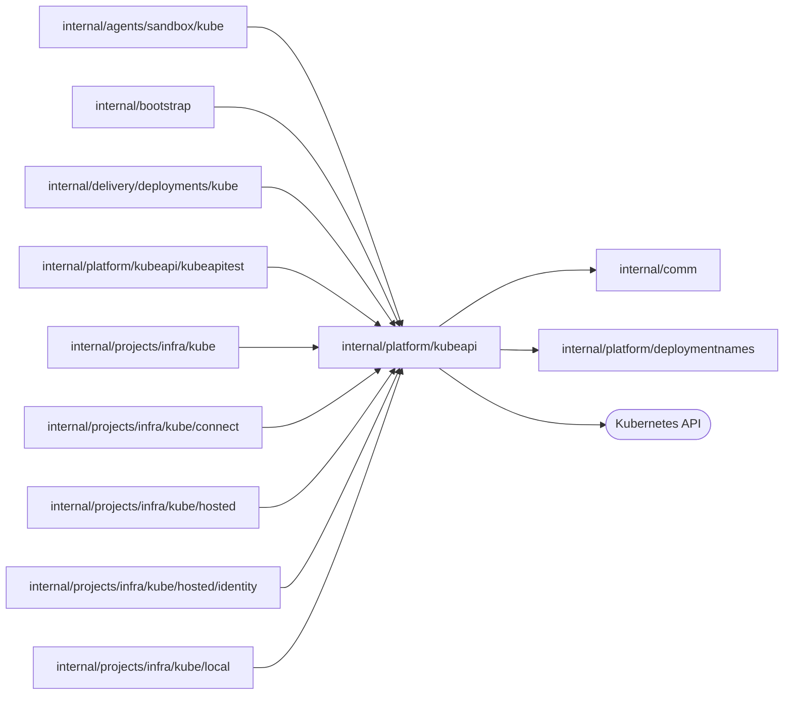

# Kubernetes API client

<!-- BEGIN GENERATED PACKAGE SUMMARY (scripts/check-package-readmes.py; edit only Purpose) -->
Purpose: Gives every Kubernetes provider one HTTP client of the Kubernetes API and the unstructured-object toolkit it builds and reads resources with.

Callers: `internal/agents/sandbox/kube`, `internal/bootstrap`, `internal/delivery/deployments/kube`, `internal/platform/kubeapi/kubeapitest`, `internal/projects/infra/kube`, `internal/projects/infra/kube/connect`, `internal/projects/infra/kube/hosted`, `internal/projects/infra/kube/hosted/identity` and `internal/projects/infra/kube/local` import this package.

Dependencies: it imports `internal/comm` and `internal/platform/deploymentnames` and calls the Kubernetes API.

<!-- END GENERATED PACKAGE SUMMARY -->

The shared Kubernetes API boundary: one HTTP client and the unstructured-object
toolkit that every provider builds and reads resources with. It knows
Kubernetes conventions and declares the keys of the owner labels (`labels.go`),
which the providers and Local Native share. `Matches` compares an object as the
API serves it with the one a caller wants, ignoring the fields the API server
defaults, for a caller that replaces what no longer matches its spec. Each caller
keeps its own resource ownership: which owner labels it stamps and requires, UID
and generation admission, and the recovery of uncertain effects.
