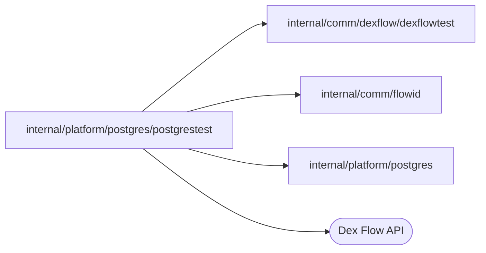

# PostgreSQL integration test connections

<!-- BEGIN GENERATED PACKAGE SUMMARY (scripts/check-package-readmes.py; edit only Purpose) -->
Purpose: Connects integration tests to the PostgreSQL of the local lane that SUPERVERSE_TEST_LANE names, never substituting the database.

Callers: no production package imports this package.

Dependencies: it imports `internal/comm/dexflow/dexflowtest`, `internal/comm/flowid` and `internal/platform/postgres` and calls the Dex Flow API.

<!-- END GENERATED PACKAGE SUMMARY -->

`OpenForTest` connects to the lane's migrated database as the server role;
`ScratchDatabaseForTest` creates an empty database owned by the owner role and
drops it when the test ends, for tests that migrate. The address and the role
passwords come from the lane (`dexflowtest.LanePostgres`): Local Kind's
forward on 127.0.0.1:28432 and its `postgres-credentials.json`, or the
effective Native instance's run layer and its own credentials file. A lane
without PostgreSQL fails the test.

`MigratedScratchDatabaseForTest` is a scratch database with every embedded
migration applied; the migrations grant to the lane's roles, which the lane
scripts create. For the read model, `SyncedColumnsForTest` reads the synced
Attributes and AttributeMaps of a Flow's PersistenceSchema (the SDK keeps the
sync option private, so by reflection), `FieldColumnsForTest` the fields of a
map instance value, both under the Attribute Store's snake_case naming, and
`RequireReadModelTableForTest` fails a test unless a migrated table has exactly
the row key's primary key and a column of the type Dex writes for each synced
value, because Dex silently skips a value without one.

`AwaitRowForTest` polls one row of a read model table until it equals the
columns that a test derives from the Flow's state (a time to the microsecond, a
number as a JSON number, any other value by its JSON encoding, which is how Dex
writes a struct to a `jsonb` column), because Dex writes a row some time after
the Flow changes; `AwaitSameIDsForTest` waits until the IDs that the Flows
list equal the IDs of the rows and otherwise names the Flows without a row and
the rows without a Flow; `StringsForTest` lists the first column of a query.

`LockTableForTest` holds a SHARE lock on a read model table, as the owner role,
until the test releases it or ends: Dex's writes, which need ROW EXCLUSIVE,
wait, while the server's reads go on. Platform Dex retries a sync batch whose
attempt waits too long (Server v1.6.1 falls back from a seven-second local
attempt to 30-second attempts within the store's 168-hour budget), so a lock of
seconds delays rows deterministically and loses none; a test uses it to hold a
row back while it checks what a read does before the row exists.
