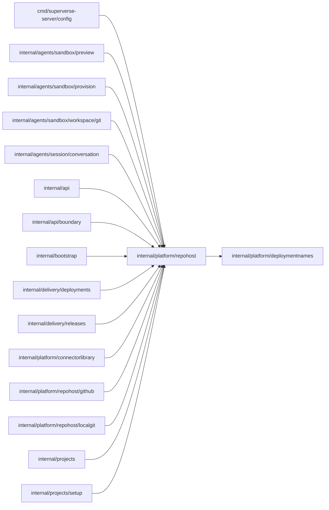

# Repository host

<!-- BEGIN GENERATED PACKAGE SUMMARY (scripts/check-package-readmes.py; edit only Purpose) -->
Purpose: Defines the Git host interface, its repository, commit and credential values and its typed errors, so every caller works with GitHub and the local Git host alike.

Callers: `cmd/superverse-server/config`, `internal/agents/sandbox/preview`, `internal/agents/sandbox/provision`, `internal/agents/sandbox/workspace/git`, `internal/agents/session/conversation`, `internal/api`, `internal/api/boundary`, `internal/bootstrap`, `internal/delivery/deployments`, `internal/delivery/releases`, `internal/platform/connectorlibrary`, `internal/platform/repohost/github`, `internal/platform/repohost/localgit`, `internal/projects` and `internal/projects/setup` import this package.

Dependencies: it imports `internal/platform/deploymentnames`.

<!-- END GENERATED PACKAGE SUMMARY -->

Every Git repository operation of the platform goes through `Host`: the managed
repository of a Project (create, find, archive, read, template initialization), file
and commit reads, release commit validation, a commit's version (`DescribeCommit`: the
number of its ancestors minus one, the root commit V0, with its subject cut at 72 code
points; the local Git host walks the history and GitHub answers one GraphQL query) and the repository-scoped credential
that a Sandbox or the builder clones and pushes with. ProjectSetupFlow, ProjectFlow,
ProjectReleaseFlow, the Preview configuration, the release API and the Git
credentials depend on this interface only.

The package holds the interface, the values and the errors; each implementation is a
sub-package that `internal/bootstrap` selects with the `repohost` setting of the
[server configuration](../../../cmd/superverse-server/config/README.md). `Provider`
declares the two settings, `ProviderGitHub` and `ProviderLocalGit`, as the only values of
a type that string literals cannot convert to, and `ParseProvider` turns the name an
operator wrote into one:

| Implementation | Package | Used by |
| --- | --- | --- |
| GitHub | `internal/platform/repohost/github` | hosted environments and `local-kind-acceptance.yaml` |
| Local Git host | `internal/platform/repohost/localgit` | `local-kind.yaml` and `native.yaml` |

Implementations never import each other and no caller imports an implementation;
`scripts/check-package-layers.py` enforces both.

## Errors

A host wraps its own detail around these, so failure classification does not depend on
the host. Callers match them with `errors.Is`.

| Error | Meaning |
| --- | --- |
| `ErrNotFound` | The repository, commit or file does not exist or cannot be read |
| `ErrCommitUnreachable` | A release commit is not on the Project branch |
| `ErrOutcomeUnknown` | A lost or unreadable response; the effect is unknown and the caller reads before it repeats a write |
| `ErrPermissionDenied` | The host refused the platform's credentials |
| `ErrRejected` | The host refused the request for another reason of its own |
| `ErrOtherHost` | A repository binding was recorded under another repository host than the server's |

A host answers a repository it does not hold as `ErrNotFound`, and archival and cleanup
take that absence for success. A repository bound under another host, such as a Project
created with `local-kind-acceptance.yaml` (GitHub) and deleted after the server returned
to `local-kind.yaml`, must not end that way: before a caller uses a binding's repository
it calls `CheckInstallation` with the binding's installation, which returns
`ErrOtherHost` unless the installation is the host's own, with a message that names the
other `Provider` to run the server with. Project deletion, Setup cleanup and the
Sandbox's repository credentials refuse such a repository instead of reading it as
absent; a repository of the active host keeps NotFound as success.

## Managed repositories

`ManagedName` and `ManagedMarker` give every host the same repository name
(`<prefix>-<name slug>-<projectID>`, such as `localkind-myapp-a7k2`) and the same
ownership marker in the repository description. The prefix is a
`deploymentnames.RepositoryPrefix` that `internal/bootstrap` chooses from the server
configuration and gives the host; the slug is the Project's name cut to `nameSlugLength`
characters.
A host archives a repository only when the setup's marker owns it.

Only the Setup of a Project derives the name: `ManagedRepository` and
`FindManagedRepository` take a `SetupIdentity` of the Project ID, the Project's immutable
name and the setup ID. Every later operation of a Project, archival included, uses the
full name that its repository binding recorded, never a recomputed name, so repositories
created under an earlier naming (`sv2-test-<projectID>`, `superverse-staging-<projectID>`)
stay in use.

| File | Responsibility |
| --- | --- |
| `host.go` | The `Host` interface, the repository, commit and credential values, the errors and `CheckInstallation` |
| `managed.go` | The name and ownership marker of a Project's managed repository |
| `provider.go` | `Provider`, the closed set of implementations the configuration selects, and `ParseProvider` |
