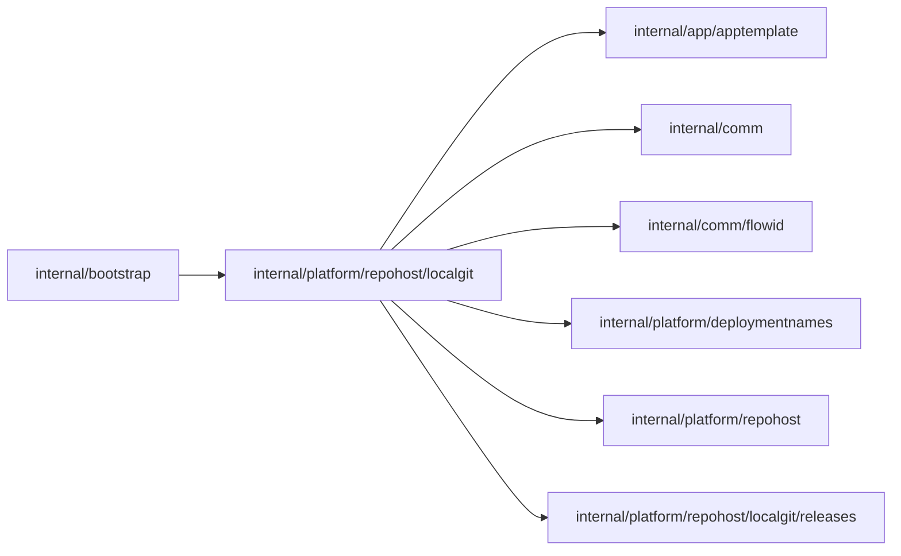

# Local Git host

<!-- BEGIN GENERATED PACKAGE SUMMARY (scripts/check-package-readmes.py; edit only Purpose) -->
Purpose: Hosts bare Git repositories inside the server for the local lanes, served over smart HTTP with repository-scoped credentials and a read-only JSON interface for the end-to-end tests.

Callers: `internal/bootstrap` imports this package.

Dependencies: it imports `internal/app/apptemplate`, `internal/comm`, `internal/comm/flowid`, `internal/platform/deploymentnames`, `internal/platform/repohost` and `internal/platform/repohost/localgit/releases`.


<!-- END GENERATED PACKAGE SUMMARY -->

The local lanes (Local Kind and Local Native) use this host instead of GitHub, so their
Project setup, Sandbox checkout and push, Release builds and deletion no longer depend
on an external service (the current contract).
It runs inside the server process, like the mock model, and is pure Go on
[go-git](https://github.com/go-git/go-git), because the server image has no `git`. The
real `git` command is its client: the Sandbox, the host builder and the end-to-end
tests.

`Host` implements `repohost.Host`; as an `http.Handler` it serves the Git protocol and
the JSON interface on the address of `localgit.listen`, which `internal/bootstrap`
opens.

## Repositories

Bare repositories live in `localgit.dir`, the main checkout's
`.local/superverse-v2/git`, which Local Kind mounts into the node and Local Native uses
directly. The lanes never run at the same time.

```text
<dir>/repository-sequence                                  the last repository ID handed out
<dir>/superverse-local/<name>.git/                         one bare repository
<dir>/superverse-local/<name>.git/superverse-repository.json   its record: ID, description, archived
<dir>/.receiving-*                                         the pack of a push being received
```

A start removes the `.creating-*` directories and `.receiving-*` files a crash left.

- Every repository belongs to `superverse-local` and is named like its GitHub twin,
  `<prefix>-<name slug>-<projectID>` with the prefix `localkind` or `localnative`
  that the server configuration selects (`localkind-myapp-a7k2`); the description
  keeps the ownership marker of its setup. A repository created under the former
  name `sv2-test-<projectID>` keeps it: the host reads and archives it by the name its
  binding recorded.
- A repository ID is a monotonic `int64` that is never reused: the sequence file is
  rebuilt from the repositories when it is missing. The installation ID is 1.
- A repository is published with one rename of a finished directory, so a crash leaves
  no half-created repository. Nothing is deleted: archival marks the record, refuses
  pushes and keeps every read.
- `InitializeTemplate` writes the embedded template as a commit with no parent and a
  fixed author and time, so the commit SHA depends on the template alone.

## The connectors library's copy

`superverse-local/dex-connectors-library` is the local lanes' copy of the public connectors library
([connectorlibrary](../../connectorlibrary/README.md)), created on first use with the marker
`superverse:connectors-library-copy` and not private. `ConnectorLibraryMirror` refreshes its `main`
from GitHub with a fast-forward-only fetch before every new contribution branch, under the copy's lock;
connector_develop subagents push their branches to it as to any repository of the host, and
`PushConnectorBranch` publishes one branch from it to the upstream library on GitHub without force, with
a token of that one operation. In the Sandbox the module's Git fetches are redirected to the copy
(`sandboxd.ModuleRedirect`: `url.<copy>.insteadOf` with the module in `GONOSUMDB`), so `go get` of a
branch that only the copy holds resolves; released versions still come from the module proxy.

## Release assets

The host also keeps release assets, in its `.releases` directory beside the repositories
([releases](releases/README.md)). Only the copy of the connectors library has releases: the
release candidates of the local lanes' contributions. When a connector_develop subagent's
finish pushed a branch, the Sandbox builds the candidate's assets with the library's own
`connectorctl` at `main` and pushes its tag, `connectors/<slug>/vX.Y.Z-rc.N`, to the copy;
the server then stores the assets with `PublishConnectorLibraryRelease`.
`GET /superverse-local/dex-connectors-library/releases/download/<tag>/<asset>` serves them
without a credential, at `ConnectorLibraryReleaseDownloadURL`, the server's loopback
address (`ServerBaseURL`), where the configuration host reads a candidate. The copy's tags
make the candidate's module resolve for `go get` in the Sandbox and in the local builder,
which both redirect the module's Git fetches to the copy.

## Credentials

A credential is `x-access-token:<token>` over HTTP Basic, the form GitHub installation
tokens use, so the Sandbox and the builder need no second code path. A token is
`sv2lg1.<claims>.<signature>`: unpadded base64url JSON claims and the HMAC-SHA256 of
`sv2lg1.<claims>` under the `git-signing-key` secret.

| Scope | Claims | Reaches |
| --- | --- | --- |
| repository | `repositoryId`, `expiresAt` | one repository: fetch and push; one hour |
| administrator | `expiresAt` | the JSON interface of every repository |

The one repository that is not private, the copy of the connectors library below, serves its reads
(the ref discovery of a fetch and the fetch) without a credential; every push to it needs one.

A missing, malformed, tampered or expired token is answered 401; a valid token of
another repository, or an administrator token on a Git path, 403.

## Smart HTTP

`GET /<owner>/<name>.git/info/refs?service=git-upload-pack|git-receive-pack`,
`POST /<owner>/<name>.git/git-upload-pack` and `POST .../git-receive-pack`, the
stateless protocol version 0. A client that asks for version 2 is answered with version
0, which every Git falls back to. A fetch advertises `multi_ack_detailed`, and the
host also lets a client fetch any commit it has by its SHA. The packs it sends carry no
deltas, so they never refer to an object outside themselves.

A push is applied under a lock per repository, which archival and template
initialization also take. The push first reads its pack from the client into a
`.receiving-*` file of the host's directory, so a slow client never holds the lock, and
archival and template initialization stop waiting for the lock when their context ends,
so a cleanup round is never stuck behind a push. The host only grows a repository:

- a branch moves forward from the commit the client saw (compare-and-swap on the
  reference, then a fast-forward check), so a forced non-fast-forward push is refused;
  the host writes a reference itself, as a file staged in the repository's directory,
  synced and renamed over the old one, so a crash leaves the old reference or the new
  one, and it reads an empty or unreadable reference file as corruption, an error,
  never as a missing reference that a push could create past the checks;
- a tag is created once and never moved, and nothing is deleted;
- only branches and tags can be pushed, under a name Git allows: `refs/heads/a..b`, a
  `.lock` suffix or a branch that starts with a dash is refused;
- an archived repository refuses everything;
- a thin pack is completed from the objects the repository already has;
- the history a branch or tag update adds must be complete before the reference changes:
  the host walks from the new tip through commits (tree and parents), trees, blobs and
  tag targets down to the commits the existing references reach, which passed the same
  check, decodes commits, trees and tags with the type their referrer names and refuses
  an update that reaches a missing object with Git's own reason, `missing necessary
  objects`. Since nothing is deleted or moved back, a missing object would otherwise
  break the repository for good.

The push report carries only fixed reasons, the `pushStatus` constants: a pack the host
cannot read or store is reported as such, and the server log keeps the cause, which can
name the server's paths.

### Limits

go-git's pack parser holds every object it stores, and the base and target of every
delta, in memory, and it calls its observers only after it has loaded an object. So
`checkPackLimits` reads the header of every object of the received pack, and the sizes
at the start of every delta's data, and refuses the pack before the parser reads it and
before the repository's lock is taken:

| What | Limit | Refusal |
| --- | --- | --- |
| The body of a push | 512 MiB | HTTP 413 |
| Its reference updates | 1 MiB | HTTP 413 |
| Its objects | 100,000 | `the push holds more than 100000 objects` |
| One object inflated, or the target of a delta | 100 MiB, GitHub's limit of a file | `an object is larger than 100 MiB` |
| Its objects inflated together | 1 GiB | `the objects of the push are larger than 1 GiB together` |

A push of 256 MiB of zeros, a few hundred kilobytes on the wire, is thus refused without
allocating the object. The host stores and checks the objects of one push at a time, so
the memory of concurrent pushes does not add up. Repositories are opened with a
large-object threshold of 1 MiB, so a larger object is streamed from disk instead of
being loaded, and `ReadFile` refuses a file over its 8 MiB limit from the object's size
before it reads the content.

### What go-git does not provide

go-git offers the pieces of the protocol, not an HTTP server. Its pack writer cannot
complete a thin pack (a push of an edited file fails with "reference delta not found"),
its fetch session rejects shallow requests and advertises neither `multi_ack_detailed`
nor fetch by SHA, and its push session moves a reference without comparing its old
value or checking for a fast-forward. This package serves the protocol itself and uses
go-git for the pack, reference and object storage. Verified with the real git command:

- `git clone --depth=1` and `git fetch --depth=1` fail with "Server does not support
  shallow clients", because the host does not advertise `shallow`. The host builder
  therefore fetches the exact commit without a depth.
- `git fetch origin <sha>` of a commit that is not a branch tip works.
- A partial clone filter is ignored by the host, with a warning from git.

## JSON interface

Read-only checks for the end-to-end tests, with `Authorization: Bearer <administrator
token>`:

| Request | Answer |
| --- | --- |
| `GET /_api/v1/repositories/<owner>/<name>` | `id`, `fullName`, `cloneUrl`, `defaultBranch`, `description`, `private`, `archived` |
| `GET /_api/v1/repositories/<owner>/<name>/branch?name=<branch>` | `name`, `sha` |
| `GET /_api/v1/repositories/<owner>/<name>/file?ref=<sha or branch>&path=<path>` | `path`, `ref`, base64 `content` |

A repository, branch, commit or file that does not exist is answered 404, and a branch
name that Git does not allow 400.

| File | Responsibility |
| --- | --- |
| `host.go` | The `Host`, its configuration, and the managed repository lifecycle |
| `repository_store.go` | The directory layout, the repository record, the ID sequence, the locks and the reference files |
| `repository_read.go` | File, commit and branch reads |
| `template.go` | The deterministic template commit |
| `token.go` | The signed credentials |
| `http_handler.go` | Routing and authentication of Git requests |
| `upload_pack.go` | Ref advertisement and the fetch protocol |
| `receive_pack.go` | The push protocol and its reference rules |
| `pushed_objects.go` | The limits of a pushed pack, its parsing and the connectivity of the history it adds |
| `read_api.go` | The administrator's JSON interface |
| `localgit_integration_test.go` | The real `git` command against a running host |
| `push_refusal_integration_test.go` | Pushes the host refuses, with the real `git` command or as a client that sends what `git` would not, and the repository they leave |
