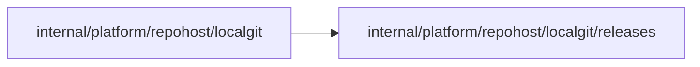

# Local Git host release assets

<!-- BEGIN GENERATED PACKAGE SUMMARY (scripts/check-package-readmes.py; edit only Purpose) -->
Purpose: Keeps the release assets of the local Git host's repositories as immutable files and serves them read-only at GitHub's download path.

Callers: `internal/platform/repohost/localgit` imports this package.

Dependencies: it imports no other package of this module and calls no remote API.

<!-- END GENERATED PACKAGE SUMMARY -->

The local lanes publish the release candidates of their connector contributions on the
local Git host's copy of the connectors library, not on GitHub
([localgit](../README.md#release-assets)). `Store` keeps each release's assets in
`<dir>/<owner>/<name>/<tag>/<asset>`, where `<dir>` is the host's `.releases` directory,
and serves `GET /<owner>/<name>/releases/download/<tag>/<asset>` as GitHub serves the
assets of a public release, so the configuration host reads a candidate with the same
resolver as an official release.

- **Names:** a repository is `owner/name`, a tag names a directory and a version
  (`connectors/newsapi/v0.1.0-rc.1`), and an asset is a plain file name. The patterns
  admit no path element that leaves the store.
- **Immutable assets:** `Publish` writes each asset through a temporary file and a hard
  link, so a reader never sees a partial asset and two writers never both create it. An
  asset that already exists with the same contents is kept, so a repeated publication
  succeeds; other contents are `errAssetConflict`. Nothing is deleted.
- **Bounded:** one asset is at most 16 MiB (`maximumAssetBytes`).
- **Public:** the assets are public data, as those of a public GitHub release are, so a
  download needs no credential.

| File | Responsibility |
| --- | --- |
| `release_store.go` | The `Store`: publication, presence and the download handler |
