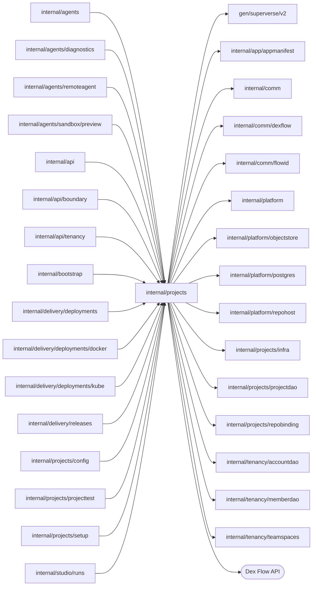

# Projects

<!-- BEGIN GENERATED PACKAGE SUMMARY (scripts/check-package-readmes.py; edit only Purpose) -->
Purpose: Owns Projects for the API, Sessions, Releases and Deployments: ProjectFlow keeps each Project's identity, repository, Live lease, commands and child membership, and starts its one Session.

Callers: `internal/agents`, `internal/agents/diagnostics`, `internal/agents/remoteagent`, `internal/agents/sandbox/preview`, `internal/api`, `internal/api/boundary`, `internal/api/tenancy`, `internal/bootstrap`, `internal/delivery/deployments`, `internal/delivery/deployments/docker`, `internal/delivery/deployments/kube`, `internal/delivery/releases`, `internal/projects/config`, `internal/projects/projecttest`, `internal/projects/setup` and `internal/studio/runs` import this package.

Dependencies: it imports `gen/superverse/v2`, `internal/app/appmanifest`, `internal/comm`, `internal/comm/dexflow`, `internal/comm/flowid`, `internal/platform`, `internal/platform/objectstore`, `internal/platform/postgres`, `internal/platform/repohost`, `internal/projects/infra`, `internal/projects/projectdao`, `internal/projects/repobinding`, `internal/tenancy/accountdao`, `internal/tenancy/memberdao` and `internal/tenancy/teamspaces` and calls the Dex Flow API.

<!-- END GENERATED PACKAGE SUMMARY -->

`internal/projects` owns `ProjectFlow` (`project-<projectID>`), the permanent
owner of one Project: its identity, repository binding, the Live pointer and
lease, the start of its one Session, the Live removal and deletion commands, and
the membership of every child it must clean up. Its sub-packages own the other Project Flows:
[`setup`](setup/README.md) one setup attempt
(`ProjectSetupFlow`) and [`repobinding`](repobinding/README.md) the exclusive
claim of a managed repository (`RepositoryBindingFlow`). ProjectFlow starts and
cleans up its Setup through the `SetupLifecycle` port, which
`setup.ProjectSetupFlowClient` implements, so this package never imports
`setup`. The complete primitive inventory is in the
[architecture](../../docs/architecture/superverse-v2.md#projectflow); this
README states the behavior the package implements.

| File | Responsibility |
| --- | --- |
| `project_flow.go` | ProjectFlow primitives, RPCs and Steps |
| `project_flow_state.go` | Project snapshot, the `Status*` ProjectStatus values and other persisted values |
| `project_flow_members.go` | The `Role` set (OWNER, BUILDER, OPERATOR), the `Members` value and the member write rules |
| `project_commands.go` | Command admission and the command phase runner |
| `project_flow_effects.go` | Child lifecycle ports (`SetupLifecycle`, `SessionLifecycle`) and the Live removal and deletion effects |
| `project_flow_failure.go` | Typed causes and the safe Failure they record |
| `project_flow_client.go` | Reads, access, creation, child admission, commands, deployment lease, the members (their writes, and their list from the read model), and the deletion its TeamSpace asks for (`teamspaces.ProjectCleanup`) |
| `project_flow_client_session.go` | Session child admission and the Session membership read |
| `app_manifest_publication.go` | Publishing a commit's app manifest as source objects |

## Dex Flow Changes

**Creation.** `ProjectFlowClient.Create` starts only ProjectFlow, with
`IDReuseDisallow`, the request fingerprint as RequestID and same-request
`IgnoreError`; the API returns the server-derived Project ID without reading a
snapshot. Every Project belongs to one TeamSpace: `TeamSpaceID` is an immutable,
synced Attribute.

**TeamSpace admission.** The start Step `RegisterProjectInTeamSpace` registers
the CREATING Project in its TeamSpace through
`TeamSpaceFlowClient.RegisterProject`, as its creator, before any effect: the
TeamSpace confirms, strongly and under its own lock, that it is READY and that
the creator is a member, or the platform admin, whose finding the API passes as
the start's input. A refusal, including a TeamSpace that never existed or is
deleted, goes to `RecordTeamSpaceAdmissionRejection`, which records
`TEAM_SPACE_ADMISSION_REJECTED` with the refusal's message, sets DELETED and
completes the Flow: nothing was created. Exhausted retries end the same way
with `TEAM_SPACE_REGISTRATION_FAILED`, because nothing exists yet either; if
the registration did reach the TeamSpace, its stale registry entry is harmless,
since the TeamSpace's deletion counts a DELETED Project as done. A deletion
admitted while the Project registered completes with it, and
`AwaitProjectCommands` drains its Channel message before the Flow completes.
`CompleteDeletion` unregisters the Project from its TeamSpace before it sets
DELETED; a TeamSpace that is gone counts as unregistered. A TeamSpace's deletion
asks each registered Project to delete itself through `DeleteForTeamSpace`,
under the TeamSpace's command ID, and requeues a FAILED deletion at its current
revision.

**Members.** The AttributeMap `Members`, keyed by AccountID, holds each
member's `{Role, AddedAt, AddedByAccountID}` and syncs as the child table
`project_members`. The creator starts as the one OWNER. `AddProjectMember`,
`SetProjectMemberRole` and `RemoveProjectMember` lock `Revision`, load the
whole map (at most 200 members) and admit a change only from an owner or the
platform admin while the Project is not deleting; they keep at least one owner,
change nothing for a repeat or an absent member, and return the members. The
members stay when the Project is deleted, so its members can read its final
DELETED snapshot; queries exclude DELETED Projects. A role counts only while
its account is a member of the Project's TeamSpace, which the API and the
authorization check in SQL; ProjectFlow cannot read another Flow's members.

**Setup start.** `StartProjectSetup` starts the accepted `SetupFlowID`
through `SetupLifecycle.StartForProject` with the Project's own StartIdentity
(20-second call, three attempts within two minutes, SYNC durability, no Project
lock). A replay joins the same Setup. Exhausted retries
enter `RecordProjectSetupStartFailure`: SETUP_FAILED with a safe LastFailure,
after which deletion is the recovery. A Setup that still commits clears only
that start failure.

**Session start.** A Project has exactly one Session, `session-<projectID>`
([the current contract](../../docs/architecture/agent-harness-design/session.md)).
`CommitProjectSetup` makes the Project READY and moves to the Step
`StartProjectSession`, its only creation trigger: while the Project is still
READY it calls `SessionLifecycle.StartForProject`, which the Session Service
implements with `SessionAgentFlowClient.StartAccepted` (`IDReuseDisallow`, the
Start RequestID `flowid.Fingerprint(struct{ProjectID string})`, same-request
`IgnoreError`), so a retried attempt, a replay and a repeated Setup commit,
which finds the Project READY and starts nothing, join the one execution. The
Step runs with SYNC durability, 30-second attempts and at most three attempts
within two minutes, without a Project lock. Exhausted retries enter
`RecordProjectSessionStartFailure`, which, under the Revision lock and with the
Session's membership loaded, records `SESSION_START_FAILED` on a READY Project
whose Session never registered; the Project stays READY. It records it in the
Attribute `SessionStartFailure`, not in `LastFailure`, which a command owns: a
command's failure, its retry and its success never touch the start failure, and
the start failure never hides a command's. The Session's registration
(`RegisterSessionChild`) clears it, so a start that was
accepted although every response was lost recovers by itself; otherwise an
operator starts the Session again
(runbook).
A Project that is no longer READY starts no Session.

**Children.** `ProjectFlowClient.AdmitChild` registers a Setup, Session,
Release or Deployment in the `ChildFlows` AttributeMap
(`ChildFlowReference{FlowID, FlowType}`, keyed by the child FlowID) before the
child's first effect. `RegisterChildFlow` is the authority on which FlowIDs
belong to the Project and rejects every registration once the Project is
DELETING; `AdmitChild` reports that, and a deleted or absent Project, as
`ErrChildAdmissionClosed`. The Session, keyed `session-<projectID>`, is the
only Session-scoped child; its Sandbox instances, Preview and subagents are never
members.

**Commands.** One command at a time, identified by its ID: REMOVE_LIVE or
DELETE_PROJECT. Admission checks the Project revision, sets DELETING for
deletion and publishes to `ProjectCommands`; a repeated ID answers with the
current state, and a FAILED command restarts under its own ID with the current
revision. `ProjectFlowClient.RemoveLive` admits REMOVE_LIVE only for the Live
pointer the caller observed, its deployment ID and Live revision; a changed
pointer is ABORTED and a Project without Live is returned unchanged.
`AwaitProjectCommands` runs the kind's phase Steps in order, both
kinds starting with `RemoveLiveServing`, `RevokeDeploymentGrant` and
`CommitLiveAbsent`, which clears the Live pointer, and `CommitProjectPhase`
advances the command under the Revision lock. A classified error enters
`RecordProjectFailure` with its Failure; exhausted retries and a passed wait
limit enter it with the final error from `RecoveryError()`. Every Failure message ends with the error
text, truncated to 2 KiB.

The phases that wait for cleanup to converge, `RemoveLiveServing`,
`RevokeDeploymentGrant`, `StopAndCleanChildren` and
`DestroyLiveDataAndInfrastructure`, are each one long-running Execute that
holds no lock and writes no Attribute: `awaitPhase` polls the effect through
`dexflow.PollUntil` every two seconds, each round within 40 seconds because it
makes several cloud, Kubernetes and child Flow calls, until it stops reporting
`ErrCleanupPending`. Under `dexflow.PollingStepOptions(30m)` the engine owns
the wait limit: ExecuteMethodTimeout and ExecuteRetry.TotalDuration are 30
minutes across every attempt, and the heartbeat timeout detects a lost Worker.
A phase still pending at the limit fails into `RecordProjectFailure`, which
records `CLEANUP_TIMEOUT` for these four phases when `dexflow.RecoveryTimedOut`
reports a passed limit, with the timeout as its cause, and `PROVIDER_FAILURE`
for exhausted retries. `PollUntil` treats a round cut off by its round timeout
as pending, which is safe because every effect queries its exact identities
before it mutates. For the same reason `awaitPhase` treats a call that went
unanswered while the round goes on as pending (`unansweredCall`): a call cut
off by its own bounded wait (a Kubernetes call after 30 seconds, a hosted cloud
call after 20, a deployment snapshot read after 15), a canceled call or a Dex
Server that answers `Unavailable`. Such a call is never `OUTCOME_UNKNOWN`, which
remains for an outcome that cannot be confirmed, such as a Sandbox cleanup that
recorded one. `ReleaseConnectionUsages`, which deletes the Project's
TeamSpace connection usages and scope tokens through the `ConnectionUsages`
port, and `ReleaseRepositoryBinding` do not poll: their unanswered,
idempotent releases go to the Step's retry policy. A phase writes one
`ProjectProgress` entry when it starts.
`StopAndCleanChildren` loads the membership once (a deleting Project admits no
child), cleans at most eight children per round, rotating the pending ones to
the back, holds Releases back while a Deployment remains and acknowledges each
child whose owner confirmed cleanup. A child stays pending, while the round
goes on with the others, when a call that reads, cleans up or acknowledges it
meets a lock conflict or goes unanswered, such as the Session's completion
call past the two-second Project cleanup lock wait. These calls are
idempotent and confirmed by the child's state, its cleanup receipt or the
membership, which the next round reads before it calls again; a child still
pending at the wait limit ends the command as `CLEANUP_TIMEOUT`.

`ArchiveManagedRepository` also uses `cleanupStepOptions` and `awaitPhase`:
one SYNC Execute, no Attribute locks or Map loads, a 30-minute engine-owned
budget across attempts, a one-minute heartbeat timeout and 40-second rounds.
`awaitRepositoryArchive` treats `repohost.ErrOutcomeUnknown` (GitHub: HTTP 5xx,
a transport or unreadable response) as pending. After each uncertain response,
the next round backs off two, four, then at most eight seconds inside its round
timeout, in addition to the two-second polling interval. Each attempt reads the
exact repository and checks its setup ownership marker before any archive PATCH;
an archived or absent repository is success. GitHub's HTTP 409, or an archive 404
racing repository deletion, is also `ErrOutcomeUnknown` and requires another read.
Other typed refusals end the phase immediately: `ErrPermissionDenied` records
`PERMISSION_DENIED`, `ErrRejected` and `ErrNotFound` record `PROVIDER_FAILURE` with
the retained cause of the repository host. A binding recorded under another
repository host than the server's (`repohost.CheckInstallation`, `ErrOtherHost`)
is refused before the archive, because this server's host would read the
repository as absent and archival would succeed without archiving it: the phase
records `REPOSITORY_HOST_MISMATCH` with a message that names the host to run the
server with. StopAndCleanChildren records the same when a registered Setup's
repository belongs to another host. Unclassified errors
keep the polling preset's five-attempt retry policy (five-second initial retry
interval, coefficient two, maximum one minute); a passed budget records
`CLEANUP_TIMEOUT`. Cancellation ends the round and backoff cooperatively.

The archive change preserves the [ProjectFlow primitive and lifecycle
inventory](../../docs/architecture/superverse-v2.md#projectflow), unchanged from
source revision `765dfa4c` except for archival polling described here: type
`ProjectFlow`, FlowID `project-<projectID>` (for example `project-a7k2`), API-derived
business IDs, creation trigger, Start RequestID and reuse policy, ProjectCommands
admission/duplicate/revision rules, all Attribute and ChildFlows keys/types,
indexes, retention and exact loads, and the shared ProjectProgress budget and
snapshot-first recovery. ChannelMaps: None. No RPC, Stream, Channel or durable
primitive is added. Retries/restarts reset only disposable backoff and query the
same repository; they create no FlowID or Run. An explicit deletion retry at the
failed revision keeps the admitted command identity. CommitProjectPhase remains
the short Revision-locked commit boundary; CompleteDeletion still owns DELETED
and engine completion after cleanup. Archived repository data remains retained until
an explicit operator deletion. Existing open executions keep their Flow/Step
identities and payloads; a newly dispatched archival attempt uses these options,
without resetting pending messages or requiring migration of durable state.

Every cleanup effect is retry safe: deletions treat an absent resource as done
and query by deterministic name, UID and ownership labels before mutating,
`ReleaseRepositoryBinding` accepts an already released generation and
`ArchiveManaged` accepts an already archived or deleted repository. `CompleteDeletion` writes
DELETED only after proving ChildFlows empty under the Revision lock, which every
membership change holds.

**Leases.** `AcquireDeployment` leases Live to one deployment against the Live
revision it replaces; `ReleaseDeployment` ends exactly that lease, and a lease
already held by a later deployment needs no release. The Project's one
Preview holds no lease: its route belongs to the Project until the deletion
releases it.

**Storage and Live execution.** The Project owns two sets of external
identities, each extend-only: a recorded UID or name is added, never replaced,
except that a Temporal credential whose `Generation` is the next one in the
same boundary replaces the recorded one, as a rotated hosted API key does.
`ProjectStorage` (`infra.StorageRefs`: the namespace, the bucket, its key
prefix and the Local Kind MinIO Service) is written by the Project's own Setup
through `RecordProjectStorage`, also while the Project is deleting, and
`CommitProjectSetup` makes the Project READY only on complete storage.
`LiveExecution` (`infra.ExecutionRefs`: the Temporal namespace, its credential
and the Live Dex Service) is written through `RecordLiveExecution` only by the
deployment that holds the active lease, while the Project is READY or
DELETING: the first Live deployment prepares the environment and later
deployments reuse it. `CommitLiveDeployment` requires it complete. Both RPCs
answer an equal value as success, a stale expected value as ABORTED and a
replacement as FAILED_PRECONDITION. Live removal keeps `LiveExecution` and the
Live Dex; `DestroyLiveDataAndInfrastructure` destroys both sets on deletion.

### Managed repository creation

RepositoryBinding is an ordinary Attribute value: RepositoryID and
InstallationID:int64; FullName, URL and DefaultBranch:string; Generation:uint64.
The binding must carry a nonzero exclusive claim generation before Setup can
commit. Sessions use DefaultBranch directly. Project deletion releases the exact
claim and runs ArchiveManagedRepository with the provider ownership marker check.
The FlowID, start reuse/admission, primitive keys, ChildFlows exact-load and locking,
ProjectCommands identity and consumption, ProjectProgress shared buffer and
snapshot recovery, RPCs and retry/cleanup contracts above remain unchanged.

The pre-launch source removal deletes alternate repository ownership/branch fields
and renames the archival Step. All old project executions are cleaned before
rollout as specified in rollout reconciliation.
No old Step handler, payload adapter or import cleanup remains in the new release.

## Database Schema Changes

None beyond the read model's `projects` table (migrations `0002_read_model`
and `0003_teamspaces`, which adds `team_space_id`), which only Dex writes. ProjectFlow and the Flows of `setup` and `repobinding` own all
Project state. ProjectFlow selects the platform Dex Attribute Store `projects`
(`postgres.ProjectStore`, row key `project-{project_id}`) where it starts, and
ProjectSetupFlow the store `project_setups` (row key `setup-{project_id}-{*}`),
so both write different snake_case columns of one row; the synced Attributes are
listed in the architecture inventories. CreatorAccountID, the creating account,
is a fact only and has no search index: the Project's members and their roles
are its `Members` map.

Reads from outside a Flow use the row through `projectdao`, a few seconds
behind the Flows. `ProjectFlowClient.Authorize` checks one `Capability` with
one query of the row joined with the caller's account, its `project_members`
row and its `team_space_members` row of the Project's TeamSpace, and returns a
`ProjectProjection`: the decoded Project and its Setup's columns, with
`Identity` and `LastCommand`, which are not synced, left zero, and the
caller's effective role. The effective role (`access.effectiveRole`) is OWNER
for the platform admin, otherwise the Project role while the account is a
member of the TeamSpace; each role holds what the roles below it hold:

| Capability | Least role | Call sites |
| --- | --- | --- |
| `CapabilityView` | OPERATOR | GetProject, WatchProject, GetRelease, ListProjectMembers |
| `CapabilityOperateLive` | OPERATOR | Live Runs reads and Flow starts and actions (`runs.Read`, `PinnedRead`, `PinnedWrite`) |
| `CapabilityBuild` | BUILDER | Session, Agent and Preview, Preview Runs, Live Runs `Write` (stop, time travel, Channel message deletion), Release candidates, lists, builds and Watches, Deployments, configuration, Live removal |
| `CapabilityManageMembers` | OWNER | ProjectMemberService writes, which ProjectFlow checks again |
| `CapabilityDelete` | OWNER, or an ADMIN of the TeamSpace | DeleteProject |

`ReadAuthorized` also serves a DELETED Project for a Watch's terminal snapshot.
`ListProjections` pages one TeamSpace's rows newest first with the caller's
effective role in each; the API checks the TeamSpace membership first. Every authorization waits
for the row of a Project created a moment ago (`postgres.AwaitRow`): on a
missing row it reads ProjectFlow once, within 10 seconds, so a Project without
one is `postgres.ErrNotFound` at once, and a new one is read again for up to 10
seconds; reads and writes of a new Project thus behave alike. A projection never reaches a
write or a Flow input: the admission of a write calls `AuthorizeCurrent`, which
authorizes from the row and then reads ProjectFlow's current state (decision
27), as Live removal, Release preparation and builds, deployments, the Release
Steps' actor checks and configuration writes do. `Read` and the child
admissions read ProjectFlow.

## UI/UX

A new Project reads CREATING with Setup PENDING until the durable start runs; a
failed start reads SETUP_FAILED and stays deletable. Creation uses a new private
managed repository from the embedded template; READY starts the Project's one Agent
Session, and a Session start that could not be confirmed reads as a READY Project
whose `session_start_failure` is `SESSION_START_FAILED`, which the Project page and
Build show.

## Tests

- `TestDeletedProjectCleanupDexIntegration` reads a Project that the Studio
  journey deleted and checks the released repository binding and the archived
  managed repository on its repository host.
- `TestAdministratorProjectAccessDexIntegration` checks owner and administrator
  access, cross-owner and unregistered denial and the administrator's read of
  a DELETED Project on retained Projects, from their read model rows.
- `TestMissingProjectReadsDexIntegration` and
  `TestRetainedProjectReadsDexIntegration` check the typed reads of absent and retained
  Project, Setup and repository binding executions.
- `TestProjectMembersDexIntegration` changes a throwaway Project's members: an
  account without a role and a builder are refused, the only owner cannot
  demote itself, four owners racing to be removed or demoted leave exactly one
  (dropping the last-owner rule fails it), and the `project_members` rows
  follow the Flow and stay after the Project's deletion.
- `TestTeamSpaceAdmissionDexIntegration` starts Projects whose creator is not
  a member of their TeamSpace and whose TeamSpace does not exist: each ends
  DELETED with `TEAM_SPACE_ADMISSION_REJECTED` and completes before any Setup
  starts.
- `TestTeamSpaceDeletionCascadeDexIntegration` deletes the TeamSpace of a READY
  Project: the deleting TeamSpace refuses a new Project, the Project's own
  deletion unregisters it, and the TeamSpace completes DELETED.
- `TestTeamSpaceDeletionWorkerRestartIntegration` replaces the server while the
  TeamSpace of a READY Project deletes it; the Project and then the TeamSpace
  still complete DELETED. It restarts the lane's server, so it runs alone.
- `TestDeletionAfterInterruptedSessionCompletionDexIntegration` deletes a
  throwaway READY Project whose one Session is idle. It cuts off a completion
  call of the deleting Project with a lock wait shorter than the Session's
  answer, requires `StopAndCleanChildren`'s rule to keep that Session pending,
  and requires DELETED without a recorded failure and the Session's graceful
  receipt on a repeated call. The Worker's own completion call cannot be made to
  time out on demand, so the scenario makes the cut-off call itself.

The Session start and its child membership are covered in
[`internal/agents`](../agents/README.md#tests)
(`TestProjectSessionIdentityDexIntegration`,
`TestProjectDeletionBeforeReadyDexIntegration` and
`TestProjectDeletionRightAfterReadyDexIntegration`), and a start whose retries
run out by `TestProjectSessionStartFailureDexIntegration`, which occupies the
Session's FlowID with another RequestID before the Project exists and requires
`SESSION_START_FAILED` in `SessionStartFailure` with `LastFailure` empty.

`TestApplicationTemplateGitHubIntegration` in `platform/repohost/github` creates an
isolated repository through the real GitHub App, confirms `archived: true`
through a fresh client, then repeats archival through that client. It also checks
absent-repository cleanup. The real GitHub organization offers no controlled
5xx/transport-loss injection; backoff, uncertain PATCH reconciliation, permanent
4xx rejection, concurrent archive/delete, budget expiry and Worker restart during
archival remain uncovered by a repeatable real-dependency scenario. No scripted
provider substitutes are used. Full current-source Local Kind browser acceptance
remains a separate release gate.

## Documentation

The architecture owns the primitive inventory, and implementation receipts own
verification evidence.
