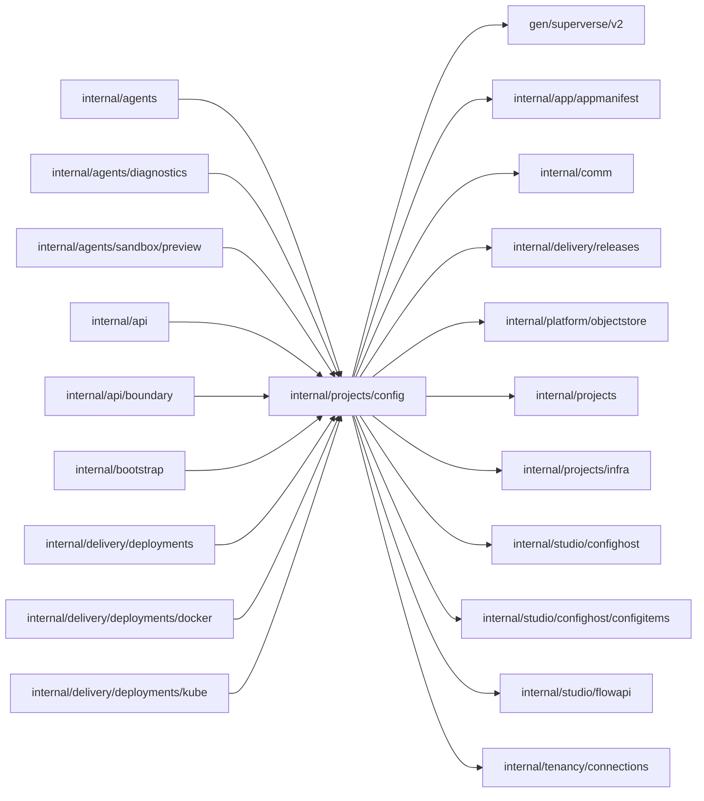

# Project configuration boundary

<!-- BEGIN GENERATED PACKAGE SUMMARY (scripts/check-package-readmes.py; edit only Purpose) -->
Purpose: Authorizes and admits the configuration of a project's scopes for the platform's Flows and Studio, serving each scope through a pooled in-process configuration host.

Callers: `internal/agents`, `internal/agents/diagnostics`, `internal/agents/sandbox/preview`, `internal/api`, `internal/api/boundary`, `internal/bootstrap`, `internal/delivery/deployments`, `internal/delivery/deployments/docker` and `internal/delivery/deployments/kube` import this package.

Dependencies: it imports `gen/superverse/v2`, `internal/app/appmanifest`, `internal/comm`, `internal/delivery/releases`, `internal/platform/objectstore`, `internal/projects`, `internal/projects/infra`, `internal/studio/confighost`, `internal/studio/confighost/configitems`, `internal/studio/flowapi` and `internal/tenancy/connections`.

<!-- END GENERATED PACKAGE SUMMARY -->

`Configuration` in `internal/projects/config`, imported as `projectconfig`,
authorizes and admits the configuration of a project's scopes for the
platform's Flows, the configuration RPCs of ProjectService and the Flow API
configuration RPCs (ConnectorService and ApplicationEnvironmentService).
`internal/studio/confighost` hosts the configuration, Connector, provider and
OAuth handlers in the existing Go server; [its README](../../studio/confighost/README.md)
describes the application environment, credentials, provider sessions and OAuth.
It opens no HTTP listener and creates no second application bootstrap.
`infra.Storage` supplies namespace-UID-checked storage and
[workload grants](../infra/README.md); this package owns no Kubernetes
lifecycle.

## Contract

### Scopes and configuration hosts

A scope is the Project's Live `{Kind: live}` or its one Preview `{Kind: preview}`.
Methods take a `infra.ScopeRef`: the project, the scope and the Project's Live
storage, which holds the configuration of both scopes; the scope selects only
the key prefix. Every request first verifies the storage
identity and current namespace UID, then uses the scope's configuration host from
a bounded pool: at most 64 hosts keyed by project, scope and namespace
UID, at most 8 concurrent requests per host, and a 20-minute idle expiry. A host
of a replaced namespace is closed; a host with requests in flight is never
evicted. Shutdown closes idle hosts at once and active hosts when released.
Hosts hold only disposable provider sessions, so durable state is entirely
outside the pool. Internal requests have 30-second deadlines and Flow API requests
two minutes; both propagate cancellation.

The host uses released `sdkgo/projectconfig` v0.26.0 configuration, credential
and ObjectStore primitives over the scope's versioned storage, with conditional
ETag writes that retain existing object versions. Storage needs scope ownership,
not Dex engine readiness or a running application. Connection configuration and
credentials name no Connector release, so a Connector upgrade keeps them valid;
the AppManifest's declared release validates their fields.

### Business API access

`Get` and `Validate` take a `ProjectConfigurationTarget` and `InvokeForAccount`
a `FlowApiContext`; both map the `ProjectScope` enum through `infra.ScopeOf`,
and the snapshot reports the `ConfigurationStatus` and `ProjectScope` enums. A
validation receipt is `{request_id, configuration_revision}`: the record itself
proves success. The API authenticates the actor; Configuration authorizes
Project access and resolves an exact prepared source. Each request states its
`Access`: `Get` and the Flow API's connection and environment reads authorize
from the Project's read model row (`ReadAccess`), while `Validate`, which may
write an initial draft or Preview's frozen version, and every other Flow API
operation are writes (`WriteAccess`), whose admission reads ProjectFlow's
current state, so that no write reaches the storage of a Project that is
already being deleted; likewise a write reads the Live Release's prepared
source from ProjectReleaseFlow and a read from the Release's read model row.
The source is a Release's prepared
source for Live, or for Preview the source the Preview prepared for the
Session's HEAD, which `PreviewReader.ReadPreviewTarget` reads from stored state
without a workspace. A configuration target names no deployment and no Sandbox
instance: the source commit and the revisions the form was read at fence it.
Browser selections never supply an upstream, HTTP method/path, storage
bucket/prefix or permission; the API maps each named operation to a fixed
route. Go passes the authorized target to the host as a typed in-process
admission. Source and AppManifest registration and freezing accept only an
internal admission, which no browser or network endpoint can present. Safe
errors omit provider bodies and secret data.

### Prepared sources, drafts and freezing

A prepared source is one commit's exact AppManifest and Flow Definitions,
registered once per scope by `RegisterPreparedSource` without starting a Worker
or replacing a serving catalog. Its AppManifest is at revision 1. A retry returns
the registered source.

A Live commit has one frozen copy, which publishing builds from Live's
next-publish layer (`DeriveLive`, below) and which no actor edits. Save and
Build calls `FreezeReleaseConfiguration`, which validates the requested copy
revision and freezes an exact version of
`projects/<projectID>/live/configuration/head` with object version, SHA-256
digest and media type. An immutable receipt binds the build and returns the same
version to a retry even after the draft changed. Release and Deployment pin that
version, never latest; `VerifyReleaseConfiguration` reads it at its exact
version and digest and revalidates it before a Deployment uses it. A newer draft
or failed build leaves the accepted Live untouched.

Preview edits the canonical `projects/<projectID>/preview/configuration/head`
in the Live bucket directly; `ValidatePreparedPreview` freezes the revision an
applying Preview start names, and a head past it is `ErrRevisionChanged` (an
`ErrConflict`), unless it is the settings refresh the same freeze recorded and
wrote before its answer was lost. `ValidateAppliedPreview` validates the exact
version a Preview applied against another prepared commit and freezes nothing;
`CheckAppliedRequirements` lists that version's gaps. A running Preview keeps its accepted key, version and
digest until an explicit new start. A stop and a reclamation retain the
Preview configuration, which the Project keeps for its lifetime; Project
cleanup removes the Preview prefix with the Live configuration, source, seed
and freeze objects, the next-publish layer and credentials.

`CheckRequirements(scope, manifest)` lists, read-only, every requirement of
the prepared source of the manifest's commit that the scope's configuration
does not meet, as `appmanifest.RequirementGap` values with names only (the
host's internal `requirements` route, described in
[its README](../../studio/confighost/README.md#requirement-gaps)). A Preview
start whose validation answers `ErrNotReady` or `ErrConflict` asks it, so its
refusal names every gap at once. A connector release that cannot be resolved
is an error, not a gap.

Reading a prepared configuration derives READY from a read-only validation of
the exact current draft, AppManifest and credentials; it neither freezes nor
writes a receipt, and it never assumes that a historical receipt validates new
edits. A configuration that is not READY names every gap of
`CheckRequirements` in `requirement_gaps`, or none when the report cannot be
made. A target always names a prepared source: a Live target without a
Release is rejected as invalid input after authorization. The Live AppManifest
head that Setup registers with `RegisterAppManifest` serves the platform only.

### Live's next publish

A Live target with `next_publish` addresses Live's next-publish layer, checked against the source
its `release_id` names (current Live's Release on the Live tab) or, with an empty `release_id`,
the source the Preview prepared for the Session's HEAD (the Preview tab's Next publish column). Its
requests are served by the Live host with `ConfigurationAdmission.NextPublish`: current Live is the
Project's READY Live pointer, its deployment and the frozen configuration of the build revision it
serves, read from ProjectReleaseFlow; Preview's applied version comes through
`PreviewReader.ReadAppliedPreviewConfiguration`, PreviewFlow's `AppliedConfiguration`, read here at
its exact version and digest through the Project's verified storage and handed over without its
secret environment references and credential broker; and the Preview's prepared source, when it is
the named one, is read through the Preview's host. A Live host reads only its own scope.

`Get` of a Live target returns the next publish as it resolves for the target's source: READY
without a gap, every gap otherwise, its items, the layer revision (`next_publish_revision`) and
Preview's applied revision (`preview_configuration_revision`); for a next-publish target the
revision is the layer's, for a Release target the revision of the version's frozen copy, with
`is_stale` when the copy was built before Live, Preview's applied version or the layer changed.
`Validate` of a next-publish target checks the resolved next publish at the layer revision it names
and writes nothing. The Flow API writes of a next-publish target edit the layer; a Release's copy
is read only to actors (`ErrInvalid`). `DeriveLive` builds a Release's frozen copy from the layer,
refused with `ErrConflict` when the layer or Preview's applied revision moved past the ones the
caller showed, and `LiveDraftState` gives build admission the copy's revision and staleness.

`PreviewItems` compares the Preview's configuration head, as an Apply would freeze it, with the
version the Preview applied (the host's `preview-items` route): each item is `UNCHANGED`,
`CHANGED`, `ADDED` or `REMOVED`, a connection also by its current TeamSpace settings, and the
count of the others is `unapplied_change_count`. Before the first Apply every item is `ADDED`.
The next publish adds `CHANNEL_SHARED` to a Slack trigger binding whose `channelId` a binding of
another READY Project's Live listens to through the same TeamSpace connection: the Projects come
from that connection's Live usages, each Project's exact pinned version is read through its
verified storage and only channel IDs are kept, and the other Project is named only to a caller who
may view it.

### Configured values for redaction

`ConfiguredValues` returns, longest first, every value of at least 8 bytes
that an application running with one frozen configuration can hold: the
ordinary settings of its connections, trigger bindings and operations, its
resolved application environment (secrets included) and the current
credentials of its READY connections, which a frozen configuration names only
logically. A value of several lines also yields each line of at least 8
bytes, so output read in pages of whole lines never shows a part of it. It
reads storage directly, through the scope's verified configuration objects,
without a configuration host.

`OutputRedaction{Project, Infrastructure, Values}` is the one redaction of
output shown outside the platform: `Text` replaces the values, longest first,
then the Project's internal resource names (`infra.Redactor`). The Agent's
platform tools ([`agents/diagnostics`](../../agents/diagnostics/README.md))
apply it to Live logs, Live run state and build log tails, and
`deployments.PublishingFlowService` to every page of a build log that
`GetReleaseBuildLog` returns; the values stay in memory for that one call and
are never returned, logged or stored.

### Errors

`ErrInvalid` rejects a malformed target, `ErrNotReady` a configuration that needs
review or authorization, `ErrConflict` a changed revision, `errNotFound` a
configuration that does not exist yet, and `ErrInvalidDefinitions` Flow
Definitions the host rejects; `infra.ErrAccessDenied` rejects a
scope or object outside the accepted resources. The host's 400, 403, 404 and 409
documents map to these errors, and so does a document with the
`FLOW_DEFINITION_INVALID` code, which the host answers with the 503 of an
unavailable definition source; any other status is an unavailable host whose
provider and storage details stay private. AppManifest registration reads the
head after an uncertain write before reporting failure.

## Files

| File | Responsibility |
| --- | --- |
| `configuration.go` | `Configuration`, its errors and metadata, Live scope, AppManifest registration |
| `configuration_studio.go` | Target resolution, `Get`, `Validate` and `InvokeForAccount` |
| `prepared_configuration.go` | Prepared sources, Preview validation, Release freezing and verification |
| `configuration_host_client.go` | The internal host routes, the bounded host pool and `Close` |
| `configuration_snapshot.go` | The API view of a target's configuration |
| `configured_values.go` | The configured values a redaction replaces |
| `live_configuration.go` | Live's next publish: its inputs, items, snapshot, a version's frozen copy and its admission state, current Live and `CHANNEL_SHARED` |
| `preview_configuration.go` | The Preview's item diff and its applied version without secrets, which Live's next publish follows |

## Dex Flow Changes

None. This package adds no Flow, AttributeMap, Channel, Stream, index or
background worker. Project owns the configuration storage references, which
both scopes' configuration uses; Release owns each prepared source, admitted
build and frozen configuration reference; Sandbox owns the Session's
AppManifest and accepted Preview configuration pins. No Flow stores credential values, a duplicate configuration
status or a mutable connection map.
[ProjectSetupFlow](../../../docs/architecture/superverse-v2.md#projectsetupflow)
registers the Live AppManifest before Setup completes.

## Database Schema Changes

None. Versioned scope-bound objects own configuration, credentials and OAuth
transactions, shared through the standard SDK protocol and its `v1alpha2`
configuration and connection schemas (the SDK also reads a `v1alpha3`
configuration document, which only shared connections or a credential broker
produce and the platform does not use). Flows retain resource lifecycle, accepted
revisions and exact immutable references. There is no projection,
configuration Flow, OAuth Flow or additional state store.

## UI/UX

Studio owns all Connector, configuration and OAuth UI source. Build Configuration
edits the prepared Preview scope; Publishing Config edits one prepared main
commit and Save and Build freezes it; Publishing Deploy selects a successful
Release. GetProjectConfiguration and ValidateProjectConfiguration return safe
resource metadata. Management pages use no iframe or shared Dex UI package; the
isolated user application Preview iframe remains.

## Tests

The Live serving Kind test in `delivery/deployments` drives this package against
real Local Kind storage: prepared-source registration and retry, freezing and
same-build recovery, Preview validation in the Live storage, the isolation of
Live and Preview configuration references and the rejection of actor requests
on internal routes. The confighost MinIO test covers
the host's storage protocol, and the Studio end-to-end journeys cover the named
RPCs through the BFF and gRPC API.

## Documentation

The architecture, the current contract, resource API and Flow primitive inventories
describe this boundary. Observed commands, identities
and incomplete checks belong in implementation receipts.
