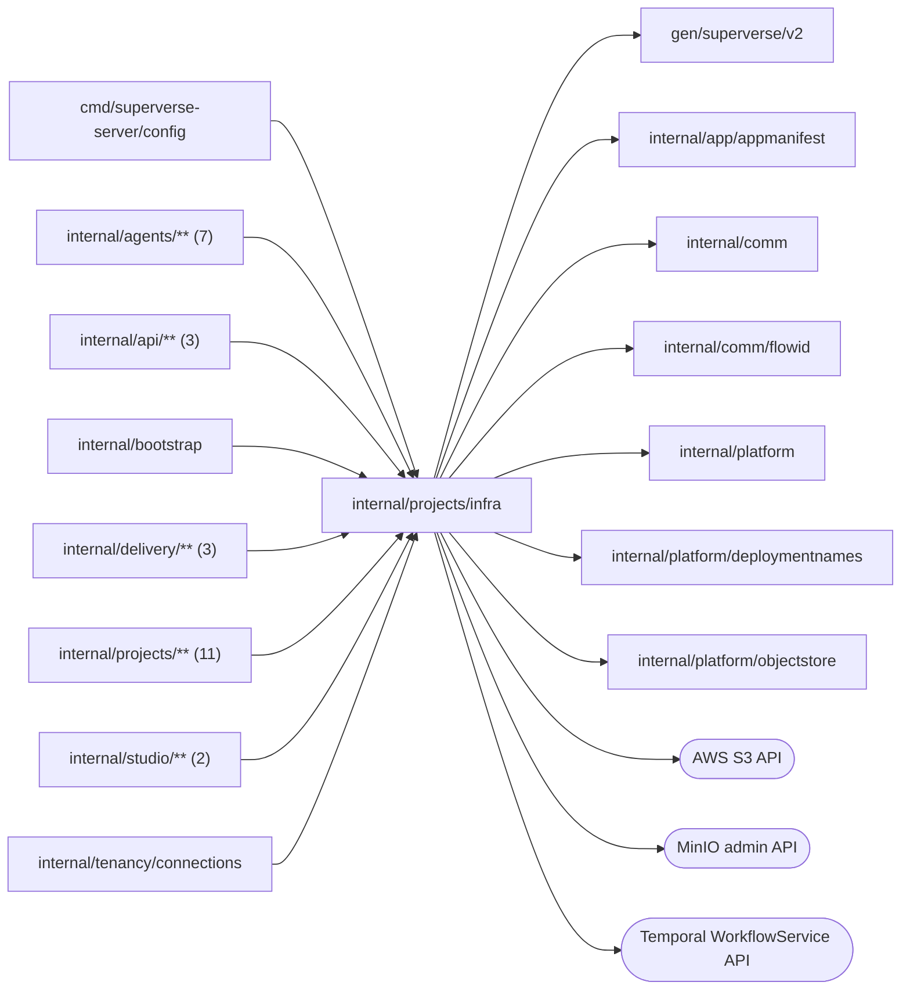

# Project infrastructure

<!-- BEGIN GENERATED PACKAGE SUMMARY (scripts/check-package-readmes.py; edit only Purpose) -->
Purpose: Declares the roles through which the platform consumes a project's storage, Temporal, Dex and workload grants, with the references, targets and errors they share.

Callers: `cmd/superverse-server/config`, `internal/agents/**` (7), `internal/api/**` (3), `internal/bootstrap`, `internal/delivery/**` (3), `internal/projects/**` (11), `internal/studio/**` (2) and `internal/tenancy/connections` import this package.

Dependencies: it imports `gen/superverse/v2`, `internal/app/appmanifest`, `internal/comm`, `internal/comm/flowid`, `internal/platform`, `internal/platform/deploymentnames` and `internal/platform/objectstore` and calls the AWS S3, MinIO admin and Temporal WorkflowService APIs.

<!-- END GENERATED PACKAGE SUMMARY -->

`infra` declares what the rest of the platform consumes of the infrastructure of
a project, and nothing about where it runs. A consumer holds the role it uses:

| Role | Methods | Consumers |
| --- | --- | --- |
| `Storage` | `EnsureStorage`, `Complete`, `VerifyProjectStorage`, `LiveStorage`, `ReadConfiguration`, `ConfigurationObjects`, `S3` | ProjectSetupFlow, ProjectFlow, ProjectDeployFlow, the project configuration, the Preview configuration |
| `Execution` | `EnsureTemporal`, `CheckTemporalDataPlane`, `EnsureExecutionAccess`, `StartProjectDex` | ProjectDeployFlow |
| `Grants` | `IssueWorkload`, `GrantEnvironment`, `RevokeWorkload` | ProjectDeployFlow, the Preview configuration |
| `Cleanup` | `DestroyScope`, `DestroyPreviewConfiguration`, `DestroyPreviewGrants` | ProjectFlow, the Preview configuration |
| `Connections` | `DialProjectDex`, `CheckWorker`, `DialSandboxDex`, `ProbeSandboxDex`, `WorkerAddress` | Studio Runs, the Sandbox instances |
| `Redactor` | `Redact` | ProjectSetupFlow, ProjectDeployFlow, the Agent's diagnostics |

The Kubernetes runtime in [`kube`](kube/README.md) implements all of them; only
`internal/bootstrap` builds it. The package also holds the value types of the
references the owning Flows persist and the typed errors:

- `StorageRefs`, `ExecutionRefs` and `ScopeRefs` are the accepted references of a
  project's configuration storage, of its Temporal namespace, Temporal credential
  and Live Dex, and of both; `ResourceRef` identifies one object by its boundary
  (the Kubernetes namespace, persisted as `Namespace`), name, UID and, for a serving
  generation, generation.
- `Scope` and `ScopeOf` name the configuration scope of a business API target, Live
  or one Session's Preview. `PreviewKeysOf` is the only derivation of a Session's
  Preview names: its configuration prefix in the Live bucket, its prepared source
  prefix, its grant workload ID and its grant identity.
- `Workload` and `Principal` are one generation of a Live deployment or of a
  Preview that is granted access to the project's storage, and the Sandbox identity
  a Preview grant binds.
- `WorkerTarget` and `SandboxDexTarget` name the Worker of a Live generation and the
  Preview Dex of a Sandbox instance by recorded identities only; they cannot select
  a URL or port.
- `ErrPending` means a resource is still converging and the owning Flow calls
  again; `ErrOwnershipConflict` keeps cleanup responsibility until an operator
  resolves a different owner or UID; `ErrAccessDenied` rejects a configuration
  object outside the accepted scope; `ErrTemporalCredential` marks an accepted
  credential only an operator can repair; `ErrGrantTooLarge` refuses a workload
  grant whose policy exceeds its provider's size limit because the configuration
  names too many secrets.
- `PublicRoutes` derives the Live (`live-<project>`) and Preview (`preview-<project>`)
  host and URL from the environment, or from the Local Kind domain and port;
  `WorkloadName` is the only derivation of `app-<workload>-<generation>`.

It also holds the runtime-independent helpers of the storage: `ApplicationObjects`,
the verified bucket that holds the application's runtime objects with its guarded
JSON writes; the configuration-head checks and the Connector SDK reference
conversions; and the MinIO administration (service accounts, grant policies and the
versioned application bucket) and Temporal start-dev settings that every local
runtime shares.

## Files

| File | Responsibility |
| --- | --- |
| `roles.go` | The roles, `Redaction` and the connection targets |
| `scope.go` | `Scope`, `ScopeOf` and `ProjectScopeOf`, the one mapping of the business API `ProjectScope` enum, both ways; `StorageRefs`, `ExecutionRefs`, `ScopeRefs`, `ResourceRef`, errors, configuration key prefixes, `PreviewKeysOf` |
| `workload.go` | `Workload` and `Principal` |
| `addresses.go` | Ports, workload names, the coding profile, image pinning and public routes |
| `objects.go` | `ApplicationObjects` and the OAuth object lifecycle |
| `configuration.go` | Configuration head checks, Connector SDK reference conversions and the bucket-owner pin |
| `minio.go` | MinIO service accounts and grant policies, the application bucket, S3 client for MinIO, credential helpers |
| `temporal.go` | `TemporalAccess`, `DataPlaneAnswer` and the project search attributes |

## Dex Flow Changes

None. This package owns no Flow; the owning Flows' contracts are in
[`superverse-v2.md`](../../../docs/architecture/superverse-v2.md#dex-flow-changes),
[`delivery/deployments`](../../delivery/deployments/README.md) and
[`agents/sandbox`](../../agents/sandbox/README.md).

## Database Schema Changes

None. Flow Attributes own business acceptance; S3 versions and cloud and
Kubernetes resource identities represent the external effects. Secret values
stay out of Flow payloads and Terraform state.

## UI/UX

None. Studio owns the configuration UI; browser-selected addresses, permissions
and storage locations are never accepted here.

## Tests

`storage_grants_integration_test.go` runs against a real MinIO: grant revocation
fences late issuance, a scoped identity reads and writes only its own objects, and a
denied bucket read fails at once instead of waiting as pending. The Kubernetes
runtime's tests are in [`kube`](kube/README.md).

## Documentation

Cloud inputs and outputs are in `infra-as-code/terraform`. Verification
evidence is in the implementation receipts.
