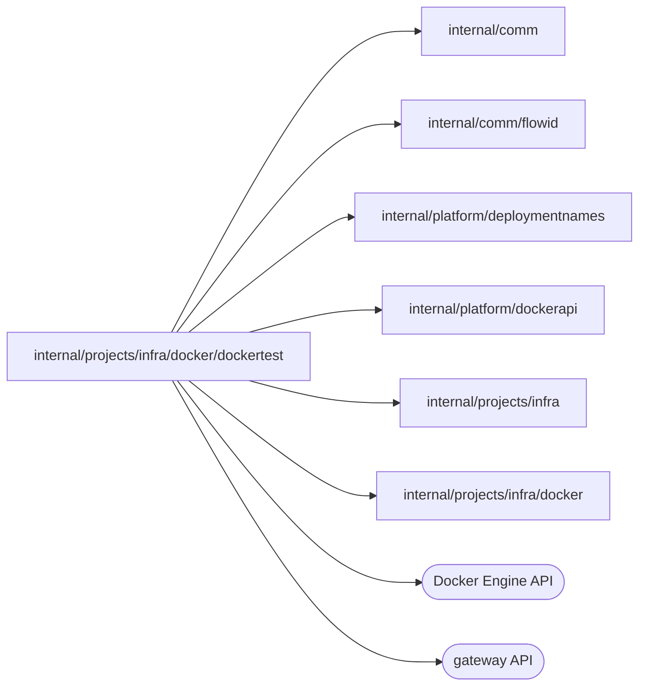

# Docker integration test infrastructure

<!-- BEGIN GENERATED PACKAGE SUMMARY (scripts/check-package-readmes.py; edit only Purpose) -->
Purpose: Gives integration tests the Docker runtime of the local engine with the pinned images and a gateway of their own, and checks that a deleted project leaves nothing.

Callers: no production package imports this package.

Dependencies: it imports `internal/comm`, `internal/comm/flowid`, `internal/platform/deploymentnames`, `internal/platform/dockerapi`, `internal/projects/infra` and `internal/projects/infra/docker` and calls the Docker Engine and gateway APIs.

<!-- END GENERATED PACKAGE SUMMARY -->

`InfrastructureForTest` is the entry point of the Docker integration tests: the
[Docker runtime](../README.md) on the real engine at
`SUPERVERSE_TEST_DOCKER_SOCKET` (by default `/var/run/docker.sock`), with the
Dex, MinIO and Temporal images that `infra-as-code/source-lock.json` pins for
the engine's architecture, a state directory in the test's temporary directory
and the network prefix `10.250.0.0/16`, apart from the Native instances' ranges
(`10.233.0.0/16` and the next `/16` for each named instance). `InstanceInfrastructureForTest`
selects a named Native instance, whose objects carry its instance label. Each test
gets a gateway of its own: a container of the pinned gateway image whose HTTP
provider polls the routes from the test process, exactly as the Native gateway
polls them from the server. An unreachable engine fails the test, never skips
it.

`DestroyProjectForTest` removes a project's Live scope as project deletion does and
`requireNothingLeft` fails the test while any container, network or volume
carries the project's label or one of its credential files remains.
`WebContainerForTest` runs a small web server of a project, in the pinned gateway
image, as a route target. `LoadConfigurationForTest` builds the
[configuration probe](configprobe/README.md) for Linux and runs it with a
workload grant's environment in a container on a project network, so the
Connector SDK loads the project configuration as an application does; it returns
the configuration revision and the digests of the values, without the SDK's log.
`EventuallyForTest` converges a call that reports `infra.ErrPending`. The tests create
and label every object they use, and their cleanups remove them.
