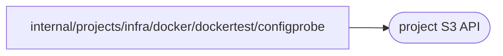

# Project configuration probe

<!-- BEGIN GENERATED PACKAGE SUMMARY (scripts/check-package-readmes.py; edit only Purpose) -->
Purpose: Loads a workload's project configuration through the Connector SDK from its grant environment, as an application starts, for the Docker integration tests.

Callers: no production package imports this package.

Dependencies: it calls the project S3 API.

<!-- END GENERATED PACKAGE SUMMARY -->

`configprobe` is a command that the Docker integration tests build for Linux and run in a container on a
project network with a workload grant's environment (`dockertest.LoadConfigurationForTest`). It calls the Connector
SDK's `projectconfig.LoadFromEnvironment`, exactly as a Live application or a Preview does when it starts, and
resolves the application environment that the configuration pins. It prints the configuration's revision and
the SHA-256 of each value it is asked for, never a value, and exits 1 with the SDK's error when a step fails,
for example when the SDK refuses the storage endpoint of the environment.
