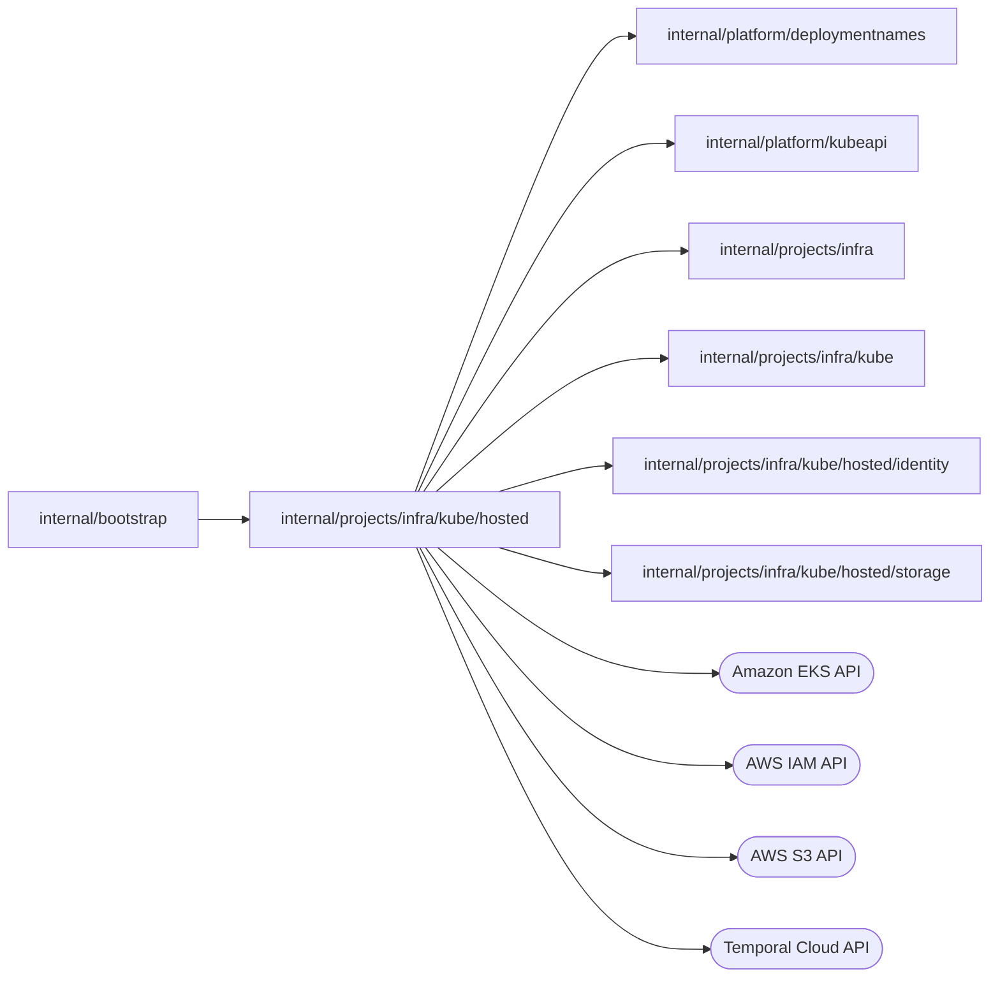

# Hosted project cloud account

<!-- BEGIN GENERATED PACKAGE SUMMARY (scripts/check-package-readmes.py; edit only Purpose) -->
Purpose: Implements the project cloud account of hosted environments for project infrastructure: S3 buckets, IAM roles with EKS Pod Identity and Temporal Cloud namespaces and keys.

Callers: `internal/bootstrap` imports this package.

Dependencies: it imports `internal/platform/deploymentnames`, `internal/platform/kubeapi`, `internal/projects/infra`, `internal/projects/infra/kube`, `internal/projects/infra/kube/hosted/identity` and `internal/projects/infra/kube/hosted/storage` and calls the Amazon EKS, AWS IAM, AWS S3 and Temporal Cloud APIs.

<!-- END GENERATED PACKAGE SUMMARY -->

`CloudAccount` composes [storage](storage/README.md) and [identity](identity/README.md) for a hosted environment: S3 buckets,
IAM roles bound by EKS Pod Identity and Temporal Cloud namespaces and API keys.
It implements `kube.Backend`; bootstrap builds it with `New` from `Config`
outside Local Kind, assigns it to `Infrastructure.Backend` and owns its `Close`.
Besides the cloud resources, it answers how the AWS environment publishes an
application: the load balancer annotations and TLS section of a route, the
gVisor runtime class, the Pod Identity egress of the Dex and the applications,
and a service account of its own for each application generation. It provisions a project's Live scope in two parts and verifies its
resource references first: the storage (`EnsureStorage`, the bucket) and the
execution environment (`EnsureTemporal`, the Temporal Cloud namespace, service
account, API key and its `temporal-credential` Secret; `EnsureDexIdentity`,
the Dex IAM role; `DexSpec`, the project Dex on that bucket and namespace).
`ReadTemporalAccess` reads the accepted namespace endpoint and API key without
changing anything. A credential that only an operator can repair is
`infra.ErrTemporalCredential`: an accepted Secret that is gone or replaced is
never replaced again, and an accepted key that is unlisted, disabled or owned
by another identity is never used. A Live
generation's grant is an IAM role of its own with its own service account and
association; a revoked one keeps a deny policy and a `revoked-at` tag as a
fence for 12 hours, longer than the 6-hour credentials Pod Identity issues
and the role's 1-hour session, after which the project's next Live issuance
deletes it, or until scope cleanup. A project therefore holds about one
Preview role per Sandbox principal, its Dex role, its current Live role and
Live fences younger than 12 hours. A fence is the second line of defense:
the deployment issues a Live grant only while the Project still leases its
generation. A Preview's grant is one IAM role per Sandbox
principal, whose trust and one Pod Identity association, which never moves,
name the principal (`identity/preview_grants.go`). The EKS Pod Identity agent caches
issued credentials, so a grant generation rewrites the role's `scope` policy
in place instead of moving the association: its statements carry their
generation in their Sid, a new generation keeps the superseded one's until
that is revoked, and revoking the last generation leaves deny-all, which IAM
evaluates per request. The `grant-generation` and `revoked-generation` tags,
written before the policy, refuse an older or revoked generation; the
`scope-written` tag keeps an issuance pending for a propagation delay after
each write. Only a write starts that delay: an issuance whose document is
unchanged and whose tag already records its generation waits at most for the
rest of the recorded delay, and the 15 seconds are an upper bound to be
measured on AWS test once the owner approves that verification. Issuance and
revocation delete the Preview's other roles, of an earlier principal or
per-generation roles of earlier releases; Session cleanup deletes the
association and the role.

### Bucket encryption

A project bucket encrypts with the environment's storage KMS key and an S3
Bucket Key, which `EnsureStorage` sets when the Project's Setup provisions the
bucket. S3 then derives the data keys of new objects from a short-lived
bucket-level key instead of calling KMS for every object, and names the
bucket ARN, not the object ARN, as the `kms:EncryptionContext:aws:s3:arn` of
the KMS calls it still makes
([S3 Bucket Keys](https://docs.aws.amazon.com/AmazonS3/latest/userguide/bucket-key.html),
checked 2026-10-12). A bucket provisioned before Bucket Keys keeps per-object
keys, and every object keeps the context it was written with. The KMS
statement of the Dex role and of every grant (`kmsThroughS3`) therefore allows
the bucket ARN beside the object ARNs, and the Terraform permissions boundary
`project_boundary` allows both forms. KMS use through S3 is thereby scoped to
the bucket rather than to single objects; the S3 `Resource` entries still
decide which objects a role reads or writes, and the bucket policy still denies
other keys and plaintext uploads. The KMS calls of all buckets share the
account's symmetric cryptographic request quota, 100,000 per second in
us-west-2 (Service Quotas `L-6E3AF000`, checked 2026-10-12).

### Grant policy size

IAM limits the inline policies of one role to 10,240 characters in all and
does not count white space
([IAM and AWS STS quotas](https://docs.aws.amazon.com/IAM/latest/UserGuide/reference_iam-quotas.html#reference_iam-quotas-entity-length)).
An issuance measures the rendered `scope` document before it writes it and
refuses a document over the limit with `infra.ErrGrantTooLarge`, which names
the size and the limit, instead of letting AWS answer `LimitExceeded`. A Live
grant is checked before any change, with the 84 characters of the deny-all
`revoked` policy that its revocation adds reserved, so the fence always fits.
A Preview generation is checked alone before any change and again together
with the statements of the generation it supersedes, which stay until that
one is revoked.

Only secret keys make a grant grow. The four statements of `grantStatements`
hold the configuration head, the Trigger inbox wildcard and the KMS key once
each, the bucket twice (a `Resource` and the S3 Bucket Key's value of the KMS
condition, see [Bucket encryption](#bucket-encryption)), and every secret key
twice: its object ARN is a `Resource` of the read statement and a value of the
KMS statement's `kms:EncryptionContext:aws:s3:arn` condition. Each occurrence
costs the ARN, its two quotes and a comma, so a key costs `2 × (len(arn) + 3)` characters,
where the ARN is `arn:aws:s3:::<bucket>/project-configuration/projects/<project>/<live|preview>/app-secrets/<NAME>/<objectID>`
and the bucket is `<bucket prefix>-<16 hex>`, 47 characters on test and 49 on
staging. With a 24-character `NAME` and a 32-character object ID (an
assumption: the configuration service names the object), a key costs 348 to
410 characters, and the fixed part of a document is 1,177 to about 1,430
characters (a Preview's carries the four generation Sids, which grow with the
generation number):

| Project ID | Live keys | Preview keys alone | Preview keys during a transition |
| --- | --- | --- | --- |
| 4 characters (default) | 25 | 24 | 10 |
| 16 characters (staging maximum) | 23 | 23 | 9 |
| 32 characters (test maximum) | 21 | 21 | 9 |

A scope therefore holds about 20 secret keys, the credential broker's token
among them, and a Preview whose configuration changes while it runs holds
about 9: every key of both generations counts until the superseded one is
revoked. Stopping and starting Preview revokes the superseded generation.

Cloud names are `<workload prefix>-<environment>-<project, first 8>-<UUIDv5, 12>`
of an identity with the full owner in tags: the Live scope's, or a Preview's
from `infra.PreviewKeysOf`, so Live cleanup never lists Preview roles. The
bucket name also binds the namespace UID. Live tags name the scope and the
namespace UID; Preview tags also name the Session and, on a grant's role and
association, its principal's namespace and service account UIDs.
`RedactionPatterns` gives `infra.Redact` the project's cloud names and bucket.
The `temporal-identity` Secret records the ID of the scope's service account,
which `CreateServiceAccount` returns, so calls read the account by ID. Only a
scope without the record, whose create response was lost or that predates the
record, or whose namespace is gone during cleanup, finds it by name in one
list of the account's service accounts (at most 100 pages of 1000).

Temporal Cloud API keys last 89 days, a platform choice below the provider's
two-year maximum. Keys rotate per key holder (`temporalKeyHolder`: a service
account and the namespace whose Secrets keep its tokens), by credential
generation: generation `g` has the key display name `<live name>` or
`<live name>-<g>` and the Secrets `temporal-credential[-<g>]` and
`temporal-key-attempt[-<g>]`. Once the accepted key has less than
`projectCloud.temporalKeyRenewDays` left, `EnsureTemporal` creates generation
`g+1` through its persisted attempt, like the first key, and returns it once
active, so the data-plane check verifies it before the deployment records it
and `StartProjectDex` moves the Dex to it. A listed key named for `g+1`
without a stored token lost its token and is revoked before another create.
The previous generation's key stays while a project Dex Deployment exists and
is not ready on the accepted generation; after that it is revoked and its
Secrets removed. A holder keeps at most three keys, below the provider's 20
per service account. Only a Live deployment calls `EnsureTemporal`, so a
Project that deploys nothing for longer than the key lifetime minus the
renewal window still reaches the expiry; its next deployment rotates the key
only if Temporal Cloud still lists the expired key (unverified), and is
otherwise refused with `infra.ErrTemporalCredential`. This gap is interim:
the shared Temporal shards of the linear-scaling design replace per-Project
keys with per-shard keys that a platform-level owner rotates. A next generation that
is not accepted yet and is broken (unlisted after its create finished,
disabled or owned by another identity) is revoked and created again.
All cloud calls are bounded by 20 seconds.

| File | Responsibility |
| --- | --- |
| `account.go` | `CloudAccount`, `Config`, `New`, cloud names and tags, their redaction patterns |
| `backend.go` | The answers of `kube.Backend` that need no cloud call: egress, TLS dial, runtime class, route annotations |
| `iam_policy.go` | IAM policy documents: statements, effects, actions and condition operators, and the inline policy size limit |
| `identity.go` | IAM roles and Pod Identity associations |
| `storage.go` | Project buckets |
| `temporal.go` | Temporal Cloud namespaces, service accounts and API keys, and the access to them |
| `execution_provisioning.go` | The project Dex's IAM role and its hosted specification |
| `scope_cleanup.go` | Removal of the hosted backends of a scope, and of identities below a cloud name |
| `workload_grants.go` | IAM workload grants, their revocation and a Session Preview's grant cleanup |
| `preview_grants.go` | A Preview's principal role: its generation tags, its `scope` policy by generation and the propagation delay |
