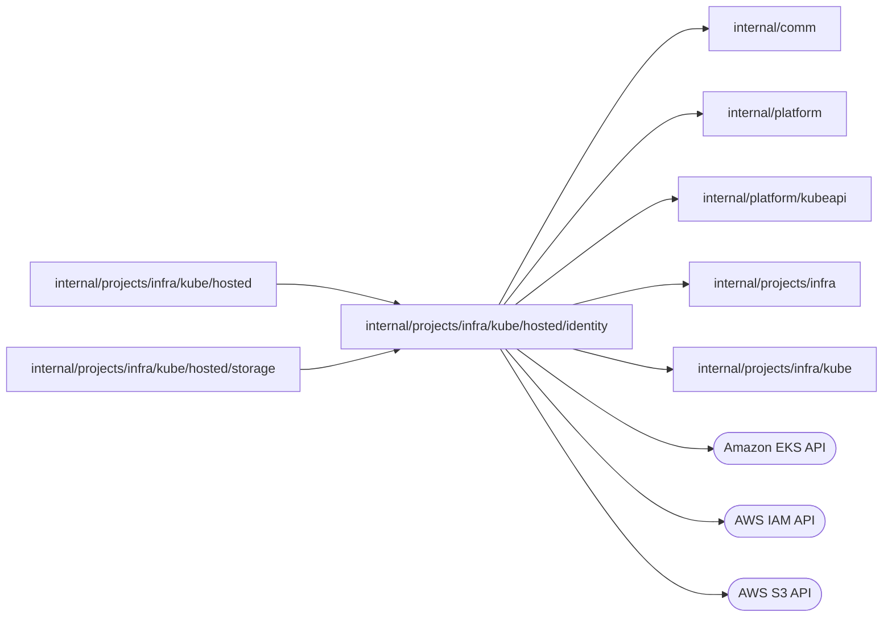

# internal/projects/infra/kube/hosted/identity

<!-- BEGIN GENERATED PACKAGE SUMMARY (scripts/check-package-readmes.py; edit only Purpose) -->
Purpose: Owns hosted IAM roles, Pod Identity associations, policy documents, grant lifecycle, and cloud resource ownership tags.

Callers: `internal/projects/infra/kube/hosted` and `internal/projects/infra/kube/hosted/storage` import this package.

Dependencies: it imports `internal/comm`, `internal/platform`, `internal/platform/kubeapi`, `internal/projects/infra` and `internal/projects/infra/kube` and calls the Amazon EKS, AWS IAM and AWS S3 APIs.

<!-- END GENERATED PACKAGE SUMMARY -->

`Account` owns AWS identity operations and the shared naming and tag rules. The hosted backend forwards its grant and Dex identity methods here; storage uses its ownership checks and bucket policy.
