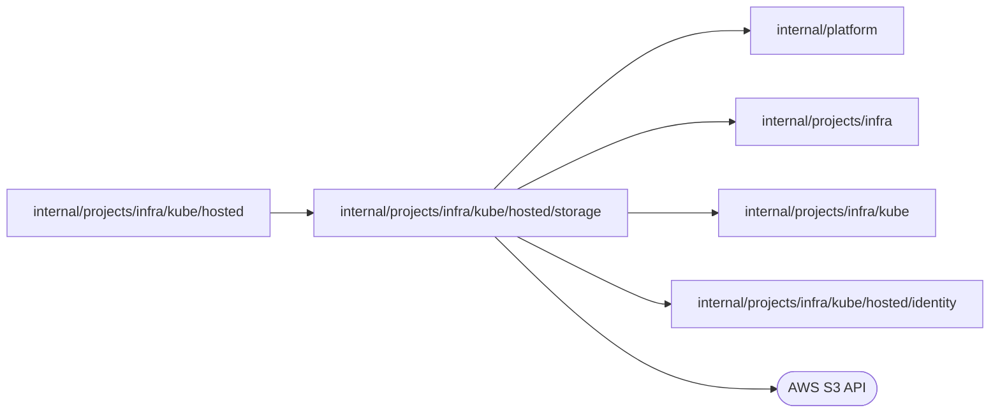

# internal/projects/infra/kube/hosted/storage

<!-- BEGIN GENERATED PACKAGE SUMMARY (scripts/check-package-readmes.py; edit only Purpose) -->
Purpose: Creates, verifies, and deletes hosted project buckets and exposes their object clients.

Callers: `internal/projects/infra/kube/hosted` imports this package.

Dependencies: it imports `internal/platform`, `internal/projects/infra`, `internal/projects/infra/kube` and `internal/projects/infra/kube/hosted/identity` and calls the AWS S3 API.

<!-- END GENERATED PACKAGE SUMMARY -->

`Account` owns the S3 bucket lifecycle and object access. It uses the identity package for the resource tags and bucket policy, while the hosted backend keeps the `kube.Backend` methods.
