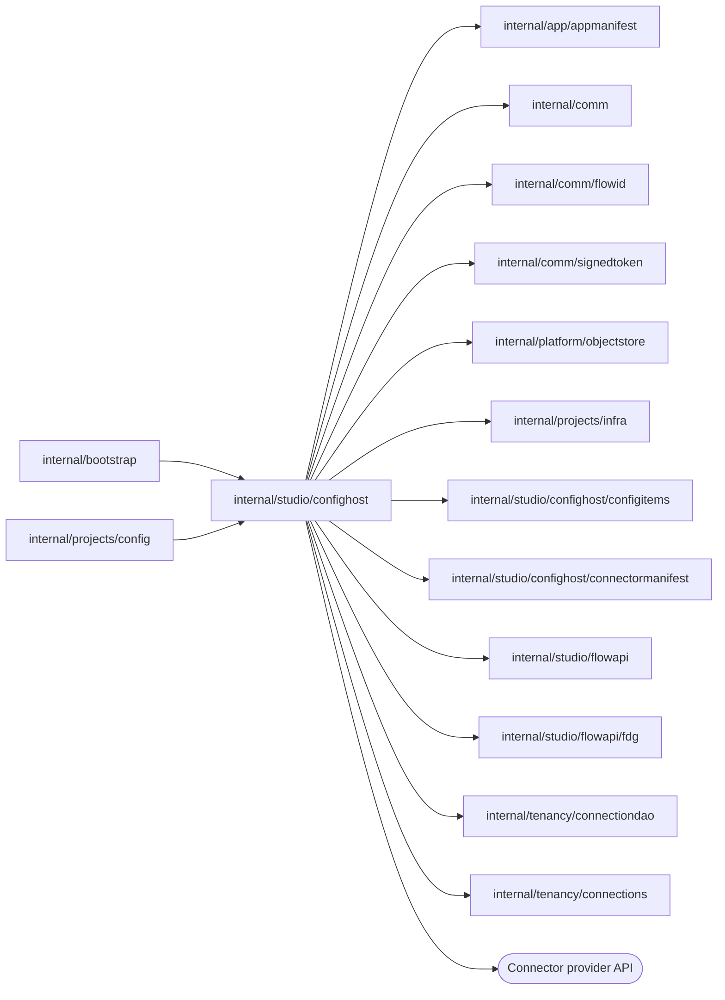

# Configuration host

<!-- BEGIN GENERATED PACKAGE SUMMARY (scripts/check-package-readmes.py; edit only Purpose) -->
Purpose: Hosts one project scope's configuration, its selections of TeamSpace connections and their provider UI sessions in process for the project configuration boundary, in the scope's versioned storage.

Callers: `internal/bootstrap` and `internal/projects/config` import this package.

Dependencies: it imports `internal/app/appmanifest`, `internal/comm`, `internal/comm/flowid`, `internal/comm/signedtoken`, `internal/platform/objectstore`, `internal/projects/infra`, `internal/studio/confighost/configitems`, `internal/studio/confighost/connectormanifest`, `internal/studio/flowapi`, `internal/studio/flowapi/fdg`, `internal/tenancy/connectiondao` and `internal/tenancy/connections` and calls the Connector provider API.

<!-- END GENERATED PACKAGE SUMMARY -->

`ConfigurationHost` serves one project scope's configuration, the TeamSpace
connections its connection names select and their provider sessions inside
the Go server. It reads and writes only below its own scope's prefix
(`scopedObjects`), whatever store it is given: another scope's values are
handed to it. It opens no
listener: [`internal/projects/config`](../../projects/config/README.md) keeps a
bounded pool of hosts and calls `Invoke` in process with a typed
`ConfigurationAdmission`. The admission is either internal, for the platform's
Flows (AppManifest and prepared-source registration, validation and freezing),
or an authenticated actor's, for the named Flow API configuration RPCs. An
actor reads and writes only an exact prepared source, and an actor's write must
name the Flow Definition revision of that source. Every response is a JSON
document with its HTTP status. The host is not a network proxy: it presents no forwarded headers,
base paths, CSRF tokens or capability tokens. `internal/studio/flowapi/fdg` parses
Flow Definition Graph bundles, and only public pinned Dex SDK protobuf types are
registered. [`connectormanifest`](connectormanifest/README.md) resolves and
verifies official Connector releases and release candidates and validates
values against their manifests.

## Application environment

Optional `application.environment` declarations include `name`, `required`,
`secret`, `minLength` in Unicode code points and `enum`. Names and values are
canonicalized; empty declarations preserve existing contract digests. Names
cannot override platform, SDK, credential, process or proxy settings. Ordinary
values and secret references live in the versioned configuration; application
secrets use immutable scoped `app-secrets/<NAME>/<objectID>` objects with exact
version and digest. Safe reads return declaration and readiness data, never
secret values or object paths.

Workloads read only the exact application-secret keys their
[grant](../../projects/infra/README.md) names. The App/SDK loader verifies the
accepted configuration and secret scope, version and digest and applies the
environment in main before clients, Workers, HTTP servers or goroutines. There
is no configuration-reader init container, plaintext configuration file or
`DEX_PROJECT_CONFIG_FILE`. Preview's private storage credential file remains.

## Requirement gaps

The internal read-only route `POST /api/v2/project-configuration/requirements`
(`RequirementsRequest{manifestDigest}` for the admitted prepared source) answers
`RequirementsReport{ready, gaps}`: every requirement of the source that the
configuration it edits does not meet, at once, as
`appmanifest.RequirementGap` values with names only, never a value, credential
or field content. Per declared connection it lists the first of
`CONNECTION_REQUIRED` (no selection of an ACTIVE TeamSpace connection of its
module, provider, major version and method), `AUTHORIZATION_REQUIRED` (the
selected connection's credential is not READY) and `CONNECTION_INCOMPLETE`
(the entry's settings do not validate against the declared release), then
`TRIGGER_BINDING_REQUIRED` or `TRIGGER_BINDING_INVALID` for each declared
trigger binding, whose configuration the Connector UI units that its Flow's
FDG composes for the binding (`connectorTriggerBindings[].configurationUI`)
validate, as they do a Step's use configuration and as Dex Web does. A saved
binding is still `TRIGGER_BINDING_REQUIRED`, once per required unit that holds
no value at one of its JSON pointers (absent, null, blank, an empty list or
object), with `unitLabel` naming the unit: each unit saves on its own, so a
save checks only the declared paths. Then
`OPERATION_CONFIGURATION_REQUIRED` for each connector factory Step of the
source that uses the connection, once per required unit of its FDG
`configurationUI` that its saved use configuration holds no value for, with
`flowName`, `stepName`, `operationId` and `unitLabel`; a use never saved lacks
every required unit, and a use without a required unit is never a gap. The
Connectors page shows a binding or Step use as configured only when it is saved
and every required unit holds a value. Then `ENVIRONMENT_REQUIRED` for each declared variable that is
missing while required, stored with another classification or invalid, or one
without a name when the stored environment fails its check otherwise. A
connector release that cannot be resolved (`CONNECTOR_RELEASE_UNAVAILABLE`) or
that does not publish a declared trigger, and a declared binding that no Flow
of the source declares for the pinned release
(`CONNECTOR_TRIGGER_SCHEMA_UNAVAILABLE`), is no gap but a failure of the
report. Connector releases publish no trigger configuration fields. Validation answers the first gap with the code it always had.

The request may name `snapshot`, an exact frozen version of the scope, such as the version a
Preview applied: the report is then that version's gaps instead of the head's.

## Preview applied version

A Preview start that applies validates exactly the revision it names. A head past it answers
`PREVIEW_CONFIGURATION_REVISION_CHANGED` (409), unless the head is the settings refresh the same
freeze wrote: before a freeze writes refreshed TeamSpace settings as a new head revision, it records
`preview-refreshes/<applied revision>` with `{applied, written, digest}`, the digest of the document
without its revision, so an attempt retried after a lost answer recognizes that head by content.
The internal read-only route `preview-items` compares the head, refreshed in memory as a freeze
would write it, with the applied version the caller names: `UNCHANGED`, `CHANGED`, `ADDED` or
`REMOVED` by item key, a connection also by its settings, with the count of changes. A selection
whose TeamSpace connection no longer exists or is no longer ACTIVE is `CHANGED` with the warning
`CONNECTION_DELETED` and keeps its stored settings; readiness reports it as a gap.

## Live next-publish layer

Live's settings for the next publish
([the current contract](../../../docs/architecture/studio-setup/flow-changes.md))
are one sparse configuration document per Project, the next-publish layer at
`<live prefix>/next-publish/configuration/head`, written by revision compare-and-swap through the SDK
store over `redirectedHeadObjects`, as a version's copy is. It holds
only what Live chose for itself; an item it does not hold **follows Preview**. Its secrets are
references into Live's own `app-secrets/` and its credential broker is Live's. A trigger binding or
Step setting of Live's own whose connection name follows Preview needs its connection's entry in
the document, so the layer holds an anchor: the entry without a selected TeamSpace connection, which
is no value of Live's own.

A request names the layer with `ConfigurationAdmission.NextPublish` and the prepared source it is
checked against with `SourceCommit`; `internal/projects/config` passes in what lies outside the Live
host's prefix: current Live (deployment and frozen version), Preview's applied version without its
secret references and credential broker, and the source itself when it is the Preview's
(`ConfigurationHost.PreparedSource`, read through the Preview's host). Setup's Next publish column on
the Preview tab and Setup on the Live tab both send such requests. The actor routes then edit the
layer: a write is validated against the named source's manifest, and `followPreview` removes Live's
own value of a connection selection, trigger binding, Step setting or (by name) environment
variable. Following is refused with `CONFIGURATION_ITEM_CANNOT_FOLLOW` (409) on the Preview scope, a
Release's copy, for a secret variable and for a connection of an endpoint-bound connector
([`connectormanifest`](connectormanifest/README.md)'s typed list, which the connector catalog exposes
as `ConnectorCatalogEntry.endpoint_bound`). A read of the layer's connections or
environment shows the next publish as it resolves, so a following item shows what it follows.

[`configitems`](configitems/README.md) resolves each item the named source declares: Live's own value;
else Preview's applied value, a connection by the TeamSpace connection Preview selects; else, when
the applied version lacks the item, current Live's value; else a requirement gap. A secret and an
endpoint-bound connection never follow: without a value of Live's own they are gaps whose
`followRefusal` (`SECRET`, `ENDPOINT_BOUND`) says why. The internal route `live-items` reports the
layer's revision, Preview's applied revision, each item `FOLLOWS_PREVIEW`, `OWN` or
`NO_LONGER_USED` (current Live has it, the source does not declare it) with whether it differs from
current Live and from Preview, their non-secret values (`liveValueJson`, `previewValueJson`) and its
`followRefusal`, the gaps of the resolved configuration, with `CONNECTION_DELETED` on a connection
item whose TeamSpace connection is gone, and, for a source of the Live scope, the state of that
version's copy. It writes nothing.

A Project without a layer reads its seed, computed from what runs: of current Live's items, every
secret, every connection of an endpoint-bound connector and every item whose value differs from
Preview's applied one (or that Preview did not apply) is Live's own; the others follow. The first
write or publish stores the seed create-if-absent as the layer's first revision and applies its own
change over it; concurrent first writes store one seed, and a change raced by another fails by
revision as any write does. Unpublished edits in the per-version drafts of earlier versions are
dropped. Running Live changes in nothing.

`live-derivations` builds a version's frozen copy (`release-drafts/<commit>/configuration/head`) for
publishing: refused (409) when the layer revision or Preview's applied revision differs from the one
the caller showed, it stores the seed of a Project without a layer, keeps the items the version
declares (`declaredSettings`), selects every connection again for the Live scope against the
version's declaration (a connection gone or no longer fitting is dropped with its bindings and Step
settings, so readiness reports it), gives the copy Live's credential broker and writes it by
revision. `release-drafts/<commit>/derivation` then records `{liveDeploymentId, layerRevision,
previewRevision, copyRevision, derivedAt}` by compare-and-swap on its ETag. The copy is stale when
the record is absent or names another current Live deployment, layer revision, Preview revision or
copy revision; a record of an earlier per-version draft reads as stale. A build freezes the copy as
before; a later layer write never changes a frozen version, and a rollback leaves the layer alone.

## TeamSpace connections and UI sessions

A connection name selects a TeamSpace connection
([`internal/tenancy/connections`](../../tenancy/connections/README.md)): an
ACTIVE connection of the Project's TeamSpace with the declared connector,
major version and method, whose OAuth scopes the declared release does not
change. `PUT /api/v2/connector-selections/{connectorId}/{connectionName}`
(`{teamSpaceConnectionId}`) writes the entry: `sharedConnectionId` and the
connection's settings as the declared release reads them, never a credential.
The scope's first selection creates its token as the secret object
`DEX_CREDENTIAL_BROKER_TOKEN` and the document's `credentialBroker`, which
names `connections.readURL` and that object; a new commit's draft keeps the
broker of its seed. A Preview selection records the Preview's usage at once;
a Live version's usages come with its deployment.

A freeze copies the selected connections' current settings into the entries
it freezes: a build into its frozen version, so a Live version keeps its
settings until the next release and a rollback restores the older ones; a
Preview start into the head it freezes, after which the Preview's usages are
exactly the connections it runs with. Applications read their credentials only
through the credential read endpoint; no scope holds `connections/*`.

A Connector UI session is the form Studio opens for a connection name's Step
settings and trigger bindings. It is bound to the actor and the source
commit, which fixes the AppManifest and definition revisions and the module.
Its Studio commands read the selected connection's credential through the
platform's read function, which renews an expiring one first, and call the
provider through the provider client and its address policy, following a
redirect only to the same HTTPS host.

## Files

| File | Responsibility |
| --- | --- |
| `configuration_host.go` | `ConfigurationHost`, `SharedConnections`, its route table, `Invoke`, the bounded response recorder, the Studio command client, the admission each request carries, strict JSON decoding and response writers |
| `project_configuration.go` | The scope's stores confined to its prefix, its AppManifest head and configuration reads, object writes, the seed write of the layer, the configuration summary and the connection draft: entries, trigger bindings and use configurations |
| `app_manifest.go` | AppManifest admission and the configuration and AppManifest routes |
| `application_environment.go` | The application environment form |
| `prepared_source.go` | Prepared-source registration with the initialization of the configuration it edits, the redirected heads of a version's copy and of the layer, and build freezes |
| `configuration_validation.go` | Readiness validation and freezing, and the requirement gap report |
| `connector_connections.go` | The Connectors page, trigger binding and use configuration |
| `shared_connections.go` | Selections of TeamSpace connections, the credential broker, the settings a freeze copies and the selection views |
| `connector_ui_sessions.go` | UI sessions and their Studio commands. A session's nonce is a token signed with the `signedtoken.ConnectorUISession` key, derived from `SharedConnections.FormKey`, that binds the actor, the Project scope, the prepared source and the connection's module for 10 minutes; the host keeps nothing, so any replica, and any host of the scope, serves it, and rotating `SUPERVERSE_COOKIE_SIGNING_KEY` voids the open sessions |
| `next_publish.go` | Live's next-publish layer: its inputs, seed, resolution report, following Preview, a version's frozen copy and its derivation record, and the Preview's item diff |
