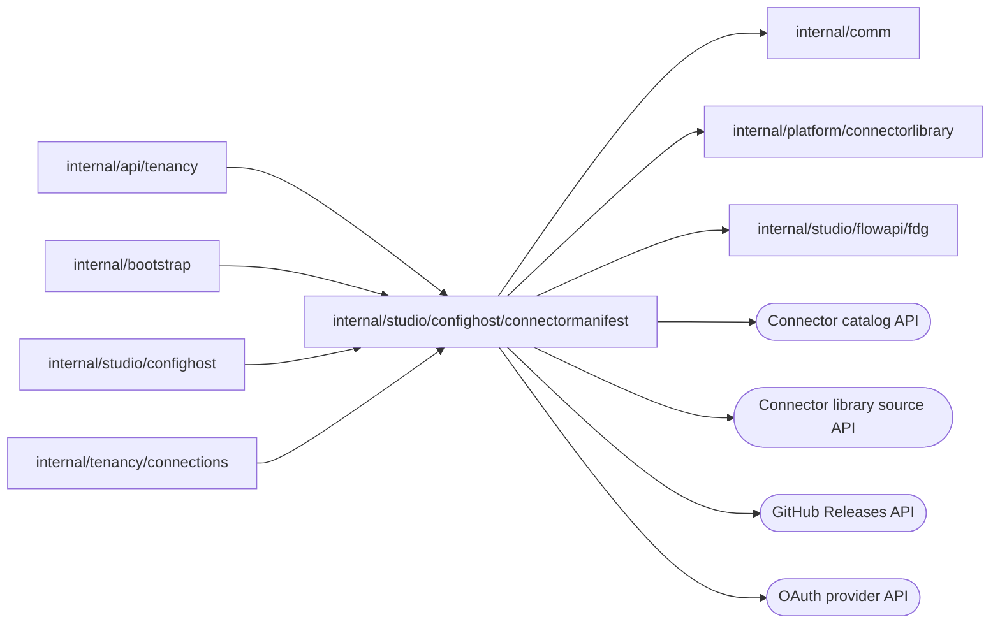

# Connector release manifests

<!-- BEGIN GENERATED PACKAGE SUMMARY (scripts/check-package-readmes.py; edit only Purpose) -->
Purpose: Resolves and verifies official Connector releases, validates values against their manifests, resolves their value sources and grants, and sends their OAuth token and identity requests.

Callers: `internal/api/tenancy`, `internal/bootstrap`, `internal/studio/confighost` and `internal/tenancy/connections` import this package.

Dependencies: it imports `internal/comm`, `internal/platform/connectorlibrary` and `internal/studio/flowapi/fdg` and calls the Connector catalog, Connector library source, GitHub Releases and OAuth provider APIs.

<!-- END GENERATED PACKAGE SUMMARY -->

Resolves published Connector versions and validates values against their
manifests for the configuration host. A published version is an official
release `vX.Y.Z`, which `ReleaseResolver` downloads from the connectors
library's GitHub Releases, or a release candidate `vX.Y.Z-rc.N`, which it
downloads from where the server publishes the candidates of its connector
contributions (`connectorlibrary.Library.ReleaseCandidateDownloadURL`). It
verifies the official identity and digest before it returns the
`ReleaseManifest`; the field, OAuth and Studio command checks admit only what
that manifest declares. Pseudo-versions are refused.

| File | Responsibility |
| --- | --- |
| `release.go` | Download and verification of official Connector releases and release candidates (`ReleaseResolver`, `Module`) |
| `release_manifest.go` | The Connector release manifest, its field types and the official release identity |
| `fields.go` | Configuration, credential and use-configuration field validation |
| `oauth2.go` | OAuth declaration and credential admission, authorization URLs, token request encoding, token expiry and scope checks |
| `value_sources.go` | Value sources (a literal, or a credential field, setting, key member or template) and their resolution with the rules of Dex Web: `ResolveOAuth2`, `GrantValues` |
| `token_grants.go` | The refresh and minting declarations (`oauth2.refresh`, `clientCredentials`, `serviceAccount.jwtBearer`), their grants with defaults, the host-kept credentials, token requests and responses kept raw, the authorization code exchange, its credentials and identity derivations |
| `studio_commands.go` | Studio command declaration checks |
| `catalog.go` | The published catalog of released connectors, kept five minutes (`Catalog`) |
| `catalog_logos.go` | Each catalog release's logo from the library's source at its tag, kept for the process (`Catalog.WithLogos`) |
| `endpoint_bound.go` | The endpoint-bound connectors (Stripe, Typeform, Help Scout and Calendly), whose connections are tied to one address, each with its reason (`EndpointBoundReason`), until the library's manifest declares it |

**Catalog logos.** `WithLogos` fills a catalog entry with the SVG its release
publishes at its tag, `logo.svg` in the connector's directory or else the
Studio icon `ui/public/icon.svg`, read from `connectorlibrary.PublishedSourceURL`.
A tag's files never change, so a logo, or a release's lack of one, stays known
for the process, for at most 1,024 releases. One read fetches at most eight at
once within five seconds; what it misses, the next read fetches. A document
that is not UTF-8 SVG, or holds a script, a foreign object or a `javascript:`
reference, counts as none. Studio shows a logo only as an image.

**Value sources.** Release metadata writes an OAuth endpoint, scope list or
token request setting as a literal, or as `{"fromSetting": <field>}` when the
connection owner enters it, and a minting grant's values may also come from a
credential field, a member of a JSON key or a template. `ValueSource` decodes
and re-encodes both forms, so the manifest Studio receives keeps them.
`ResolveOAuth2` resolves an oauth2 method from a connection's settings: a
missing or null setting takes its field's default, a setting endpoint is an
absolute http or https URL without user information, a fragment or spaces (the
HTTP client's address policy decides where it may connect), a literal endpoint
is https, scopes are a non-empty list without blank or spaced entries, and a
token request option is one of its values.

**Grants.** `Grants` lists a method's refresh and minting grants with their
defaults: an oauth2 method that maps `refresh_token` has one grant unless
`refresh.grants` lists several, terminal errors default to `invalid_grant`
(`invalid_client` for client credentials) and a response without `expires_in`
keeps its token without an expiry. `Release.HostKeptCredentials` returns the
fields a host keeps from applications exactly as the release metadata lists
them (`authMethods[].hostKeptCredentials`), never derived here, and whether
the release declares them: a release published before the list declares none
and must not back a TeamSpace connection, while an empty list keeps nothing. `ManifestAuth.Method` carries the grants
of an in-place method too, so it never looks static.

**Token requests.** `SendTokenRequest` posts a grant with the client by the
resolved endpoint authentication (a client without a secret sends only its
ID) and returns the response uninterpreted, so a caller can store it before it
parses it; an error means no response arrived and the outcome is unknown.
`AuthorizationGrant.Credentials` interprets an authorization code exchange once.
Every provider call takes the caller's HTTP client, which applies the address
policy.

## Tests

`TestPublishedOAuthRefreshDeclarations` (in the configuration host's live
release tests) resolves a published OAuth release from GitHub and checks its
validation, literal resolution, default grant, host-kept credentials and the
JSON round trip of the manifest.
