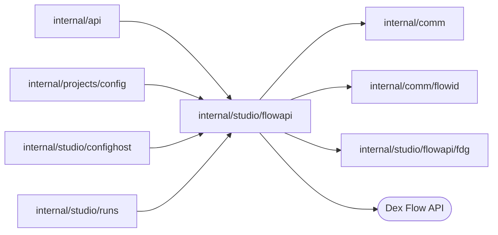

# Dex Flow API

<!-- BEGIN GENERATED PACKAGE SUMMARY (scripts/check-package-readmes.py; edit only Purpose) -->
Purpose: Serves the Dex Flow UI document operations in process for Studio Runs: catalog, search, Display, edits, Actions, Start and RunID-bearing engine diagnostics.

Callers: `internal/api`, `internal/projects/config`, `internal/studio/confighost` and `internal/studio/runs` import this package.

Dependencies: it imports `internal/comm`, `internal/comm/flowid` and `internal/studio/flowapi/fdg` and calls the Dex Flow API.

<!-- END GENERATED PACKAGE SUMMARY -->

`flowapi` serves the Dex Flow UI document semantics in process for Studio Runs.
Its [`fdg`](fdg/README.md) subpackage holds the Flow Definition Graph 2.0
contract those operations serve and imports nothing from `flowapi`.

| File | Responsibility |
| --- | --- |
| `flows.go` | catalog, search, Summary and Display, edits |
| `actions.go` | Actions and their permission mappings |
| `start.go` | Start and Start recovery |
| `engine_diagnostics.go`, `engine_diagnostic_documents.go` | RunID-bearing engine diagnostics |
| `dex_value_mapping.go` | Dex value and diagnostic document mapping |
| `json_response.go` | Studio documents and gRPC error mapping |
| `flow_api.go`, `definition_binding.go` | the adapter, its authorization and Start definition binding |

## Boundary

The package uses the pinned public Dex SDK generated client. It has no Web
server, routes, trusted headers, local Worker selection or permission inputs.
Studio Runs builds one `FlowAPI` per request from the authorization it resolved
(actor, serving target revision and Worker), the serving definitions and a
Worker check, and calls one typed operation that returns a JSON document with
its HTTP status. Studio Runs owns resource authorization, target selection and
the definition revision check; the Studio BFF owns browser CSRF protection.

`fdg.ParseBundle` is the trust boundary of the definitions: it accepts only valid FDG
2.0 graphs of Go source with distinct Flow types and validates every rule the
operations rely on. The operations retain the catalog, typed visibility queries,
Summary and Display, edits, Actions, Start, uncertain Start recovery and explicit
engine diagnostics. RunID is confined to engine diagnostics. Every served target
can start Flows; the Inbox lists Flows awaiting the Start permission or any
declared Action permission, which filters a view and authorizes nothing.

Start success is admission-only and returns the validated FlowID without a
readback. Its Dex RequestID binds the logical fingerprint of the actor, target,
Worker, definition revision, Flow type, FlowID, operation UUID and input to the
exact definition revision; Start recovery compares that exact envelope.
Executions without a current binding keep diagnostics, but current Summary,
Display, edit and Action interpretation is rejected. JSON document mapping keeps
number tokens without a float64 conversion.

## Diagnostic long polls

`WaitHistory` and `ReadStream` have a 30-second idle window, shorter than Studio's
35-second BFF deadline and browser backstop. Neither window is a gRPC deadline:
Dex enforces a deadline with its own clock and resets the call when that clock
reaches it, so a Dex whose clock runs ahead of this server's, such as one in a
container VM, would end the read as Canceled. History ends its window with a
timer on this server's clock and gives Dex only the caller's later deadline.
Stream reads use the pinned Dex SDK's unary `ReadStreamRequest` with
`WaitTimeSeconds = 30`, which Dex ends itself; the existing caller context still
owns cancellation. An ended window is DeadlineExceeded, mapped here to a 408
document for the BFF to relay; a caller that left still gets 499. A message or event arriving earlier completes the read
normally. Empty reads retain the caller's history event or Stream resume token.
These are read windows only: no Flow identity, execution lifecycle, primitive,
retention or database schema changes. Stream delivery stays best effort.
