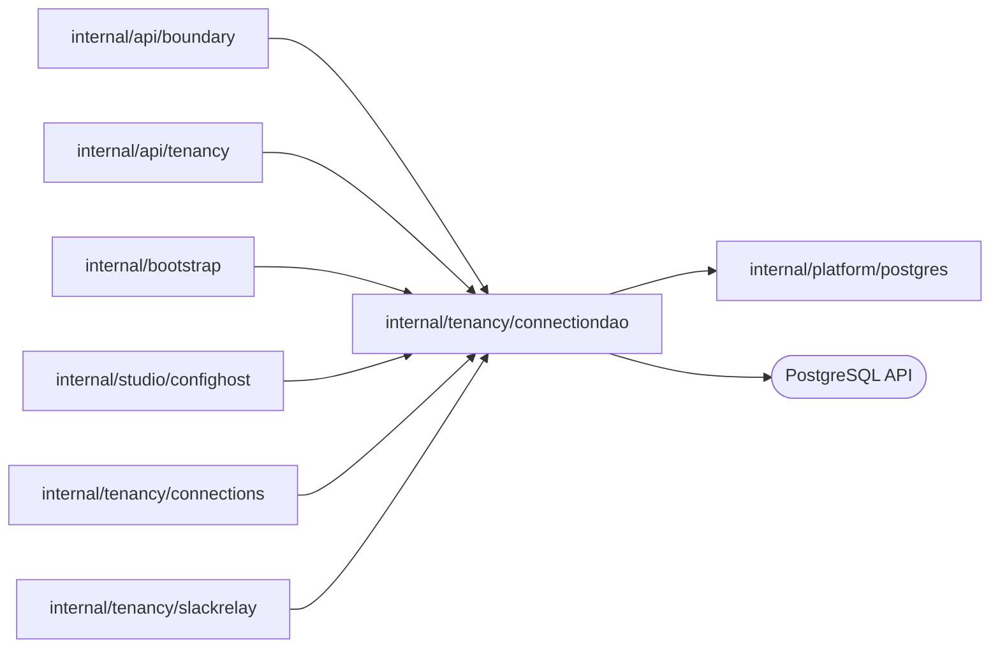

# Connection tables

<!-- BEGIN GENERATED PACKAGE SUMMARY (scripts/check-package-readmes.py; edit only Purpose) -->
Purpose: Reads and writes the TeamSpace connection, usage and scope token tables: creation, settings, refresh leases, credential commits, usages, deletion and read authorization.

Callers: `internal/api/boundary`, `internal/api/tenancy`, `internal/bootstrap`, `internal/studio/confighost`, `internal/tenancy/connections` and `internal/tenancy/slackrelay` import this package.

Dependencies: it imports `internal/platform/postgres` and calls the PostgreSQL API.

<!-- END GENERATED PACKAGE SUMMARY -->

The only SQL of TeamSpace connections
(`docs/architecture/teamspace/connections.md`). It
holds the queries, the row types, their transactions and the closed sets the
tables store, and no business rule: `internal/tenancy/connections` decides
what a credential holds, when it refreshes and what a result means. The rows
hold no secret; `credential_ref` and `token_secret_ref` reference objects.

| Method | Query |
| --- | --- |
| `Create` | `INSERT … ON CONFLICT (team_space_id, connection_id) DO NOTHING`, else the existing row; the partial unique index on the name is `ErrNameTaken` |
| `Connection`, `Connections`, `Usages` | One connection; a page of a TeamSpace's connections newest first by `(created_at, connection_id)`; the usages of connections |
| `UpdateSettings` | Settings and `manifest_version` of an ACTIVE connection at the expected `revision`; with a failure, in the same statement `REAUTHORIZATION_REQUIRED` and the next `credential_revision` |
| `AdvanceManifestVersion` | In one transaction: the row `FOR UPDATE`, then the new version when the caller's comparison says it is newer |
| `ClaimRefreshLease`, `ClaimAuthorizationLease` | The lease at the expected `credential_revision` of an ACTIVE connection whose lease is free or expired; a renewal's only while the credential is READY |
| `CommitCredential` | The credential reference, times and status with the next `credential_revision`, only under the caller's lease at the expected revision (a renewal's only over a READY credential); the lease ends |
| `RequireReauthorization`, `RecordAuthorizationFailure`, `ReleaseRefreshLease` | The terminal status with its failure and the next `credential_revision`, or only the end of the lease, under the caller's lease |
| `LeaseHeldFor` | Whether the caller holds the lease for at least a duration more by the database clock |
| `MarkReauthorizationRequired` | The terminal status with its failure and the next `credential_revision` of a READY credential at the expected revision, without a lease; else `ErrRevisionChanged` |
| `RegisterTrigger` | In one transaction: the token's scope, its usage row of the connection `FOR NO KEY UPDATE` (absent or not ACTIVE is `ErrNotSelected`; not a platform connection of the relayed connector is `ErrNotRelayed`), the usage's other connection names counted against the limit (`ErrRegistrationLimit`), then the `slack_trigger_registrations` row upserted |
| `TriggerRoutes`, `RequireAccountReauthorization` | The registrations of the ACTIVE, READY platform connections of a connector installed in a provider account (organization `IS NOT DISTINCT FROM`); those connections' READY credentials issued before the uninstall event marked for reauthorization with the next `credential_revision` and no lease |
| `RetainTriggerRegistrations` | A scope's registrations whose connection name no longer selects the registered connection, removed at a Preview freeze and a Live preparation |
| `Delete` | In one transaction: the row `FOR UPDATE`, the usages of Projects in the deleted status removed, the others (`ErrInUse`), then DELETED at the expected `revision` |
| `AddUsages` | In one transaction: every named connection `FOR SHARE` and ACTIVE (else `ErrUnavailable`, naming the others), optionally the scope's other usages removed, then each usage under its connection's TeamSpace with a fresh `added_at` |
| `ReleaseUnusedUsages`, `Now` | The scope's usages that the kept set leaves out and that were recorded before a database time |
| `DeleteProjectUsages`, `DeleteTeamSpaceConnections` | A deleted Project's usages and tokens; a deleted TeamSpace's usages and connections |
| `Access`, `BuildsEveryUser` | From the synced read model: a TeamSpace's status, an account's role in it and whether it builds any of its Projects; whether it builds every Project that uses a connection in a scope |
| `RecordScopeToken`, `ScopeToken`, `AuthorizeRead` | A scope's token hash and secret reference, kept when one exists; a token hash resolved to its Project scope and the ACTIVE connection that scope uses |

`ErrNotFound`, `ErrRevisionChanged`, `ErrNameTaken`, `ErrInUse`,
`ErrUnavailable`, `ErrNotSelected`, `ErrNotRelayed` and `ErrRegistrationLimit` are returned unwrapped; every other error names its
operation. A usage and a deletion of the same connection serialize on the
connection row: a foreign key alone takes only a key-share lock, which does
not conflict with the deletion's status update.

## Tests

The integration tests run against the lane's PostgreSQL as the server role and
delete their rows: idempotent and racing creates
(`TestConnectionCreationIntegration`), the lease and the write-back fence
(`TestRefreshLeaseIntegration`), 40 rounds of a usage racing a deletion, which
never leave a DELETED connection in use (`TestUsageAndDeletionRaceIntegration`;
without the `FOR SHARE` lock it fails), usage sets, the release time guard,
scope tokens and cleanup (`TestUsagesIntegration`), the forward-only
manifest version (`TestManifestVersionIntegration`), and the deletion of a
connection that only DELETED Projects used (`TestDeletedProjectUsagesIntegration`).
The Slack relay's queries: registrations refused for an unknown token, an
unused, a user or another connector's connection, refreshed, limited to eight
names also under twenty concurrent registrations, which the usage row's lock
guarantees (`TestTriggerRegistrationIntegration`); registrations removed with
their usages by a replaced Preview set, a release, a Project and a TeamSpace
deletion (`TestTriggerRegistrationCleanupIntegration`); routing by account and
organization, provider accounts kept by a refresh and replaced by a
reauthorization, and an uninstall marking only its platform connections
(`TestTriggerRoutingIntegration`).
`TestTeamSpaceConnectionServiceIntegration` in `internal/api` covers `Access`
and `BuildsEveryUser`.
