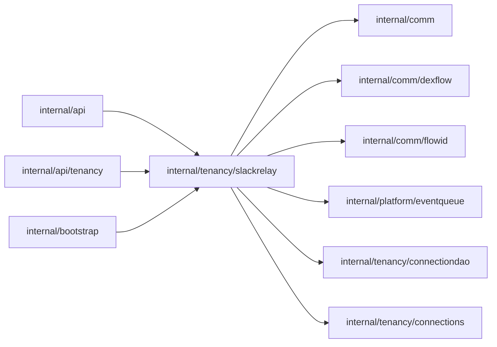

# Slack event relay

<!-- BEGIN GENERATED PACKAGE SUMMARY (scripts/check-package-readmes.py; edit only Purpose) -->
Purpose: Receives the platform Slack application's signed events, routes them to registered scopes, queues and delivers them signed to applications' public trigger routes.

Callers: `internal/api`, `internal/api/tenancy` and `internal/bootstrap` import this package.

Dependencies: it imports `internal/comm`, `internal/comm/dexflow`, `internal/comm/flowid`, `internal/platform/eventqueue`, `internal/tenancy/connectiondao` and `internal/tenancy/connections`.

<!-- END GENERATED PACKAGE SUMMARY -->

The wire contracts are `docs/api/slack-relay.md` and the design is
`docs/architecture/teamspace/connections.md` ("Slack event relay").

| Entry point | Listener | Behavior |
| --- | --- | --- |
| `ServeEvents` | The public Slack events listener (`connections.slackRelay.listenAddress`), served only with `SUPERVERSE_SLACK_SIGNING_SECRET` | `POST /api/slack/events`: reads at most `queue.maxEventBytes`, verifies `v0` HMAC-SHA256 of the raw body in constant time within 5 minutes, answers a verified `url_verification` with its challenge, and always answers 200. A verified `event_callback` is routed by its `authorizations` (team and enterprise ID) within one second to every registration of an ACTIVE, READY `platform` Slack connection of that installation and offered to the queue once per registered connection name; `app_uninstalled` and `tokens_revoked` mark those connections `REAUTHORIZATION_REQUIRED` instead. |
| `ServeRegistration` | The credential read listener | `POST /internal/slack-triggers/register` with the scope token: `REGISTERED`, `CONNECTION_NOT_SELECTED` or `NOT_RELAYED`; 400, 401, 409 (an eighth name is the limit), 413, 500, 503. The request names no address. |
| `Run` | none | Consumes the queue: each delivery POSTs `{"event_id","event_time","team_id","event"}` (Slack's inner event byte for byte) to `<scope route>/triggers/slack/<unpadded base64url(connection name)>`, signed `Dex-Relay-Signature: v1=<HMAC-SHA256(scope token, "v1:<timestamp>:<body>")>` with `Dex-Relay-Timestamp`, within `delivery.timeout`, without following redirects. Anything but 200 drops the event. |

- Routing and the uninstall update are `connectiondao` queries; registrations are
  `slack_trigger_registrations` rows that go with their usage rows.
- The scope route comes from the `ScopeRoutes` port, which `internal/bootstrap` implements
  as the platform probes routes: the public URL on AWS, the gateway with the URL's host on
  Local Kind, and the lane gateway with the route's host on Local Native. The scope token
  comes from the `ScopeTokens` port (`internal/projects/config`), read once per scope and
  kept in memory for at most 10 minutes and 1024 scopes; a delivery answered 400, such as a signature that a rotated token no
  longer matches, forgets it so the next delivery reads it again.
- Every drop is a WARN record `slack relay dropped an event` with its `reason` and the
  event ID, team, enterprise, Project and scope it knows; nothing logs a payload, a header
  value, a token or a signature.
- Recent events: `Relay.RecentEvents(projectID, scope)` returns the metadata of the events routed to a scope, newest first,
  from an in-memory ring of 50 per scope for at most 512 scopes, every string cut to 128 bytes, with the time the process began recording (`recent_events.go`); `Relay.UnroutedEvents` counts events without a route per TeamSpace connection (at most 1024). Each delivery records one entry
  with its fate (`RECORDED`, `NOT_RUNNING`, `APPLICATION_UNAVAILABLE`, `REFUSED`, `TIMED_OUT`, `TOKEN_UNAVAILABLE`,
  `QUEUE_FULL`) and never its text; a restart clears it. See `docs/api/slack-relay.md`.

With several server replicas each replica keeps its own queue and scope tokens. An event is
queued on the replica that received it, so the order of one key's events holds only among the
events one replica received, and a replica that stops drops the events still in its queue.
The queue's limits (`connections.slackRelay.queue`) bound each replica.
