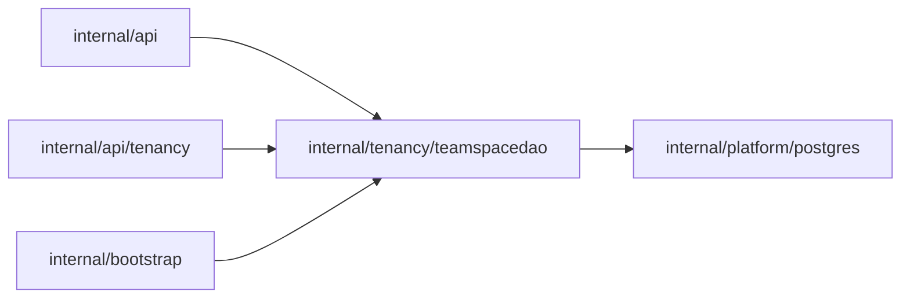

# TeamSpace read model queries

<!-- BEGIN GENERATED PACKAGE SUMMARY (scripts/check-package-readmes.py; edit only Purpose) -->
Purpose: Reads the team_spaces table, which the platform Dex Attribute Store writes from TeamSpaceFlow: a member's TeamSpaces, keyset-paged, and one TeamSpace with its Home counts.

Callers: `internal/api`, `internal/api/tenancy` and `internal/bootstrap` import this package.

Dependencies: it imports `internal/platform/postgres`.

<!-- END GENERATED PACKAGE SUMMARY -->

The only SQL of the `team_spaces` table (`docs/architecture/teamspace/read-model.md`).
Dex is its only writer, from TeamSpaceFlow's synced Attributes; the member rows
it joins are the child table of TeamSpaceFlow's `Members` map. The package holds
queries and row types and no business rule, and reads only.

| Method | Query |
| --- | --- |
| `ListTeamSpaces` | The TeamSpaces the account is a member of, or all of them, newest first in `(created_at, team_space_id)` keyset pages, with the account's role; it leaves out the excluded status and filters by the requested ones |
| `TeamSpace` | One TeamSpace outside the excluded status with the account's role, its member count, and the counts of its Projects and of those with Live, leaving out a Project status the caller excludes |

Every column but the key may be NULL, because Dex writes only the columns of
its batch; a row without a status has not been written by TeamSpaceFlow and is
not found. JSON columns stay the Attributes' JSON encodings (`json.RawMessage`),
which the package that owns the type decodes. Statuses and roles are passed in
or returned as stored: the owning Flow package declares their typed constants.
A missing or excluded row is `postgres.ErrNotFound`; every other error names
its operation. The list returns the next page's `postgres.PageKey` with the
page, and the statements run through the read model helpers of
[`postgres`](../../platform/postgres/README.md) that the other DAOs share.

TeamSpaceService serves its reads from these queries.

## Tests

`TestTeamSpaceDAOIntegration` writes TeamSpace, member and Project rows into a
migrated scratch database of the lane's PostgreSQL
(`postgrestest.MigratedScratchDatabaseForTest`) as Dex would, pages through the
list for a member, for every TeamSpace and with a status filter, and reads one
TeamSpace for a member and a non-member, with its counts.
