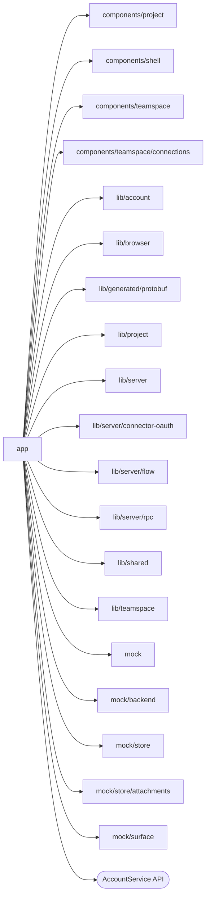

# Studio routes

<!-- BEGIN GENERATED DIRECTORY SUMMARY (scripts/check-readmes.mjs; edit only Purpose) -->
Purpose: The Next.js routes: signed-in and sign-in pages, the BFF route handlers and the `/dex` Flow API routes, and the only files that choose mock or production code.

Importers: no production directory imports this directory.

Imports: it imports `components/project`, `components/shell`, `components/teamspace`, `components/teamspace/connections`, `lib/account`, `lib/browser`, `lib/generated/protobuf`, `lib/project`, `lib/server`, `lib/server/connector-oauth`, `lib/server/flow`, `lib/server/rpc`, `lib/shared`, `lib/teamspace`, `mock`, `mock/backend`, `mock/store`, `mock/store/attachments` and `mock/surface` and calls the `AccountService` API.

<!-- END GENERATED DIRECTORY SUMMARY -->

Route segments follow Next.js conventions and have no README of their own;
this one covers all of `app/`. A route file stays thin: it reads its route
parameters, chooses between the production code and `mock/` with
`isStudioMockEnabled()`, and hands the request to its owner in `lib/server/` or
renders a component. `globals.css` loads the stylesheets in cascade order and
`layout.tsx` applies the stored theme before first paint.
