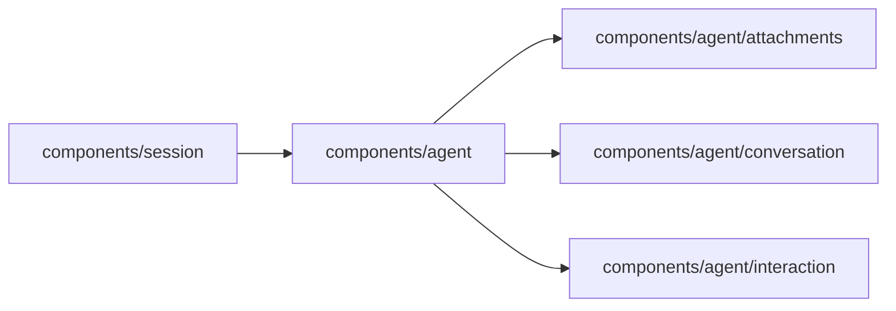

# Agent UI

<!-- BEGIN GENERATED DIRECTORY SUMMARY (scripts/check-readmes.mjs; edit only Purpose) -->
Purpose: The shared Agent UI's single entry `index.ts`; Studio reaches the conversation and interaction presentation only through this entry.

Importers: `components/session` imports this directory.

Imports: it imports `components/agent/attachments`, `components/agent/conversation` and `components/agent/interaction`.

<!-- END GENERATED DIRECTORY SUMMARY -->

The Agent UI is transport-free: it renders the Agent types of
`lib/session/agent-types.ts` and reports user intent through callbacks, so it
imports neither `lib/api`, `lib/browser` nor a feature provider.
