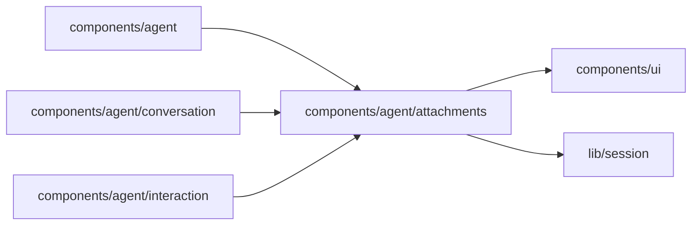

# Message attachments

<!-- BEGIN GENERATED DIRECTORY SUMMARY (scripts/check-readmes.mjs; edit only Purpose) -->
Purpose: The files a sent or queued message attached, as chips with image thumbnails, reached only through the links the page injects, so the shared Agent UI stays transport-free.

Importers: `components/agent`, `components/agent/conversation` and `components/agent/interaction` import this directory.

Imports: it imports `components/ui` and `lib/session`.

<!-- END GENERATED DIRECTORY SUMMARY -->
