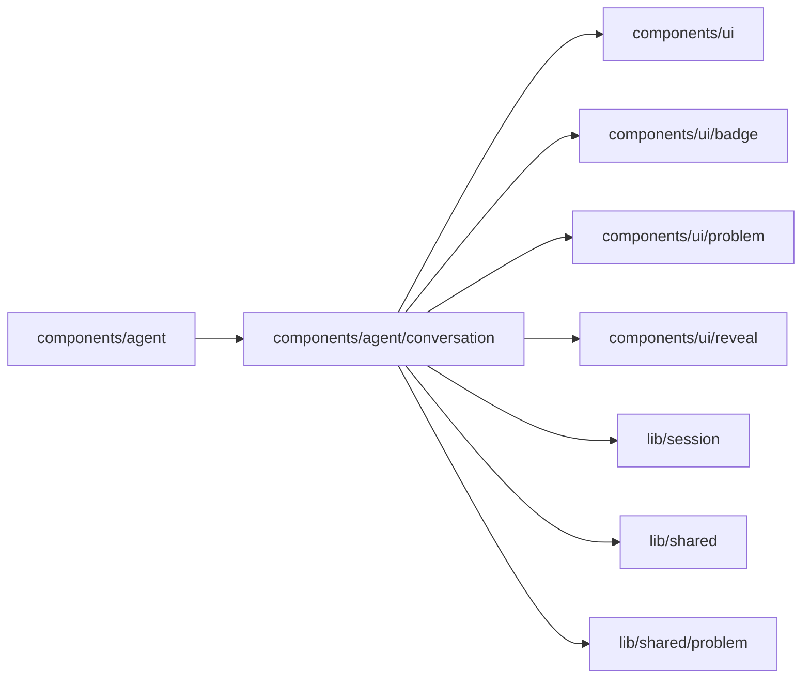

# Agent conversation

<!-- BEGIN GENERATED DIRECTORY SUMMARY (scripts/check-readmes.mjs; edit only Purpose) -->
Purpose: Renders an Agent conversation: turns, messages, notices, Markdown and each turn's work as one plain line, with its full log, markers and metrics folded, on a live clock.

Importers: `components/agent` imports this directory.

Imports: it imports `components/ui`, `components/ui/badge`, `components/ui/problem`, `components/ui/reveal`, `lib/session`, `lib/shared` and `lib/shared/problem`.

<!-- END GENERATED DIRECTORY SUMMARY -->

A failed model call may have lifecycle events from two Dex Steps with distinct Stream
sources. The work log joins them by the announced message sequence, closes its clock
from the snapshot's waiting state, and uses the durable failure marker to show the
explanation after reconnect or reload.
