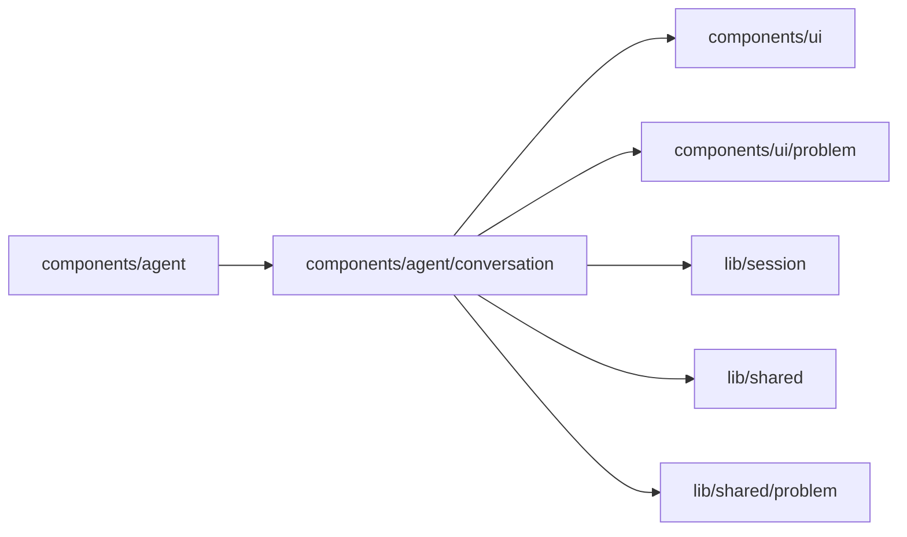

# Agent conversation

<!-- BEGIN GENERATED DIRECTORY SUMMARY (scripts/check-readmes.mjs; edit only Purpose) -->
Purpose: Renders an Agent conversation from committed messages, activity and live text: turns, messages, notices, markers, Markdown, the work log with compact tool rows and model metrics, and the live clock.

Importers: `components/agent` imports this directory.

Imports: it imports `components/ui`, `components/ui/problem`, `lib/session`, `lib/shared` and `lib/shared/problem`.

<!-- END GENERATED DIRECTORY SUMMARY -->
