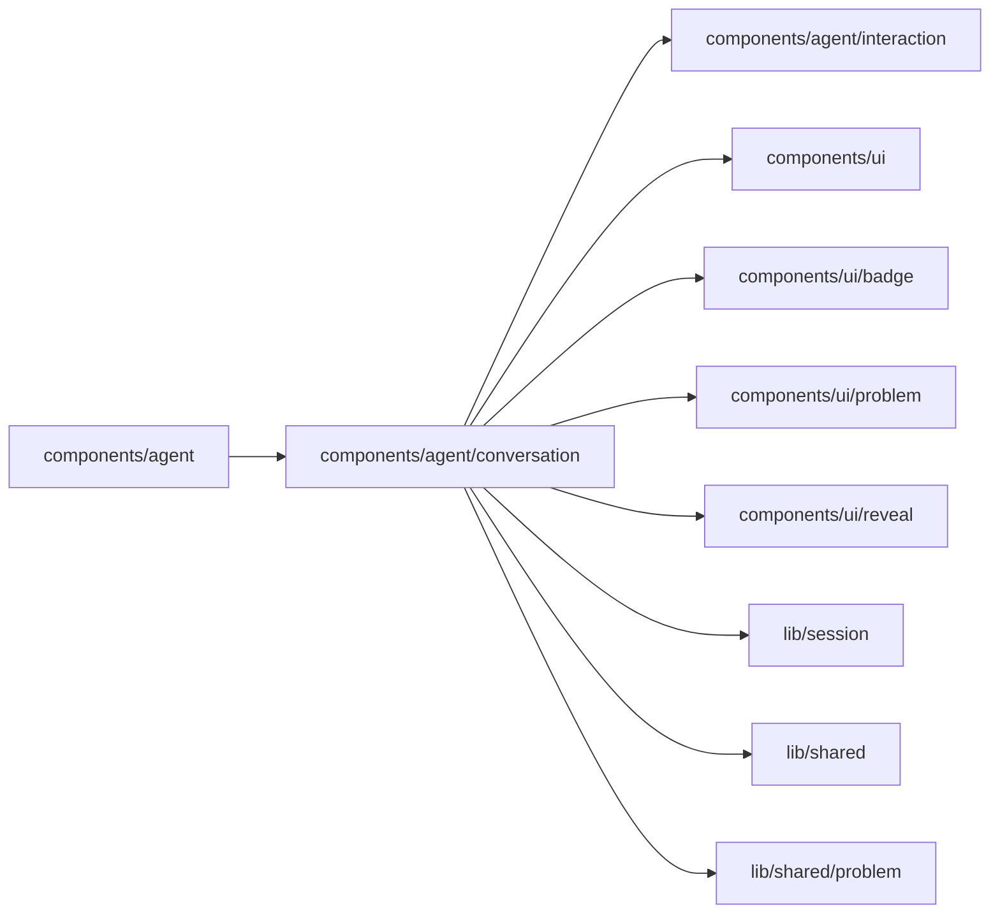

# Agent conversation

<!-- BEGIN GENERATED DIRECTORY SUMMARY (scripts/check-readmes.mjs; edit only Purpose) -->
Purpose: Renders an Agent conversation: turns, messages, notices, Markdown, and each recorded requirements version and turn's work as one plain line, with its log and metrics folded, on a live clock.

Importers: `components/agent` imports this directory.

Imports: it imports `components/agent/interaction`, `components/ui`, `components/ui/badge`, `components/ui/problem`, `components/ui/reveal`, `lib/session`, `lib/shared` and `lib/shared/problem`.

<!-- END GENERATED DIRECTORY SUMMARY -->

A failed model call may have lifecycle events from two Dex Steps with distinct Stream
sources. The work log joins them by the announced message sequence, closes its clock
from the snapshot's waiting state, and uses the durable failure marker to show the
explanation after reconnect or reload.

A turn whose `confirm_requirements` call recorded a version of the requirements shows it once,
after its work log, as one line, "Recorded version N: <title>", which opens to the card when it
is the current version (`components/agent/interaction/RecordedRequirements.tsx`). The history
holds no version numbers, so the line counts back from the Snapshot's current version. A
Session created from an example recorded version 1 at its start, with no call: its line shows
beside the greeting (`requirementsStartSequence`), named by the example once a later version is
current.
