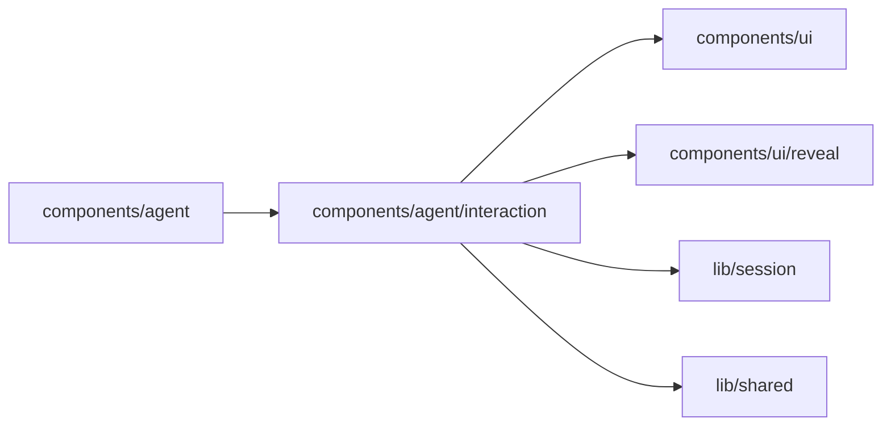

# Agent interaction

<!-- BEGIN GENERATED DIRECTORY SUMMARY (scripts/check-readmes.mjs; edit only Purpose) -->
Purpose: What the Agent asks of and shows the reader: question batches, the requirements card and confirmed requirements, queued messages, todo progress, timers and background tasks.

Importers: `components/agent` imports this directory.

Imports: it imports `components/ui`, `components/ui/reveal`, `lib/session` and `lib/shared`.

<!-- END GENERATED DIRECTORY SUMMARY -->
